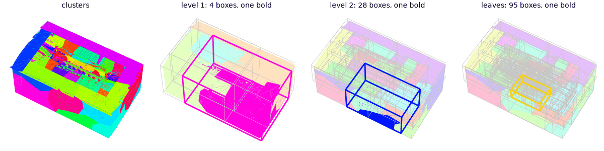
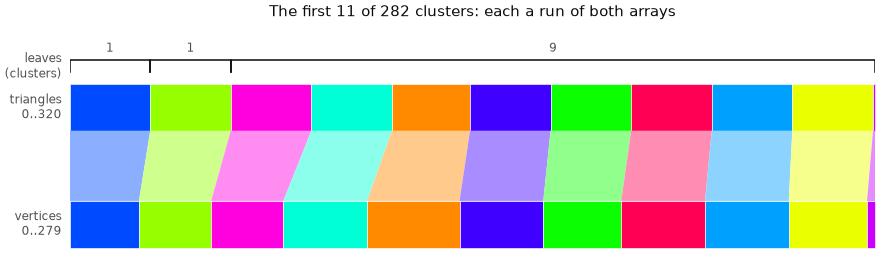
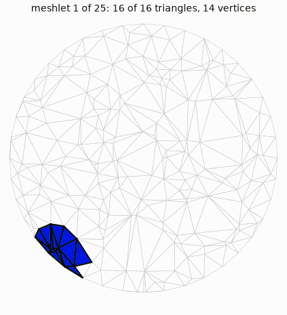
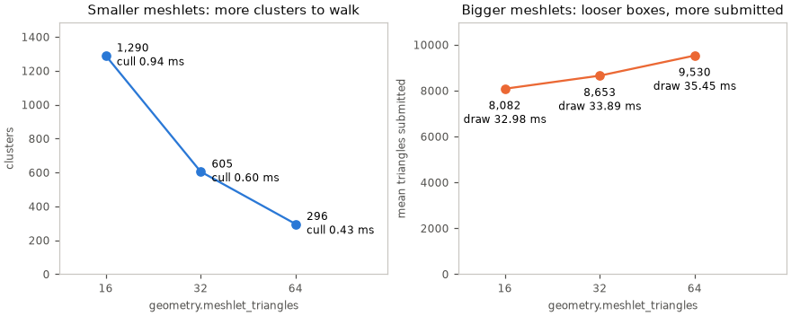
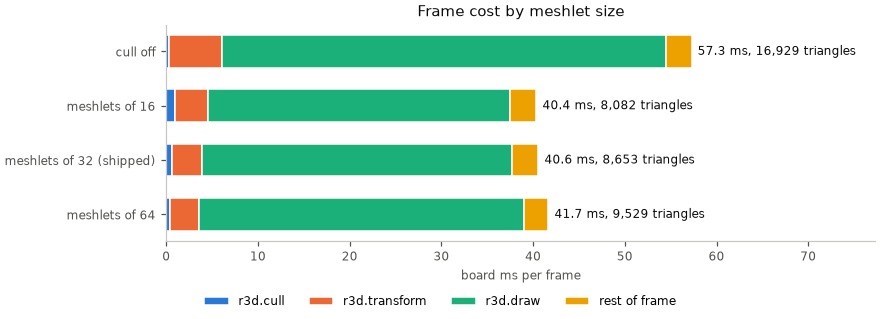

# Baked Mesh

The mesh a bake writes and a renderer reads: its clusters and tree, and the
meshlets the clusters are. Its entry is [LMSH](../../assets/formats/LMSH.md); a shared shape's
colours are [LCOL](../../assets/formats/LCOL.md) sets. How a mesh is made is
[Mesh-Import.md](Mesh-Import.md); drawing it is [Mesh-Rendering.md](../Mesh-Rendering.md).

## Clusters and the tree

Triangles group into **clusters**, the leaves of a tree rooted at `nodes[0]`:
one box test culls a subtree. Positions are `int16`, `position_scale` per unit.

*Clusters, then each level's boxes with one root-to-leaf path bold.*

*A cluster owns a run of each array and indexes only its own vertices.*

A vertex carries one sRGB colour, baked light times albedo. With
`shading = { flat = ... }` each triangle instead has one RGB565 colour
(`light.face_colours()`) averaged over the points `shading.flat` sets, and
vertices weld by position alone.

## Meshlets

Clusters are meshoptimizer's **meshlets**[[11]](../../Citations.md#meshoptimizer):
at most `geometry.meshlet_triangles` (4 to 256, default 32) of one sidedness.
The octree is built over their centres.

*The importer's clusterizer call on a flat patch, limit 16: whole meshlets in
emitted order, since meshoptimizer has no per-triangle hook.*

Culling clusters about halves the triangles submitted and takes roughly a
third off the frame. Meshlets of 16 and 32 tie; 64 loses, because its coarser
boxes let through more triangles than its fewer culls save. Each size on the
board, against submitting every cluster:

<!-- generated: meshlet-sizes sha256=7b9138a62b58e43fbb9da4dd918030b2d9994d8c7af7375db57f1d0603b659f3 -->

Meshlet sizes on the board

| Row | Clusters | Vertices/triangle | Mean submitted triangles | Cull ms | Transform ms | Draw ms | Frame ms |
|---|---|---|---|---|---|---|---|
| cull off | 605 | 1.040 | 16929.0 | 0.34 | 5.70 | 48.46 | 57.28 |
| meshlets of 16 | 1290 | 1.166 | 8082.3 | 0.94 | 3.62 | 32.98 | 40.36 |
| meshlets of 32 (shipped) | 605 | 1.040 | 8652.7 | 0.60 | 3.24 | 33.89 | 40.57 |
| meshlets of 64 | 296 | 0.959 | 9529.5 | 0.43 | 3.17 | 35.45 | 41.67 |

<!-- /generated: meshlet-sizes -->

The `meshlet-sizes` chart and rows are generated from each size's own suite capture and
regenerated bake. The [meshlet capture recipe](../../../launcher/tools/render/README.md#meshlet-size-captures)
owns preparation, capture validation and refresh commands.

Meshlets share vertices, so a frame transforms fewer than with octree-cut
leaves. The draw order they set decides depth ties, a fraction of a percent of
pixels. Levels of detail on them: [plans/Cluster-LOD.md](../../plans/Cluster-LOD.md).
