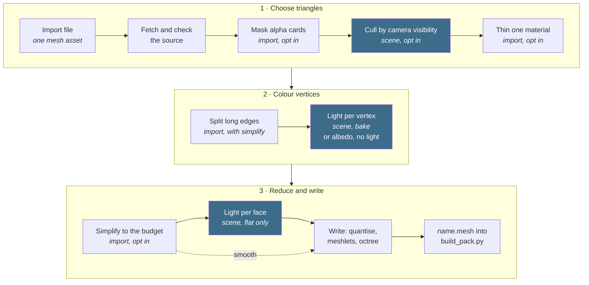
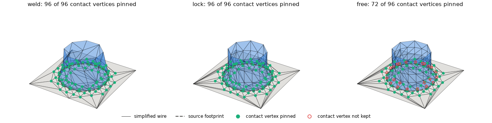
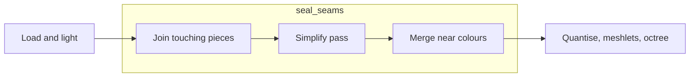
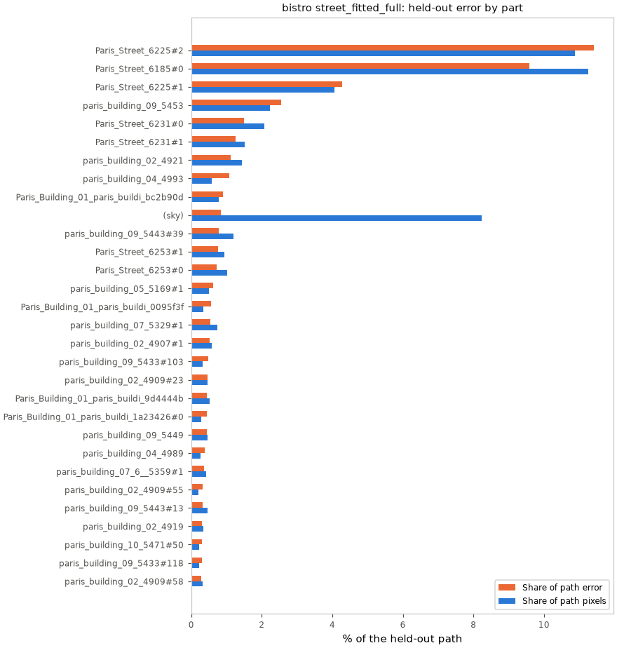
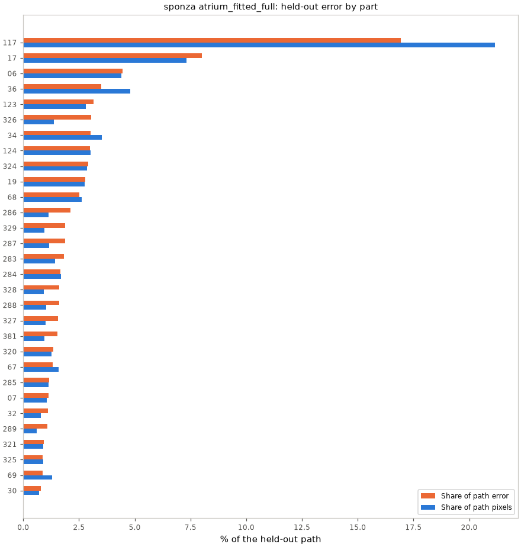
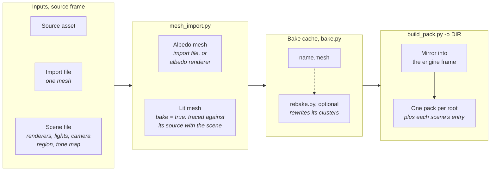
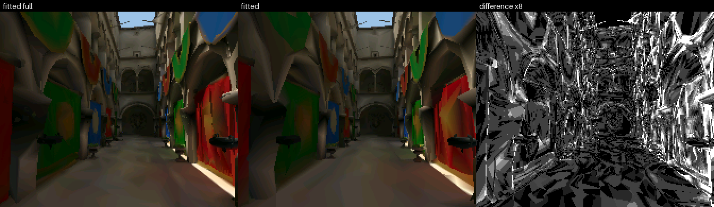
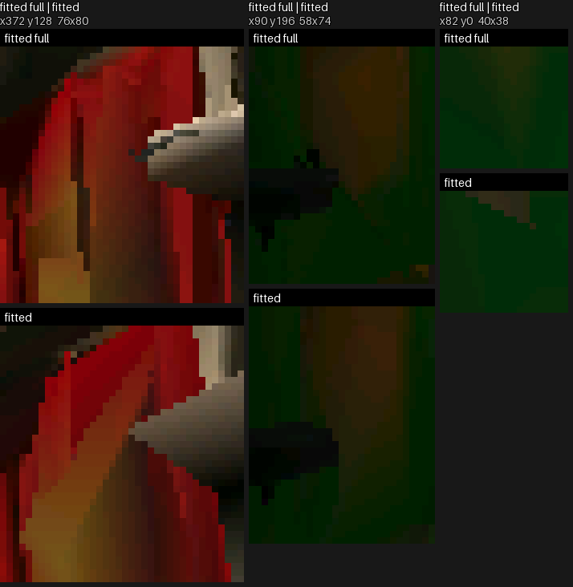

# Mesh Import

How a source mesh becomes a baked lit-mesh: the offline tools and the bake
stages. The entry a renderer consumes is [Baked-Mesh.md](Baked-Mesh.md), how
its light is computed and scored is [Bake-Method.md](Bake-Method.md), and
drawing it is [Mesh-Rendering.md](../Mesh-Rendering.md).



Blue steps are the scene's renderer options; the rest are the import file's.

## Import options

Keys before `;` are required; after it, optional.

### Source, output and materials

| Option | Keys | What it does | Default | Cost (bake / frame) | Option link |
|---|---|---|---|---|---|
| `[source]` | `path`, `credit` | Locates the local source file; `credit` records its attribution. | Required. | Local file / none. | [source](#source) |
| `[output]` | ; `name`, `position_scale` | Names the single mesh and position scale; bakes go to the cache. | `name` required without `[[variants]]`, rejected with them; `position_scale` 8. | Write / none. | [output](#output) |
| `[materials]` | ; `double_sided` | Draws listed material faces from both sides. | `[]`. | None / more faces drawn. | [materials](#materials) |

#### source

`[source].path` names a local file relative to the import file:

| Extension | Reads | Colour |
|---|---|---|
| `.obj` | its sibling `.mtl` and the textures the MTL names | the material's `Kd` and texture |
| `.glb` | every mesh node's triangles, placed by the node; a skinned node's in its bind pose | per vertex: `COLOR_0` times the material's base colour |
| `.fbx` | converted once to a `.glb` (`launcher/tools/fbx/fbx_to_glb.py`, cached by content), then read as one | as `.glb` |
| `.blend` | exported to a `.glb` inside Blender by `launcher/tools/bake/bake.py` (`[source] clips` names the actions), a cached bake like a mesh, then read as one | as `.glb` |

`credit` records the source attribution. Source files sit in
`launcher/demo/*/source/`, which uses Git LFS (MTL and attribution files stay
text) and which firmware clones exclude through `.lfsconfig`. Before a source
bake or reference render, run this from the repository root:

```sh
git lfs pull --exclude=""
```

The empty exclude clears the clone's default exclusion for this pull.

A model too large to commit or to trace is first reduced to an OBJ by
[`source/reduce_source.py`](../../../launcher/tools/r3d/source/reduce_source.py),
which keeps its objects and textures; the import's `simplify` then starts
from that OBJ.

#### output

`[output]` names the mesh entry. Baked meshes are stored in the bake cache. `position_scale` is the
number of quantisation ticks per model unit.

#### materials

`[materials].double_sided` lists materials whose faces draw from both sides.

### Skin lighting

| Option | Keys | What it does | Default | Constraint | Option link |
|---|---|---|---|---|---|
| `[skin]` | ; `lighting` | Selects the skinned renderer's runtime lighting mode, stored in SKIN. | `"direct"`. | None / none. | [skin](#skin) |

#### skin

```toml
[skin]
lighting = "direct"
```

`lighting` is stored in SKIN v2 and selects the runtime kernel on attachment.
Unknown values fail naming the import file and allowed modes.

- `direct` (default): shades the blended normal without normalising it.
- `renormalised`: normalises the blended normal before direct shading.
- `table`: samples bilinear irradiance from the scene's normal-direction table.

[Lighting modes](../animation/Skinned-Lighting.md#lighting-modes) has the comparison sheet and the
cost and error of each mode on the board.

### Process options

| Option | Keys | What it does | Default | Cost (bake / frame) | Option link |
|---|---|---|---|---|---|
| `[process]` | ; `seed` | Seeds thin's random choice. | `0`; only with thin. | None / none. | [process](#process) |

#### process

`[process].seed` makes `thin` choose the same triangles on every import.

### Geometry

Every Geometry table opts its step in; without it the step does not run.

| Option | Keys | What it does | Default | Cost (bake / frame) | Option link |
|---|---|---|---|---|---|
| `geometry.alpha_mask` | `keep_alpha` | Drops alpha-tested triangles that are mostly transparent. | Off. | Seconds / fewer triangles. | [alpha_mask](#alpha_mask) |
| `geometry.thin` | `material`, `keep` | Keeps a share of one material's triangles. | Off. | None / fewer triangles. | [thin](#thin) |
| `geometry.simplify` | `dense_edge`, `seal_seams`, `colour_deviation` | Splits long edges and simplifies each variant to its budget, colour steering the collapses; can seal seams. | Off. | Seconds / set by the budget. | [simplify](#simplify) |

#### alpha_mask

`geometry.alpha_mask` removes mostly transparent cut-out cards because the
rasterizer does not alpha-test them. Off is above on; this step also changes
what the simplifier keeps elsewhere, so not every difference is a card.


#### thin

`geometry.thin` retains a selected share of one material's triangles. It is
for material whose geometry occupies more of the budget than it shows. The
share is random, so `process.seed` makes it repeatable.


#### simplify

`geometry.simplify` splits long edges and simplifies each variant to its
budget with meshoptimizer's<sup>[[11]](../../Citations.md#meshoptimizer)</sup> quadric error simplifier<sup>[[12]](../../Citations.md#garland-1997)</sup>,
with the baked colour as an appearance attribute<sup>[[13]](../../Citations.md#hoppe-1999)</sup>.

| Key | Meaning |
|---|---|
| `dense_edge` | The longest unsplit edge. |
| `props`, `props_share` | Materials that reserve the `props_share` part of the budget. |
| `seal_seams` | See [seal_seams](#seal_seams). |
| `colour_deviation` | Source units that price one panel colour step. |

The baked colour steers which edges collapse: losing one colour step costs as
much as moving a surface `colour_deviation` away, for `props` and the rest
alike, at every budget. A smaller value keeps surfaces nearer their source
planes and less colour detail: a trade, not a limit.

Each `[[objects.meshes]]` rule carves out matching source objects:

| Key | Meaning |
|---|---|
| `match` | Exactly `{ object = "glob" }` or `{ material = "glob" }`; must match. |
| `triangles` | Mesh budget per copy, separate from the variant's rest budget. |
| `variants` | Optional `{ variant = triangles }`: a variant's own per-copy budget. |
| `min_triangles` | Optional floor on the scaled budget, at most `triangles`. Default 1. |
| `seam` | Optional policy; touching defaults to `lock`, otherwise `free`. |

A variant draws each copy with its entry in `variants`, or else
round(`triangles` x its `objects_scale`), never below `min_triangles`;
`import_settings.variant_meshes()` owns this rule. The variant's `triangles`
budgets the rest, retaining `props` shares and the global pass. Its optional `ceiling` caps emitted
triangles, including copies, and is at least `triangles`. Carved meshes are paid first, at what they emit;
the rest shares what is left. `simplify.check_ceiling` raises when the copies alone leave no room.
Overlapping rules are rejected.

Objects touch when a vertex lies within `repair.seal_tolerance` of the other's
surface. `objects/contact.py` owns the graph and both sides' border vertices.
The tolerance is the reciprocal of `output.position_scale`.

| Policy | Simplification | Seam |
|---|---|---|
| `weld` | Join touched passes and sum budgets; shared vertices collapse together, touching unshared contacts are pinned. | Closed |
| `lock` | Own pass; fix contact vertices on both sides. | Closed |
| `free` | Own pass; only the rest's side of a contact is fixed. | May open on the mesh's side; the rest stays closed |

A pillar standing on a floor, carved with each policy and the same configured
budgets:



Weld and lock pin every contact vertex; weld shares one budget with the floor,
so its pillar ends with fewer triangles than under lock. Free keeps only the
floor's side pinned, and the pass spends what it frees up the shaft.

Rigid copies share local simplification and their union of locks. Each copy
is lit against the full source.

A shape writes a colourless LMSH and an LCOL with one set per copy: RGB888
vertices for smooth shading, RGB565 faces for flat. Mirrored copies own a
shape with reversed winding and a positive-determinant placement.

A carved renderer's cache `.bundle` holds the coloured rest, shapes, LCOL
entries and a versioned copy manifest. Pack building unpacks assets and
discards the manifest; SCNE holds the rest renderer and placed copies.

Shape ids use the scene name and a stable name hash; the manifest retains
the rule, source object and copy names.

Rules match the alpha-masked source. Carved meshes skip per-triangle visibility;
`thin` runs once per shared shape with the import seed. The rest keeps its
visibility and thinning steps.

`objects/seams_report.py` accepts a scene renderer, scratch import settings and
a host viewer. Its JSON reports contacts, budgets, copies and locked input
vertices. Lock cost is emitted triangles above the pass target; locks can keep
more than the target. Each affected contact gets a `free`/`lock` comparison
and crops where pixels differ.

#### Stand-ins

Each carved shape tries regular edge simplification and a plane proxy at its
own budget. The proxy joins nearby, parallel thin parts into double-sided
rectangles and simplifies the remaining parts into the unused budget.

Each candidate is drawn unlit from the cube's face, edge and corner directions.
The mean CIE76 error against the source averages black and white backgrounds.
Equal errors within `ERROR_TIE` favour regular simplification.

Any locked vertex excludes the plane proxy. Without joinable plates, regular
simplification runs alone and skips scoring. Copies share the chosen local
geometry and retain their own placements.

`r3d/objects/stand_ins.py` owns the thresholds:

| Constant | Value | Why |
|---|---|---|
| `VIEW_DIRECTIONS` | Normalized nonzero cube directions | Cover every side without a scene camera. |
| `VIEW_PIXELS` | 96 | Approximate a copy's p95 on-screen diameter. |
| `PLATE_RATIO` | 0.25 | A part is a plate when its thickness is at most a quarter of its width (its middle extent): boards and slats, not legs or posts. |
| `PARALLEL_COS` | 0.97 | Allow small differences in plate normals. |
| `PLANE_SHARE` | 0.02 | Bound plane separation by the shape's diagonal. |
| `TOUCH_SHARE` | 0.03 | Join plates separated by small gaps relative to that diagonal. |
| `ERROR_TIE` | 1e-9 | Keep candidate order for numerically equal errors. |

Allocation mesh and pass rows include the choice:

| Field | Meaning |
|---|---|
| `stand_in` | Chosen kind: `regular` or `plane`. |
| `stand_ins` | Candidate rows in preference order. |
| `stand_ins[].kind` | Candidate kind. |
| `stand_ins[].triangles` | Emitted triangles per copy. |
| `stand_ins[].error` | Mean view error; null when scoring is skipped. |
| `stand_ins[].chosen` | Whether the candidate supplies the shape. |

#### seal_seams

`seal_seams = true` joins touching pieces before simplification, reducing gaps
at their borders.



| Step | What it does |
|---|---|
| Join | Welds border vertices within one quantisation step and splits border edges at the vertices lying on them, so a shared edge is one edge. |
| Pass | Runs meshoptimizer with light regularizing instead of regularizing. |
| Merge | Gives vertices at one quantised position one colour when they differ by at most one and a half RGB565 steps. |

It cuts the empty spots but does not remove them, and costs frame time for the
triangles it keeps.

The same import with `seal_seams` off against on, at a pose where it shows,
off above on: a pixel-sized hole that shows the sky is sealed.


### Geometry variants

| Option | Keys | What it does | Default | Cost (bake / frame) | Option link |
|---|---|---|---|---|---|
| `[[variants]]` | `name`; `triangles` | Names a geometry budget. | Required with `geometry.simplify`; otherwise optional (one mesh named by `output.name`). | Seconds each / set by the budget. | [variants](#variants) |
| `[[variants]].triangles` | — | Sets a simplified mesh's triangle budget. | Required with `geometry.simplify`. | Seconds / set by the budget. | [variants triangles](#variants-triangles) |
| `[[variants]].objects_scale` | — | Scales each `[[objects.meshes]]` copy budget. | 1. | — / set by the budgets. | [variants objects_scale](#variants-objects_scale) |

#### variants

`[[variants]]` gives a geometry output its name and, with `simplify`, its
triangle budget. Without variants, `output.name` names the single output.

#### variants triangles

`[[variants]].triangles` is the triangle budget `simplify` brings a variant to;
a `fit` budget may not exceed it.

#### variants objects_scale

`[[variants]].objects_scale` multiplies each `[[objects.meshes]]` copy budget
for this variant, so one set of rules serves every tier; a rule's `variants`
entry or `min_triangles` overrides or floors the result.

## Objects and instances

An OBJ object is an `o` or `g` group; an ungrouped file uses its stem.
A glTF object is a mesh node, placed by its world transform. A nameless
node uses its index. Only vertices referenced by triangles belong to an object.

[`objects/objects_report.py`](../../../launcher/tools/r3d/objects/objects_report.py)
reports shared shapes after the import's alpha mask. Matching is rigid:
scaled copies remain separate shapes. Reflections are recorded per instance.

| Test | Requirement |
|---|---|
| Candidate bucket | Equal vertex and triangle counts, and material multiset |
| Correspondence | Matching topology uses Kabsch<sup>[[86]](../../Citations.md#kabsch-1976)</sup>; reordered vertices use signed PCA frames and bijective nearest neighbours, then Kabsch |
| Acceptance | Largest vertex residual within `MATCH_TOLERANCE` times the object's bounds diagonal; mapped triangle winding and materials agree as multisets |

Each colour below is one repeated shape, boxed at every copy in view. The
view is the camera-path pose where those boxes show the most visible edge;
`render_doc_images.sh` regenerates it.


| Report output (`--out` directory) | What it shows |
|---|---|
| objects.md / objects.json | Shapes, copies, triangles saved, match residuals |
| poses.csv, lod.png | Per camera-path pose: whole and in-view budgets, repeated-shape LOD budget, and triangles LOD frees |
| error.csv / error.md, error.png | With `--held-out`: every object part's path pixels and held-out error, ranked |

- Repeated shapes step down while their triangle share exceeds what projected area allows; `LOD_TRIANGLE_RATIO` and `LOD_LEVELS` in `objects_report.py` set the quarter-triangle levels and cap.
- This is an estimate: pixels per triangle is calibrated from the path; enclosing-sphere footprints overstate tall, thin props.

### Held-out error by object

`--held-out` scores a fitted renderer's locked fit against its held-out
references ([`objects/object_error.py`](../../../launcher/tools/r3d/objects/object_error.py)).
Each pixel's dE76 is charged to the object part the reference shows there,
so the rows sum to the held-out score.

| Term | Meaning |
|---|---|
| Object part | Triangles of one source object joined by welded positions; `name#k` when the object has several |
| Path pixels, error share | The part's share of all held-out pixels and of their summed dE76; the sky is its own row |
| Source, drawn triangles | Shares of the source, and of the fit's triangles charged to the nearest source triangle centre |
| repeat ×N | A rigid copy of a shape placed N times, matched over parts |
| welded | Shares a position with another object |
| segment | One welded part: only sub-mesh segmentation can split it |



<!-- generated: bistro-object-error sha256=4e85258527d0ae2a1ec0f28cf2ca326f535e844d36576bbd415a8297cf22cf3c -->
> Generated by: `python launcher/tools/r3d/objects/objects_report.py launcher/demo/bistro/bistro.scene.toml --object street_fitted_full --out DIR --held-out --docs`

Mean dE76 over the held-out path 6.364, over 10014 object parts in view. 9.1% of the drawn triangles sit on parts no held-out pixel shows.

Object parts, ranked by error share. Names leave out `Bistro_Research_Exterior_`.

| Rank | Object part | Material | Path pixels | Mean dE76 | Error share | Source triangles | Drawn triangles | Flags |
|---:|---|---|---:|---:|---:|---:|---:|---|
| 1 | Paris_Street_6225#2 | Pavement_Cobblestone_Wet_BLENDSHADER | 10.87% | 6.7 | 11.41% | 0.11% | 0.73% | welded |
| 2 | Paris_Street_6185#0 | Pavement_Cobblestone_Big_BLENDSHADER | 11.26% | 5.4 | 9.59% | 0.09% | 1.40% |  |
| 3 | Paris_Street_6225#1 | Pavement_Cobblestone_Wet_BLENDSHADER | 4.06% | 6.7 | 4.28% | 0.09% | 0.36% | welded |
| 4 | paris_building_09_5453 | MASTER_Roofing_Metal_01 | 2.24% | 7.2 | 2.55% | 0.06% | 0.57% |  |
| 5 | Paris_Street_6231#0 | Pavement_Cobblestone_01_BLENDSHADER | 2.07% | 4.6 | 1.50% | 0.02% | 0.09% | welded |
| 6 | Paris_Street_6231#1 | Pavement_Cobblestone_01_BLENDSHADER | 1.52% | 5.3 | 1.26% | 0.02% | 0.20% | welded |
| 7 | paris_building_02_4921 | MASTER_Brick_Large_Beige_BLENDSHADER | 1.43% | 5.0 | 1.12% | 0.04% | 0.39% | segment |
| 8 | paris_building_04_4993 | MASTER_Brick_Small_Red | 0.59% | 11.6 | 1.08% | 0.04% | 0.32% | segment |
| 9 | Paris_Building_01_paris_buildi_bc2b90d | MASTER_Concrete_Yellow | 0.78% | 7.3 | 0.90% | 0.01% | 0.10% |  |
| 10 | (sky) |  | 8.24% | 0.7 | 0.85% | 0.00% | 0.00% |  |
| 11 | paris_building_09_5443#39 | MASTER_Concrete | 1.19% | 4.1 | 0.77% | 0.13% | 0.73% |  |
| 12 | Paris_Street_6253#1 | MASTER_Brick_Small_Red_BLENDSHADER | 0.93% | 5.2 | 0.76% | 0.03% | 0.56% |  |
| 13 | Paris_Street_6253#0 | MASTER_Brick_Small_Red_BLENDSHADER | 1.02% | 4.5 | 0.72% | 0.03% | 0.41% |  |
| 14 | paris_building_05_5169#1 | MASTER_Roofing_Shingle_Grey | 0.51% | 7.9 | 0.63% | 0.01% | 0.13% | repeat ×2 |
| 15 | Paris_Building_01_paris_buildi_0095f3f | MASTER_Concrete_Grooved | 0.34% | 10.7 | 0.57% | 0.01% | 0.04% |  |
| 16 | paris_building_07_5329#1 | MASTER_Brick_Large_Beige_BLENDSHADER | 0.74% | 4.6 | 0.54% | 0.02% | 0.16% | repeat ×2 |
| 17 | paris_building_02_4907#1 | MASTER_Brick_Large_Beige_BLENDSHADER | 0.57% | 5.9 | 0.53% | 0.00% | 0.01% | repeat ×2 |
| 18 | paris_building_09_5433#103 | MASTER_Concrete_Smooth | 0.32% | 9.5 | 0.48% | 0.07% | 0.34% |  |
| 19 | paris_building_02_4909#23 | MASTER_Concrete_Smooth | 0.45% | 6.5 | 0.46% | 0.01% | 0.08% |  |
| 20 | Paris_Building_01_paris_buildi_9d4444b | MASTER_Concrete_Grooved | 0.52% | 5.5 | 0.45% | 0.01% | 0.14% | segment |

Source objects, every part summed. Names leave out `Bistro_Research_Exterior_`.

| Source object | Material | Parts seen / all | Path pixels | Mean dE76 | Error share | Source triangles | Drawn triangles |
|---|---|---:|---:|---:|---:|---:|---:|
| Paris_Street_6225 | Pavement_Cobblestone_Wet_BLENDSHADER | 3 / 3 | 14.99% | 6.7 | 15.75% | 721 | 236 |
| Paris_Street_6185 | Pavement_Cobblestone_Big_BLENDSHADER | 2 / 2 | 11.37% | 5.4 | 9.69% | 337 | 304 |
| paris_building_02_4909 | MASTER_Concrete_Smooth | 138 / 258 | 3.73% | 6.3 | 3.71% | 6156 | 900 |
| Paris_Street_6231 | Pavement_Cobblestone_01_BLENDSHADER | 2 / 2 | 3.59% | 4.9 | 2.77% | 116 | 57 |
| paris_building_09_5453 | MASTER_Roofing_Metal_01 | 1 / 1 | 2.24% | 7.2 | 2.55% | 208 | 114 |
| paris_building_07_1__5349 | MASTER_Concrete_Smooth_BLENDSHADER | 192 / 233 | 2.17% | 6.1 | 2.06% | 13451 | 1141 |
| paris_building_09_5433 | MASTER_Concrete_Smooth | 152 / 216 | 1.66% | 7.7 | 2.01% | 4854 | 443 |
| paris_building_07_5319 | MASTER_Concrete_Smooth_BLENDSHADER | 195 / 233 | 2.39% | 5.2 | 1.96% | 12934 | 1045 |
| paris_building_04_5019 | MASTER_Concrete | 178 / 185 | 0.95% | 11.4 | 1.70% | 2111 | 403 |
| Paris_Street_14_NormalsFix_2 | Pavement_Curbstones | 413 / 586 | 1.49% | 6.9 | 1.61% | 3229 | 289 |
| Paris_Street_6253 | MASTER_Brick_Small_Red_BLENDSHADER | 2 / 2 | 1.95% | 4.9 | 1.49% | 212 | 193 |
| paris_building_09_5443 | MASTER_Concrete | 45 / 62 | 1.97% | 4.6 | 1.42% | 1256 | 293 |
| paris_building_02_4921 | MASTER_Brick_Large_Beige_BLENDSHADER | 1 / 1 | 1.43% | 5.0 | 1.12% | 120 | 77 |
| paris_building_04_4993 | MASTER_Brick_Small_Red | 1 / 1 | 0.59% | 11.6 | 1.08% | 128 | 64 |
| paris_building_05_5137 | MASTER_Concrete | 51 / 95 | 0.52% | 13.0 | 1.07% | 1141 | 145 |
| Paris_MainBalcony_01_6103 | Balcony_Trims | 86 / 86 | 0.44% | 14.9 | 1.02% | 3205 | 70 |
| Paris_Building_01_paris_buildi_bc2b90d | MASTER_Concrete_Yellow | 1 / 1 | 0.78% | 7.3 | 0.90% | 44 | 19 |
| paris_building_05_5169 | MASTER_Roofing_Shingle_Grey | 4 / 8 | 0.69% | 7.8 | 0.85% | 67 | 43 |
| paris_building_05_5127 | MASTER_Concrete_Smooth | 55 / 107 | 0.51% | 10.1 | 0.81% | 1406 | 189 |
| paris_building_05_5129 | MASTER_Concrete_Grooved | 7 / 9 | 0.65% | 7.3 | 0.75% | 150 | 99 |

Repeated shapes, every copy summed.

| Shape (first copy) | Material | Copies seen / placed | Path pixels | Mean dE76 | Error share | Source triangles | Drawn triangles |
|---|---|---:|---:|---:|---:|---:|---:|
| Bistro_Research_Exterior_paris_building_07_5329#1 | MASTER_Brick_Large_Beige_BLENDSHADER | 2 / 2 | 1.17% | 4.9 | 0.90% | 132 | 58 |
| Bistro_Research_Exterior_Paris_Building_01_paris_buildi_7c1faab#0 | MASTER_Curtains | 71 / 148 | 0.38% | 12.3 | 0.75% | 142 | 28 |
| Bistro_Research_Exterior_paris_building_02_4907#1 | MASTER_Brick_Large_Beige_BLENDSHADER | 2 / 2 | 0.80% | 5.4 | 0.67% | 4 | 4 |
| Bistro_Research_Exterior_paris_building_05_5169#1 | MASTER_Roofing_Shingle_Grey | 2 / 2 | 0.51% | 7.9 | 0.63% | 62 | 37 |
| Bistro_Research_Exterior_bux_hedge_box_long_low2_3977 | Foliage_Bux_Hedges46.DoubleSided | 12 / 12 | 0.80% | 4.2 | 0.53% | 504 | 120 |
| Bistro_Research_Exterior_Paris_SidewalkBarrier_01A4_6177#0 | Sidewalkbarrier | 5 / 5 | 0.38% | 8.4 | 0.51% | 2360 | 10 |
| Bistro_Research_Exterior_Paris_Building_01_paris_buildi_6a0ff93#0 | MASTER_Concrete_Smooth | 16 / 16 | 0.32% | 9.9 | 0.50% | 1568 | 105 |
| Bistro_Research_Exterior_paris_building_05_51__5261#8 | MASTER_Concrete_Grooved | 2 / 2 | 0.51% | 5.9 | 0.48% | 86 | 72 |
| Bistro_Research_Exterior_Paris_PlantPot_01A3_6141 | Plantpots | 9 / 9 | 0.29% | 9.9 | 0.45% | 720 | 49 |
| Bistro_Research_Exterior_Paris_Bollard_01A2_4137#0 | Bollards | 4 / 4 | 0.17% | 15.8 | 0.41% | 440 | 81 |
| Bistro_Research_Exterior_paris_building_05_5129#7 | MASTER_Concrete_Grooved | 2 / 2 | 0.32% | 7.7 | 0.39% | 82 | 54 |
| Bistro_Research_Exterior_Paris_BistroAwning_02B7_4127#5 | Awnings_Hotel_Fabric | 9 / 9 | 0.20% | 12.4 | 0.39% | 918 | 50 |
| StringLight_Wind_23 | Stringlights | 3 / 3 | 0.09% | 22.4 | 0.32% | 72 | 10 |
| Bistro_Research_Exterior_paris_building_10_5471#50 | MASTER_Concrete_Smooth | 2 / 2 | 0.26% | 7.8 | 0.32% | 104 | 28 |
| Bistro_Research_Exterior_paris_building_10_11__5511 | MASTER_Brick_Large_Beige_BLENDSHADER | 2 / 2 | 0.53% | 3.7 | 0.31% | 216 | 122 |
| Bistro_Research_Exterior_paris_building_10_5493#0 | MASTER_Roofing_Metal_01 | 2 / 2 | 0.25% | 7.4 | 0.29% | 152 | 55 |
| Bistro_Research_Exterior_Paris_StreetPivot_018_6387 | Paris_StreetPivot | 42 / 50 | 0.13% | 13.8 | 0.28% | 504 | 17 |
| Bistro_Research_Exterior_paris_building_04_4987#52 | MASTER_Building_Details | 52 / 64 | 0.23% | 6.9 | 0.25% | 208 | 15 |
| Bistro_Research_Exterior_Paris_SidewalkBarrier_01A3_6175#2 | Sidewalkbarrier | 5 / 5 | 0.20% | 7.7 | 0.24% | 460 | 2 |
| Bistro_Research_Exterior_Paris_Table_01___10__6493#0 | Paris_Table_Terrace | 87 / 121 | 0.15% | 10.2 | 0.23% | 1044 | 35 |
<!-- /generated: bistro-object-error -->



<!-- generated: sponza-object-error sha256=7c2d8b2db148d3a9f3a36c8d2e0396cb391154bb9b3b8c2ee9c7c25bddc7ebdf -->
> Generated by: `python launcher/tools/r3d/objects/objects_report.py launcher/demo/sponza/sponza.scene.toml --object atrium_fitted_full --out DIR --held-out --docs`

Mean dE76 over the held-out path 5.390, over 1026 object parts in view. 8.1% of the drawn triangles sit on parts no held-out pixel shows.

Object parts, ranked by error share. Names leave out `sponza_`.

| Rank | Object part | Material | Path pixels | Mean dE76 | Error share | Source triangles | Drawn triangles | Flags |
|---:|---|---|---:|---:|---:|---:|---:|---|
| 1 | 117 | floor | 21.14% | 4.3 | 16.93% | 0.00% | 0.27% |  |
| 2 | 17 | arch | 7.32% | 5.9 | 8.01% | 1.18% | 4.44% |  |
| 3 | 06 | bricks | 4.39% | 5.5 | 4.46% | 0.04% | 0.62% |  |
| 4 | 36 | bricks | 4.79% | 3.9 | 3.50% | 0.06% | 1.92% |  |
| 5 | 123 | arch | 2.80% | 6.1 | 3.15% | 0.76% | 2.63% | repeat ×2 |
| 6 | 326 | fabric_g | 1.36% | 12.1 | 3.04% | 1.88% | 1.74% |  |
| 7 | 34 | bricks | 3.51% | 4.6 | 3.02% | 0.08% | 1.83% |  |
| 8 | 124 | arch | 3.03% | 5.3 | 3.00% | 0.76% | 2.04% | repeat ×2 |
| 9 | 324 | fabric_f | 2.87% | 5.5 | 2.91% | 1.88% | 0.96% |  |
| 10 | 19 | ceiling | 2.76% | 5.4 | 2.78% | 0.95% | 7.31% | repeat ×2 |
| 11 | 68 | bricks | 2.62% | 5.2 | 2.52% | 0.01% | 0.46% |  |
| 12 | 286 | fabric_d | 1.14% | 10.1 | 2.13% | 2.24% | 0.93% | repeat ×3 |
| 13 | 329 | fabric_g | 0.94% | 10.8 | 1.88% | 1.98% | 1.91% | repeat ×2 |
| 14 | 287 | fabric_e | 1.17% | 8.6 | 1.87% | 2.24% | 0.88% | repeat ×3 |
| 15 | 283 | fabric_d | 1.42% | 6.9 | 1.84% | 2.24% | 0.58% | repeat ×3 |
| 16 | 284 | fabric_a | 1.69% | 5.3 | 1.66% | 2.24% | 0.60% | repeat ×2 |
| 17 | 328 | fabric_c | 0.91% | 9.6 | 1.62% | 1.88% | 1.48% | repeat ×2 |
| 18 | 288 | fabric_a | 1.02% | 8.5 | 1.60% | 2.24% | 0.72% | repeat ×2 |
| 19 | 327 | fabric_f | 1.00% | 8.4 | 1.56% | 1.98% | 1.47% | repeat ×2 |
| 20 | 381 | roof | 0.94% | 8.8 | 1.53% | 5.70% | 3.58% |  |

Source objects, every part summed. Names leave out `sponza_`.

| Source object | Material | Parts seen / all | Path pixels | Mean dE76 | Error share | Source triangles | Drawn triangles |
|---|---|---:|---:|---:|---:|---:|---:|
| 117 | floor | 1 / 1 | 21.14% | 4.3 | 16.93% | 5 | 45 |
| 17 | arch | 1 / 1 | 7.32% | 5.9 | 8.01% | 2896 | 732 |
| 06 | bricks | 1 / 1 | 4.39% | 5.5 | 4.46% | 100 | 103 |
| 36 | bricks | 1 / 1 | 4.79% | 3.9 | 3.50% | 148 | 317 |
| 123 | arch | 1 / 1 | 2.80% | 6.1 | 3.15% | 1860 | 434 |
| 326 | fabric_g | 1 / 1 | 1.36% | 12.1 | 3.04% | 4608 | 287 |
| 34 | bricks | 1 / 1 | 3.51% | 4.6 | 3.02% | 204 | 301 |
| 124 | arch | 1 / 1 | 3.03% | 5.3 | 3.00% | 1860 | 337 |
| 324 | fabric_f | 1 / 1 | 2.87% | 5.5 | 2.91% | 4608 | 159 |
| 19 | ceiling | 1 / 1 | 2.76% | 5.4 | 2.78% | 2332 | 1205 |
| 68 | bricks | 1 / 1 | 2.62% | 5.2 | 2.52% | 18 | 76 |
| 286 | fabric_d | 1 / 1 | 1.14% | 10.1 | 2.13% | 5504 | 154 |
| 329 | fabric_g | 1 / 1 | 0.94% | 10.8 | 1.88% | 4864 | 315 |
| 287 | fabric_e | 1 / 1 | 1.17% | 8.6 | 1.87% | 5504 | 145 |
| 283 | fabric_d | 1 / 1 | 1.42% | 6.9 | 1.84% | 5504 | 95 |
| 284 | fabric_a | 1 / 1 | 1.69% | 5.3 | 1.66% | 5504 | 99 |
| 328 | fabric_c | 1 / 1 | 0.91% | 9.6 | 1.62% | 4608 | 244 |
| 288 | fabric_a | 1 / 1 | 1.02% | 8.5 | 1.60% | 5504 | 118 |
| 327 | fabric_f | 1 / 1 | 1.00% | 8.4 | 1.56% | 4864 | 242 |
| 381 | roof | 1 / 1 | 0.94% | 8.8 | 1.53% | 13988 | 590 |

Repeated shapes, every copy summed. Names leave out `sponza_`.

| Shape (first copy) | Material | Copies seen / placed | Path pixels | Mean dE76 | Error share | Source triangles | Drawn triangles |
|---|---|---:|---:|---:|---:|---:|---:|
| 123 | arch | 2 / 2 | 5.83% | 5.7 | 6.15% | 3720 | 771 |
| 286 | fabric_d | 3 / 3 | 3.16% | 8.6 | 5.06% | 16512 | 389 |
| 19 | ceiling | 2 / 2 | 3.73% | 5.0 | 3.48% | 4664 | 2106 |
| 287 | fabric_e | 3 / 3 | 2.58% | 6.9 | 3.30% | 16512 | 301 |
| 284 | fabric_a | 2 / 2 | 2.71% | 6.5 | 3.26% | 11008 | 217 |
| 329 | fabric_g | 2 / 2 | 2.20% | 7.9 | 3.23% | 9728 | 488 |
| 11 | column_a | 8 / 8 | 2.64% | 5.7 | 2.81% | 1456 | 183 |
| 32 | column_c | 4 / 4 | 2.15% | 6.7 | 2.69% | 1048 | 151 |
| 30 | column_c | 4 / 4 | 2.56% | 5.6 | 2.67% | 1048 | 124 |
| 328 | fabric_c | 2 / 2 | 1.80% | 7.6 | 2.55% | 9216 | 363 |
| 67 | arch | 2 / 2 | 2.65% | 5.0 | 2.47% | 560 | 355 |
| 327 | fabric_f | 2 / 2 | 1.18% | 7.8 | 1.70% | 9728 | 341 |
| 213 | column_b | 6 / 6 | 1.35% | 5.5 | 1.39% | 7320 | 195 |
| 33 | column_c | 4 / 4 | 1.10% | 5.5 | 1.13% | 1584 | 158 |
| 325 | fabric_c | 2 / 2 | 1.21% | 4.7 | 1.06% | 9728 | 302 |
| 21 | arch | 2 / 2 | 0.67% | 6.9 | 0.85% | 1096 | 131 |
| 120 | column_a | 4 / 4 | 0.69% | 4.6 | 0.59% | 1360 | 136 |
| 61 | arch | 11 / 11 | 0.43% | 6.8 | 0.54% | 440 | 382 |
| 297 | flagpole | 10 / 10 | 0.26% | 10.9 | 0.52% | 1920 | 14 |
| 369#50 | vase_round | 8 / 8 | 0.38% | 7.2 | 0.50% | 17592 | 1055 |
<!-- /generated: sponza-object-error -->

## The offline tools

Two kinds of file drive the mesh tools in
[`launcher/tools/r3d/`](../../../launcher/tools/r3d/README.md). An **import
file** beside a source asset describes that one mesh. A **scene file** places
meshes and owns lights, camera region and tone map
([Scene-Files.md](../scene/Scene-Files.md)).



[`import_settings.py`](../../../launcher/tools/r3d/import_settings.py) reads and
checks both files with the standard library alone. Every table is closed: an
unknown key is an error.

| Command, from the repository root | What it writes |
|---|---|
| `python launcher/tools/r3d/mesh_import.py IMPORT` | The import's authored albedo mesh into the bake cache. |
| `python launcher/tools/r3d/mesh_import.py SCENE` | Each renderer's mesh: a `bake = true` renderer traced with the scene's lights, camera visibility and tone map; an albedo renderer its import's shared mesh. |
| `python launcher/tools/r3d/mesh_import.py PATH --mesh NAME` | That one mesh only. |
| `python launcher/tools/r3d/build_pack.py -o DIR` | One [pack](../../assets/Building-Packs.md#packs) per root from the `.mesh` entries it names, baking each scene's [entry](../../assets/formats/SCNE.md) on the way. |
| `python launcher/tools/r3d/rebake.py MESH.mesh` | That cached `.mesh` in place, its clusters and octree only; rerun `build_pack.py` to pack it. |

A cached `<name>.mesh` is an entry of the [asset pack](../../assets/README.md),
held in the bake cache
([`launcher/tools/bake/bake.py`](../../../launcher/tools/bake/bake.py)). It
carries no normals: shading is already baked.

### Frames

| Frame | Axes | Used by |
|---|---|---|
| Source | Right-handed: +x right, +y up, camera looking down -z. | Source assets, scene TOMLs, cached bakes, bake-time tools, poses files. |
| [Engine](../../math/Conventions.md#conventions) | Source with z negated. | Built packs. |

`build_pack.py` mirrors each entry once, through
[`asset/engine_frame.py`](../../../launcher/tools/asset/engine_frame.py):

| Mirrored | Kept as authored |
|---|---|
| Position z is negated. | Triangle order. |
| A placement's matrix `M` becomes `S M S`, `S = diag(1, 1, -1)`. | Baked colours. |
| Quaternion `(x, y, z, w)` becomes `(-x, -y, z, w)`. | Key times and interpolation. |
| Clips' translation and rotation tracks, cubic tangents included. | Every other track. |
| Bounds swap their mirrored z endpoints. | |

A z equal to the int16 minimum is rejected: its negation cannot fit.

[`track_host.py`](../../../launcher/tools/anim/track_host.py) `--poses` writes a
poses file from a `.anim.toml`, baked into an unmirrored scratch pack, and
`triangle_sizes` mirrors each pose as it reads it. A built pack's clips are
already mirrored, so `--poses` on a `--pack` gives wrong poses.

### Import file

**Rule: an import brings geometry in as authored, and each geometry table
present turns its step on.** Visibility and lighting belong to the renderer in
its scene ([Scene-Files.md](../scene/Scene-Files.md)).

With only `[source]` and `[output]`:

| Aspect | Result |
|---|---|
| Triangles | The source's, kept: nothing cut, simplified or lit. |
| Vertex colour | Material albedo: the `Kd` colour times the texture. |
| Encoding | 8 bits with a 1/2.2 gamma, not the piecewise sRGB curve; no tone map. |
| Source vertex colours | Not read. |

Two variants of one import differ in what `simplify` keeps. Below, one
pose of the same fit at the full budget (top) and at about half of it
(bottom).




Scene-owned bake, visibility, shading and fit settings are described in
[Scene-Files.md](../scene/Scene-Files.md#option-reference).

Each tool and its module, `rebake.py` and when to rebake rather than bake in
full, and the triangle-size report are in
[`launcher/tools/r3d/README.md`](../../../launcher/tools/r3d/README.md).
