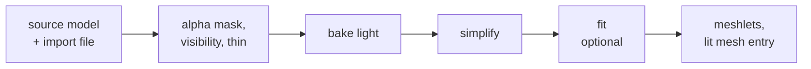
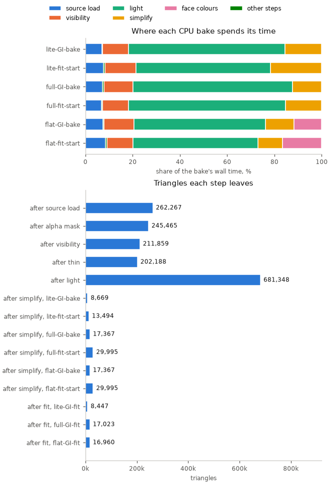

# Offline: import, bake, fit

The host half of the [render pipeline](../README.md): a source model becomes
lit meshes the board draws without lighting them. Everything here runs on the
CPU, except the fit, which needs a CUDA GPU.



| Stage | Reads → writes | Settings | Owner |
|---|---|---|---|
| Source model | OBJ, glTF, FBX or .blend with materials → triangles with materials and UVs | `[source]` | [Mesh-Import.md](Mesh-Import.md#source) |
| Alpha mask | triangles, textures → fewer triangles; the board does not alpha-test | `geometry.alpha_mask` | [Mesh-Import.md](Mesh-Import.md#alpha_mask) |
| Visibility | triangles, the camera's region or path → the seen triangles | the renderer's `visibility` | [Scene-Files.md](../scene/Scene-Files.md#visibility-camera_region) |
| Thin | seen triangles → a share of one material's, for dense foliage | `geometry.thin` | [Mesh-Import.md](Mesh-Import.md#thin) |
| Light | triangles, the scene's lights → a colour per vertex or face; rays traced by Mitsuba<sup>[[15]](../../Citations.md#mitsuba3)</sup> on the CPU | `[bake]`, `[indirect]`, `[sky]`, `[ambient]`, `tonemap_white` | [Bake-Method.md](Bake-Method.md), [Scene-Files.md](../scene/Scene-Files.md#bake) |
| Simplify | lit triangles → each variant at its budget | `geometry.simplify`, each variant's `triangles` | [Mesh-Import.md](Mesh-Import.md#simplify) |
| Fit | a variant, reference renders → the fitted mesh; CUDA GPU | the renderer's `fit` | [Appearance-Fit.md](Appearance-Fit.md) |
| Meshlets | the final mesh → clusters, nodes, the `.mesh` entry | `geometry.meshlet_triangles` | [Baked-Mesh.md](Baked-Mesh.md#meshlets) |
| Asset pack | a scene, its meshes and clip → one pack per root | an app's demo assets | [Building-Packs.md](../../assets/Building-Packs.md#packs) |

| Page | Covers |
|---|---|
| [Mesh-Import.md](Mesh-Import.md) | The import file and its options, the geometry steps, objects and instances, the offline tools |
| [Bake-Method.md](Bake-Method.md) | How a bake's light is computed: local occlusion, bounced light, the fidelity scores |
| [Appearance-Fit.md](Appearance-Fit.md) | Fitting a baked mesh to reference renders: what each `fit` key does, the stages, the loss |
| [Bake-Quality.md](Bake-Quality.md) | What each bake option buys, measured against the source, with every comparison image |
| [Baked-Mesh.md](Baked-Mesh.md) | The mesh a bake writes: clusters, the tree, meshlets ([LMSH](../../assets/formats/LMSH.md)) |

The scene options that drive a bake (`bake`, `visibility`, `shading`, `fit`)
are set per renderer in the [scene file](../scene/Scene-Files.md#mesh_renderer).

## Where the time goes

Every step runs on the CPU except the fit, which needs a CUDA GPU. The chart
gives each step's share of a bake; seconds depend on the machine, so time your
own with:

```sh
python launcher/tools/render/bake_steps.py SCENE.scene.toml [--mesh NAME]
```

<!-- generated: bake-steps sha256=418c525e915e378838991b7589306bb396a177d6dee4ba9d0b4355aa0ecb4711 -->


Peak memory: 3.4 GiB of RAM (in simplify) and 1.2 GiB of VRAM (in fit).

<details><summary>Bake steps</summary>

| Variant | Step | Share of variant | Triangles in | Triangles out | Peak RAM MiB | Peak VRAM MiB |
|---|---|---|---|---|---|---|
| lite-GI-bake | source load | 7% | 0 | 262267 | 1608.7 | not available |
| lite-GI-bake | alpha mask | 0% | 262267 | 245465 | 1566.5 | not available |
| lite-GI-bake | visibility | 11% | 245465 | 211859 | 2009.4 | not available |
| lite-GI-bake | thin | 0% | 211859 | 202188 | 1840.6 | not available |
| lite-GI-bake | light | 66% | 202188 | 681348 | 3375.5 | not available |
| lite-GI-bake | simplify | 15% | 681348 | 8669 | 3532.3 | not available |
| lite-GI-bake | meshlets | 0% | 8669 | 8669 | 3433.5 | not available |
| lite-GI-bake | write | 0% | 8669 | 8669 | 3433.5 | not available |
| lite-fit-start | source load | 8% | 0 | 262267 | 1600.5 | not available |
| lite-fit-start | alpha mask | 1% | 262267 | 245465 | 1581.0 | not available |
| lite-fit-start | visibility | 13% | 245465 | 211859 | 1984.4 | not available |
| lite-fit-start | thin | 0% | 211859 | 202188 | 1922.2 | not available |
| lite-fit-start | light | 57% | 202188 | 681348 | 3378.6 | not available |
| lite-fit-start | simplify | 22% | 681348 | 13494 | 3515.2 | not available |
| lite-fit-start | meshlets | 0% | 13494 | 13494 | 3417.3 | not available |
| lite-fit-start | write | 0% | 13494 | 13494 | 3417.3 | not available |
| lite-GI-fit | fit | 100% | 13494 | 8447 | 2761.5 | 1138.0 |
| full-GI-bake | source load | 7% | 0 | 262267 | 1624.4 | not available |
| full-GI-bake | alpha mask | 1% | 262267 | 245465 | 1567.0 | not available |
| full-GI-bake | visibility | 12% | 245465 | 211859 | 1965.6 | not available |
| full-GI-bake | thin | 0% | 211859 | 202188 | 1887.5 | not available |
| full-GI-bake | light | 68% | 202188 | 681348 | 3373.0 | not available |
| full-GI-bake | simplify | 12% | 681348 | 17367 | 3519.4 | not available |
| full-GI-bake | meshlets | 0% | 17367 | 17367 | 3368.3 | not available |
| full-GI-bake | write | 0% | 17367 | 17367 | 3368.3 | not available |
| full-fit-start | source load | 7% | 0 | 262267 | 1624.2 | not available |
| full-fit-start | alpha mask | 0% | 262267 | 245465 | 1569.1 | not available |
| full-fit-start | visibility | 11% | 245465 | 211859 | 1974.0 | not available |
| full-fit-start | thin | 0% | 211859 | 202188 | 1897.8 | not available |
| full-fit-start | light | 67% | 202188 | 681348 | 3368.1 | not available |
| full-fit-start | simplify | 15% | 681348 | 29995 | 3514.4 | not available |
| full-fit-start | meshlets | 0% | 29995 | 29995 | 3416.8 | not available |
| full-fit-start | write | 0% | 29995 | 29995 | 3416.8 | not available |
| full-GI-fit | fit | 100% | 29995 | 17023 | 2791.8 | 1164.0 |
| flat-GI-bake | source load | 7% | 0 | 262267 | 1613.3 | not available |
| flat-GI-bake | alpha mask | 0% | 262267 | 245465 | 1570.4 | not available |
| flat-GI-bake | visibility | 13% | 245465 | 211859 | 1986.1 | not available |
| flat-GI-bake | thin | 0% | 211859 | 202188 | 1936.3 | not available |
| flat-GI-bake | light | 56% | 202188 | 681348 | 3371.9 | not available |
| flat-GI-bake | simplify | 12% | 681348 | 17367 | 3509.2 | not available |
| flat-GI-bake | face colours | 12% | 17367 | 17367 | 3327.0 | not available |
| flat-GI-bake | meshlets | 0% | 17367 | 17367 | 3326.8 | not available |
| flat-GI-bake | write | 0% | 17367 | 17367 | 3326.8 | not available |
| flat-fit-start | source load | 9% | 0 | 262267 | 1627.3 | not available |
| flat-fit-start | alpha mask | 0% | 262267 | 245465 | 1569.8 | not available |
| flat-fit-start | visibility | 11% | 245465 | 211859 | 1983.0 | not available |
| flat-fit-start | thin | 0% | 211859 | 202188 | 1887.4 | not available |
| flat-fit-start | light | 53% | 202188 | 681348 | 3373.7 | not available |
| flat-fit-start | simplify | 10% | 681348 | 29995 | 3514.0 | not available |
| flat-fit-start | face colours | 17% | 29995 | 29995 | 3426.3 | not available |
| flat-fit-start | meshlets | 0% | 29995 | 29995 | 3424.4 | not available |
| flat-fit-start | write | 0% | 29995 | 29995 | 3424.4 | not available |
| flat-GI-fit | fit | 100% | 29995 | 16960 | 2772.2 | 1200.0 |

</details>
<!-- /generated: bake-steps -->

The GPU stage writes the `bake-steps` chart and rows from its own rebakes and
fits. Refresh them on a machine with a CUDA GPU with:

```sh
sh launcher/tools/render/render_doc_images.sh --stage gpu
```

RAM peaks are sampled process RSS; only GPU steps read VRAM. Each fitted
input's rebake is `fit-start`, with its fit on its own row. The machine's
hardware and versions go in the stage's `measurements.json`.
