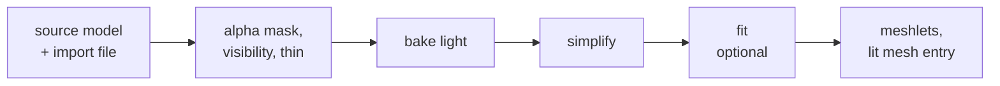

# Offline: import, bake, fit

The host half of the [render pipeline](../README.md): a source model becomes
lit meshes the board draws without lighting them. Everything here runs on the
CPU, except the fit, which needs a CUDA GPU.

| Page | Covers |
|---|---|
| [Mesh-Import.md](Mesh-Import.md) | The import file and its options, the geometry steps, objects and instances, the offline tools |
| [Bake-Method.md](Bake-Method.md) | How a bake's light is computed: local occlusion, bounced light, the fidelity scores |
| [Appearance-Fit.md](Appearance-Fit.md) | Fitting a baked mesh to reference renders: what each `fit` key does, the stages, the loss |
| [Bake-Quality.md](Bake-Quality.md) | What each bake option buys, measured against the source, with every comparison image |
| [Baked-Mesh.md](Baked-Mesh.md) | The mesh a bake writes: clusters, the tree, meshlets ([LMSH](../../assets/formats/LMSH.md)) |

The scene options that drive a bake (`bake`, `visibility`, `shading`, `fit`)
are set per renderer in the [scene file](../scene/Scene-Files.md#mesh_renderer).
