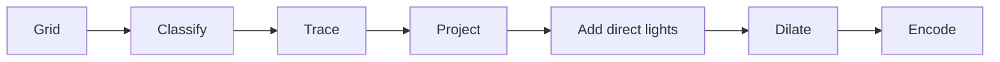

# Baking SH probes

A scene's sibling `<scene>.probes.toml` requests an incident-radiance grid
beside its mesh bakes. The `sh_probes` bake kind writes
[`SHPR`](../../assets/formats/SHPR.md), without changing mesh or reference keys.

```toml
directions = 512
spp = 4
```

| Option | Meaning |
|---|---|
| `spacing` | Requested cell width in source units; omitted uses ProbeViews' near-plane default and cell limit |
| `directions` | Positive Fibonacci sphere direction count, default in [`sh_probe_settings.py`](../../../launcher/tools/r3d/sh_probe_settings.py) |
| `spp` | Positive independent paths per direction, default in [`sh_probe_settings.py`](../../../launcher/tools/r3d/sh_probe_settings.py) |

```sh
python launcher/tools/bake/bake.py list PATH --kind sh_probes
python launcher/tools/bake/bake.py bake PATH --kind sh_probes --out OUTPUT
```

The CPU Bakes workflow produces these rows; `bake.py lock --from-run RUN`
locks its artifacts. The key names the source bytes, requested sampling,
seed, alpha threshold, two-sided materials, camera region and near plane,
scene lights, bounce depth, albedo boost and the reached tool code and pins.

The baker caches source coordinates. At pack time, `asset/engine_frame.py`
mirrors the origin, cell lattice and L1 coefficients along each reflected axis,
matching the mesh frame.



Only the requesting import's source is traced.

ProbeViews supplies the jittered cell grid, classification and relocation.
The record addresses regular cell centres; tracing uses relocated positions.
Inside cells receive synchronous six-neighbour dilation from outside cells.

Paths include direct sky and the baked sun, point and spot lights, bounced at the surface bake's depth.
Realtime lights contribute neither paths nor direct terms.
Ambient, artistic indirect intensity, tone mapping and AO do not alter transport.

For each RGB channel, $N$ path directions $\omega$ project as

```math
c_{lm} = \frac{4\pi}{N} \sum_{\omega} L(\omega)\, Y_{lm}(\omega)
```

No path can hit a sun, point or spot light, so each adds its light straight
to every outside probe. It takes one shadow ray per probe and light, no farther
than a point or spot light, and none where that light's falloff is zero:

```math
c_{lm}^{\text{direct}} = \pi \cdot \text{colour} \cdot \text{intensity} \cdot \text{falloff} \cdot \text{visibility} \cdot Y_{lm}(\omega_{\text{light}})
```

The falloff is 1 for a sun and the range window and cone of
[Bake-Method.md](Bake-Method.md#point-and-spot-lights) for a point or spot
light; a probe has no normal, so there is no cosine.

The SH basis follows Sloan 2008<sup>[[129]](../../Citations.md#sloan-2008)</sup>;
the separation of lighting coefficients and diffuse convolution follows
Ramamoorthi and Hanrahan 2001<sup>[[128]](../../Citations.md#ramamoorthi-hanrahan-2001)</sup>.
These are radiance coefficients; a diffuse consumer applies the cosine kernel.

The bake log reports cells, inside cells, wall time, bytes, primary paths
($`n_{\text{outside}} \cdot n_{\text{directions}} \cdot n_{\text{spp}}`$) and the direct lights' shadow rays. Classification rays and
secondary bounces are excluded from the primary-path count, as with reference
bake planning.
