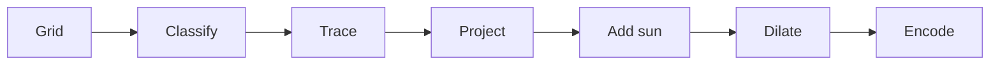

# Baking SH probes

An import's `geometry.sh_probes` requests one scene-level incident-radiance
grid beside its mesh bakes. The `sh_probes` bake kind writes
[`SHPR`](../../assets/formats/SHPR.md), without changing mesh or reference keys.

```toml
[geometry]
sh_probes = { directions = 512, spp = 4 }
```

| Option | Meaning |
|---|---|
| `spacing` | Requested cell width in source units; omitted uses ProbeViews' near-plane default and cell limit |
| `directions` | Positive Fibonacci sphere direction count, default in [`sh_probe_settings.py`](../../../launcher/tools/r3d/sh_probe_settings.py) |
| `spp` | Positive independent paths per direction, default in [`sh_probe_settings.py`](../../../launcher/tools/r3d/sh_probe_settings.py) |

```sh
python launcher/tools/bake/bake.py list PATH --kind sh_probes
python launcher/tools/bake/bake.py bake PATH --kind sh_probes --out OUTPUT
```

The CPU Bakes workflow produces these rows; `bake.py lock --from-run RUN`
locks its artifacts. The key names the source bytes, requested sampling,
seed, alpha threshold, two-sided materials, camera region and near plane,
scene lights, bounce depth, albedo boost and the reached tool code and pins.
The payload is a bake artifact; pack loading is a separate consumer.



Only the requesting import's source is traced.

ProbeViews supplies the jittered cell grid, classification and relocation.
The record addresses regular cell centres; tracing uses relocated positions.
Inside cells receive synchronous six-neighbour dilation from outside cells.

Paths include direct sky and bounced sunlight at the surface bake's bounce depth.
Ambient, artistic indirect intensity, tone mapping and AO do not alter transport.

For each RGB channel, projection is
`c_lm = (4*pi/N) sum L(w) Y_lm(w)`. A directional sun contributes
`pi * color * intensity * visibility * Y_lm(sun_direction)` separately,
using one shadow ray per outside probe and sun.

The SH basis follows Sloan 2008<sup>[[129]](../../Citations.md#sloan-2008)</sup>;
the separation of lighting coefficients and diffuse convolution follows
Ramamoorthi and Hanrahan 2001<sup>[[130]](../../Citations.md#ramamoorthi-2001)</sup>.
These are radiance coefficients; a diffuse consumer applies the cosine kernel.

The bake log reports cells, inside cells, wall time, bytes, primary paths
(`outside * directions * spp`) and sun shadow rays. Classification rays and
secondary bounces are excluded from the primary-path count, as with reference
bake planning.
