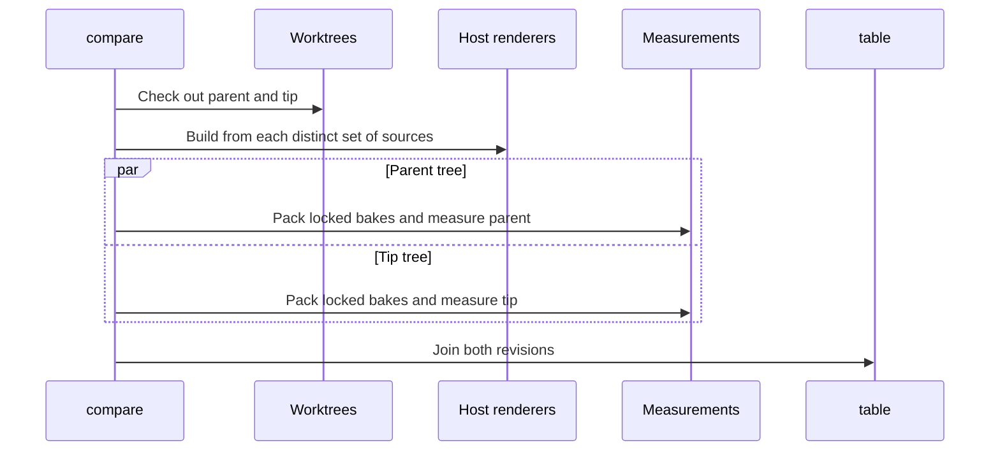

# Track scorecard

The scorecard compares the fitted Sponza and Bistro scenes. Use the
[r3d environment](../../../launcher/tools/r3d/README.md) and a checkout with Git LFS assets.
Install the scorecard's closest-point library in that environment.

```sh
python -m pip install -r launcher/tools/render/scorecard/requirements.txt
python launcher/tools/render/scorecard/scorecard.py compare \
  --parent PARENT_REF --tip TIP_REF --out launcher/tools/results/track \
  --capture parent JOB_A=parent.log --capture tip JOB_B=tip.log
```

Both refs must contain the scorecard. Each runs in a temporary detached worktree.
The report directory holds each revision's JSON and pose images.



Measurement prints wall time for each row and scene. The arms share cached source samples when
the source content, part geometry and sampling state match.

Captures are optional and repeatable. Supply A308 logs from the fitted playback suite and name each with its job ID.

| Row | Measurement owner |
|---|---|
| A308 mean and p95 | `perf/frame_profile.py` reads the playback profiles. Each capture supplies its logged mean goal and p95 ceiling by row and quarter. |
| App heap after the first frame | The playback suite samples app heap free bytes and largest block after its warm-up draw. The parser shows **not logged** for a capture without a reading. |
| See-through pixels | `see_through.py` sums pixels where the source blocks a view that the baked mesh opens, along the camera path. |
| Sky holed frames | `sky_through_walls.py` counts frames with enclosed sky absent from the source. The tracer combines the scene's source meshes in world space. |
| Held-out mean dE76 | `r3d/appearance_simplify.py` scores the fit's held-out views with its CUDA rasterizer. The cell names the sets and view count, or why the rasterizer is unavailable. |
| Front IoU and relative Hausdorff | `r3d/objects/part_shape.py` uses the object error report's part names, materials and triangle assignment. |
| Pack bytes | `r3d/build_pack.py` builds the scene's pack and the scorecard reports its length. |

Front IoU compares the orthographic silhouettes along the source part's thinnest principal axis. Relative Hausdorff takes the larger p99 of the two distances and divides it by the source part’s bounds diagonal.

Source part samples search the entire drawn mesh. Samples of the drawn triangles assigned to that part
search the entire source mesh. Libigl queries closest points in float64.

Each material class shows its lowest part IoU and highest distance. The table ranks classes by
the tip’s lowest IoU, then highest distance. The CSV lists every part and prints values to six significant digits.

## Reuse measurements

Run `measure` inside a revision to save its JSON and images. Run `table` with both JSON files to regenerate the report. Keep each JSON beside the image directory that `measure` writes.

```sh
python launcher/tools/render/scorecard/scorecard.py measure \
  --out /path/to/parent.json --capture JOB_A=/path/to/parent.log
python launcher/tools/render/scorecard/scorecard.py table \
  --parent /path/to/parent.json --tip /path/to/tip.json --out /path/to/report
```

The sheets use evenly spaced flight poses drawn at the landscape panel size at half resolution. Nearest-neighbour enlargement preserves the render pixels.

Pass `--overlay MODULE:FUNCTION` to add a tinted tip column. The callable receives the tip scene path, tip revision tree, pose rows and `(width, height)`.

Return one float mask with `height` rows and `width` columns, with values in `[0, 1]` for each pose. With `table`, use `--tip-tree` to point to the measured tip checkout.
