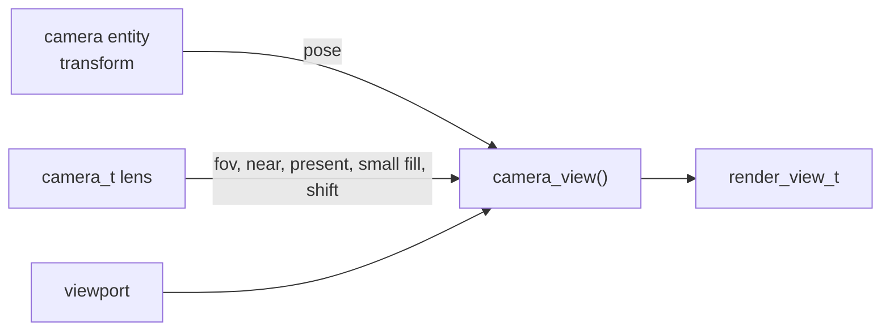

# Camera

A scene camera is two things stored apart: a pose, which is the transform of the entity that
carries it, and a lens, the `camera_t` in `scene/camera/camera.h`. This page says where each
lives and how a frame gets its view.

| Part | Holds | Lives in |
|---|---|---|
| Pose | position and rotation, roll included; scale is ignored | the camera entity's transform (`scene->locals[entity]`) |
| Lens | `half_fov_short_tan`, `near_z`, `present`, `small_fill`, `shift` | `scene->cameras[c].lens`, beside the entity index it belongs to |

## From scene to view

`camera_view(camera, pose, viewport)`
([`camera.c:5`](../../../launcher/main/scene/camera/camera.c#L5)) builds the frame's `render_view_t`
from the pose, field of view and near distance, then copies the lens's `present` and
`small_fill` onto it. `scene_camera_lens()` reads a camera by its name's `name_hash()`; `SCENE_CAMERA_FIRST` selects the first.

The field of view is stored as the tangent of half the *shorter* picture side
(`half_fov_short_tan`). `render_view_refit()` reprojects a retained pose through a new
viewport.

### Lens shift

`scene_camera_set_shift()` moves the optical centre off the picture's middle: an
off-axis frustum, the camera's *lens shift*. The shift runs along the camera's right
and up, in picture short sides, so it holds through quarter turns and render sizes.

| Use | How |
|---|---|
| A window onto a fixed rectangle | move the eye across the rectangle's plane and shift by the eye's offset over the rectangle's width: the rectangle stays framed while what lies behind it slides |
| Where it applies | `render_view_set_shift()` places `lens.cx`, `lens.cy`; `r3d_lens_fit()` scales them with the picture, so a resolution step keeps the shift |

## Which lens fields animate

Two fields are exposed to animation, listed in `CAMERA_FIELDS`
([`camera.c:12`](../../../launcher/main/scene/camera/camera.c#L17)):

| Field | Type | Meaning |
|---|---|---|
| `half_fov_short_tan` | float | the field of view, as above |
| `near_z` | float | distance of the near plane |

`present` and `small_fill` are per-camera settings and are not animated.

## How the animation binder finds them

The binder gets a table of targets, each with component references. Every entity gets its
transform as component 0. An entity that carries a camera gets a second reference at
`components[entity * 2 + 1]`, pointing at `&CAMERA_FIELDS` and that camera's `lens`, and its
`component_count` becomes 2 ([`scene_animation.c:38`](../../../launcher/main/scene/scene_animation.c#L38)).
A clip then names `ANIM_COMPONENT_CAMERA` (`CAMR`) and a field by name; the track format and
the glTF pointer it comes from are in [Animation tracks](../animation/Animation-Tracks.md).

To make another lens field animatable, add an `ANIM_FIELD(camera_t, field, type)` row beside
the struct; nothing in the binder changes.
