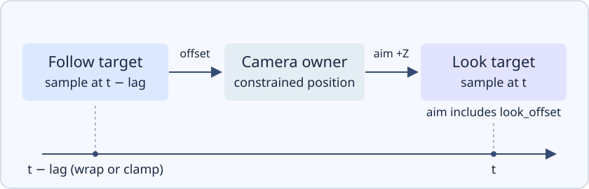

# Scene constraints

A constraint takes the owner's timeline pose as input. Follow sets the position.
Look-at aims the owner's local +Z from that position. Weight blends the result
with the input pose and preserves the owner's scale.

The scene samples a target and its ancestors at the requested time. Each
unkeyed transform field keeps its current local value. Follow clamps its
lagged sample time at zero. Look-at uses the current time and transforms
`look_offset` through the look target's world transform.

A target key starts a hand-off from the preceding target. Both targets are
sampled on every evaluation. An unset target uses the owner's position for
follow or the owner's rotation for look-at. Seek and playback produce the
same pose at the same millisecond.

Constraints run after the scene timeline and before the pose update.
The loader rejects property animation, constraints and hinges on a
target's transform path, or on the owner's ancestors. The owner's own
transform can have timeline keys.

See [Scene Files](Scene-Files.md#constraint-and-hinge) for authoring and
[Rig](../../kinematics/Rig.md) for follow frames, aiming and the pole fallback.
