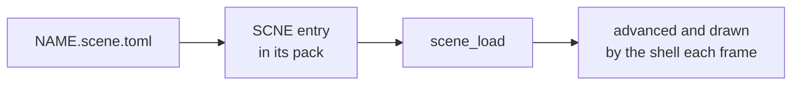

# Scenes

A scene places baked meshes, skinned meshes, lights and cameras. It is authored
as a file, baked into a pack entry, and loaded and advanced on the board.

| Page | Covers |
|---|---|
| [Scene-Files.md](Scene-Files.md) | The scene file: objects, components, what a scene must carry, every option grouped per component |
| [Scene-Manager.md](Scene-Manager.md) | The runtime: load by name, the component arrays, what the shell does each frame, hierarchy, ownership |
| [Camera.md](Camera.md) | A scene camera: pose and lens, how a view is built, lens shift, which lens fields animate |

The entry's bytes are [SCNE](../../assets/formats/SCNE.md); a first scene, step
by step, is [Building a Scene](../Building-a-Scene.md).
