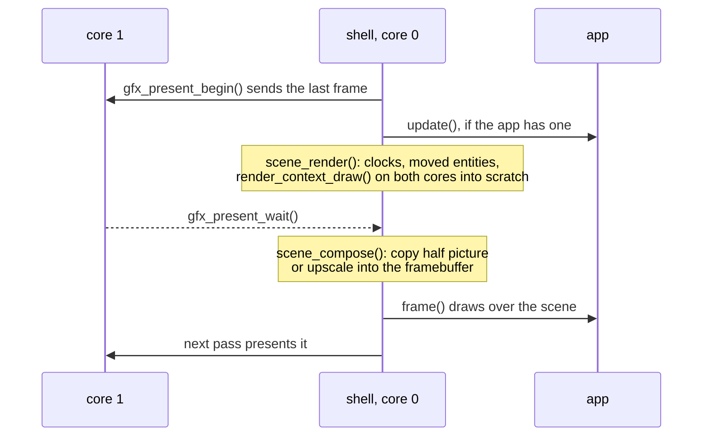

# Scenes each frame

What the shell does with the loaded scenes every frame, and the calls
beneath it. The scenes themselves are [Scene-Manager.md](Scene-Manager.md).

## Each frame

`scene_render()` touches no framebuffer, so it runs while the last frame is
still being sent.

`scene_compose()` expands the draw into the half picture when it fits
([the rule](../Rendering-Options.md#render-scale-and-the-half-picture)).
Otherwise it writes the full framebuffer, once the send is done.

If `scene_render()` did not run (the first frame after activating), compose
draws first. An app gets this overlap whenever a camera is active, with or
without `update()`.

A paused expanded picture keeps the overlap so each pass composes it again
without rendering. With no camera active the loop is the plain one.

Unpaused frames redraw the whole picture, including static scenes. A camera
needs full-framebuffer layout; in band mode the scene draws into scratch
with no destination for upscaling.

`scene_render()` runs the animation and skinning stages
([Skeleton-and-Skin.md](../animation/Skeleton-and-Skin.md#runtime)),
then resolves the hierarchy ([Hierarchy](Scene-Manager.md#hierarchy)), fills `instances[]`
from the active renderers and draws. The raster's scratch block is the engine's, sized
for the largest enabled mesh's working buffers, every enabled instance's
census slot and the render size. Dynamic resolution reserves the finest
step's raster block; the census list stays at the same offset across steps.
The block grows only when the required storage exceeds its capacity. A
taken block cannot grow, so growing takes a new one and leaves the old one
for the next rewind.

## Beneath it

Host tools and tests pass a `const render_view_t*` to `raster_draw()`
and compose its picture with `raster_upscale()`. `lens_view()` builds a
frame view from a lens (`lens_t`, `scene/camera/lens.h`) and a pose; a
scene camera's pose is its entity's world, which an [animation
track](../animation/Animation-Tracks.md) moves.

The shell's half of the API (the request poll, the two frame halves and the
release on exit) is `scene/scene_shell.h`; apps include `scene/scene.h` and
the component modules they use.
The shell does not call it by name: `shell/scene_system.c` registers it as the
engine system `scene`, at `SHELL_ORDER_SCENE`
([firmware/Frame-Loop.md](../../firmware/Frame-Loop.md#engine-systems)).
