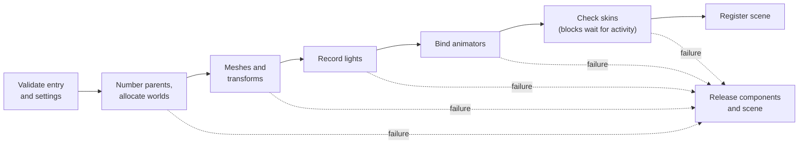

# Loading scenes

How a scene is requested, opened and released, and what memory it holds.
The world it loads into is [Scene-Manager.md](Scene-Manager.md#the-world).

## Loading

Scenes load as packs do ([Loading-Packs.md](../../assets/Loading-Packs.md#async-loading)):
the plain call blocks, `_async` returns the root at once.

<!-- generated: scene-load-scene-async-example check: python launcher/tools/gen/examples_doc.py --check -->
```c
/* load_scene_async: request on enter, activate its camera once READY, release on exit. */
#include "scene/camera/camera.h"
#include "scene/scene.h"

typedef struct {
    entity_t hall;
    bool shown;
} load_scene_example_t;

void
load_scene_enter(load_scene_example_t* visit, const char* id) {
    *visit = (load_scene_example_t){.hall = scene_load_async(id, NULL, HANDLE_NONE)};
}

void
load_scene_frame(load_scene_example_t* visit) {
    if (!visit->shown && scene_state(visit->hall) == PENDING_READY) {
        visit->shown = camera_activate(camera_first(visit->hall));
    }
}

void
load_scene_exit(load_scene_example_t* visit) {
    scene_release(visit->hall);
    *visit = (load_scene_example_t){0};
}
```
<!-- /generated: scene-load-scene-async-example -->

`scene_load_async(id, done, owner)` requests the scene's pack with the root
as its owner. The `scene` engine system's poll, after the asset store's,
opens the scene in one pass once its pack is READY, then runs `done` before
`frame()`, never inside the request. Requests made inside a callback wait
for the next pass. Until READY the root can be placed and enabled, and
`entity_find()` finds nothing in it.

| State | Lifetime |
|---|---|
| WAIT | until the pack and the scene open, or the request is cancelled |
| READY | holds the scene and its pack until released |
| FAILED | holds the root and its reason (`scene_failure()`) until released or reclaimed, oldest first |
| CANCELLED | holds nothing; no callback |
| NONE | a zero, stale, released or unknown root |

`scene_load(id)` runs the same open inline and returns the root READY or
FAILED; `ENTITY_NONE` only when `SCENE_ROOTS_MAX` records hold scenes. A
failure logs one reason and names it: no such scene, no run of entity slots
long enough, no memory, or no pack or an entry it could not open, or an
entity whose placement does not decompose, with the entry's id and the
pack's status. Release every root, FAILED ones too.

Owners are the asset store's: `HANDLE_NONE` is the running app's, a token
groups requests, and an entity owns requests that end with its scene.
`scene_cancel()` suppresses completion and, before READY, frees the partial
work; `scene_release()` unloads in any state.

## Ownership

A scene belongs to the app running when it was loaded. When an app exits the
shell runs its systems' `app_exit` phase, which for scenes is
`scene_unload_all()`: it releases every scene, blocking and async, and drops
the scratch, so nothing an app loaded outlives it. An app may release a scene
itself sooner.

The shell lends the manager the app arena with `scene_set_take()`. What a
scene keeps in PSRAM, and the render context's scratch, are taken from it:

| Piece | From |
|---|---|
| The scene's block, resident mesh arrays, its animators' storage | the app arena |
| The raster scratch block | the app arena |
| Skinning output and skin light storage, while the skin's entity is active; light tables | the internal heap |
| A development debug view's state | the PSRAM heap |

- `scene_release()` frees the heap pieces only. Arena memory goes back when
  the app rewinds past it, so scenes still release in any order.
- Releasing the last scene drops the scratch, so an app that marks before
  `scene_load()` may rewind after `scene_release()`.
- `scene_load()` mounts the scene's pack; `scene_load_from()` takes a pack, so
  a test can load from one it builds.
- The pack outlives the scene, which reads its entry and every skin, skeleton
  and clip it names in place.
- Static meshes copy their positions, triangles and colours into one PSRAM
  block per scene, one copy per distinct array. Skinned meshes keep reading
  the pack.
- The entry is validated before its components attach. Settings supply
  ambient and tone map before light and skin attachment.


