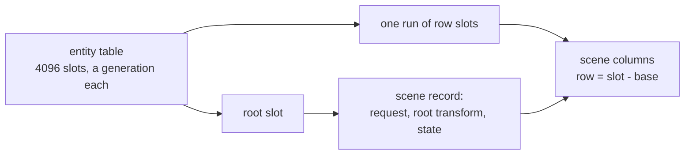
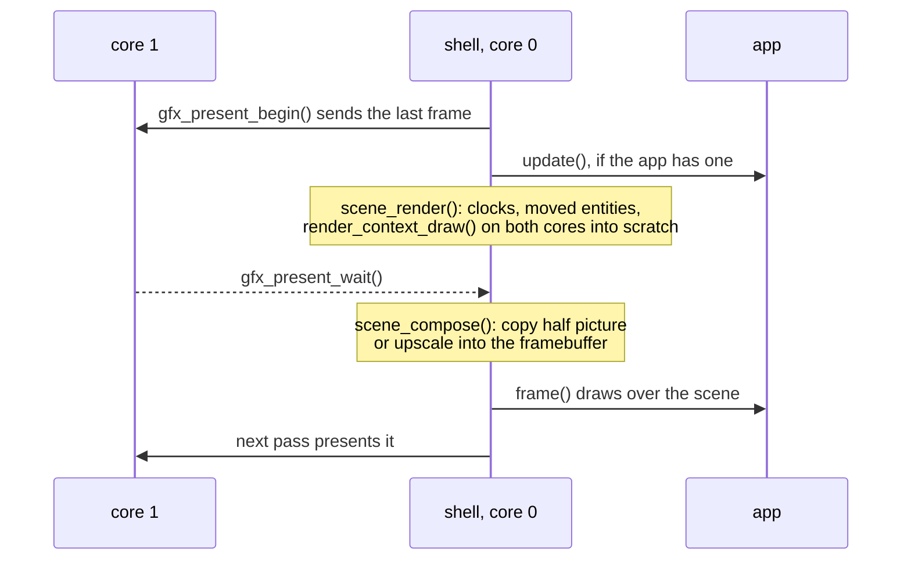
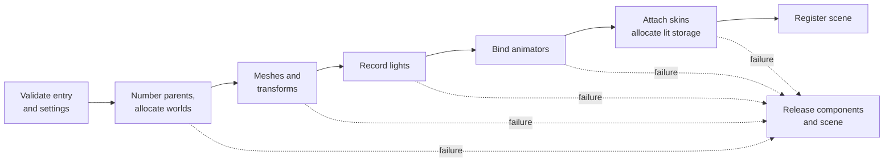

# Scene manager

Scenes are engine machinery the shell drives. An app loads a scene by name and
activates a camera; the shell advances every loaded scene and draws through the
active camera each frame, so an app never calls draw. The code is
`launcher/main/scene/`; [Building-a-Scene.md](../Building-a-Scene.md#6-draw-it)
shows an app using it.

## The world

The engine has one world. Every loaded scene is a subtree in it under its
**root entity**, which `scene_load()` returns; moving or disabling the root
moves or hides the whole scene.

An `entity_t` is a [handle](../../../launcher/main/core/handle.h): owner,
slot and generation. The world keeps a generation per slot for the whole run,
so a handle kept after its scene's release is refused, even once the slot
is issued again. A refused handle changes nothing and reads as zero, NULL
or the identity; a development device build also logs and asserts on a
stale or foreign one. A slot whose generation would wrap is retired.



| Piece | Lives | Holds |
|---|---|---|
| entity table | PSRAM, allocated once for the run | the latest generation of each of `HANDLE_SLOT_MAX + 1` slots |
| scene record | the manager, `SCENE_ROOTS_MAX` of them | its root's slot, transform and flags, its request and state, its failure |
| scene columns | the scene's block ([below](#what-a-scene-holds)) | its entities' components, indexed by row |

A root slot is issued at the request, before the scene's entity count is
known; the rows' run is issued when the scene opens. A call on an entity
finds its record by slot range, so its cost does not depend on the scene.

## What a scene holds

A scene holds packed component arrays indexed by a row: the entity's index
in the SCNE entry. Attaching clips allocates the animator's bindings and pose
buffers in PSRAM; attaching a skin allocates its model matrices, palette and
output mesh together in internal RAM. Lit colors and the world-space normal
palette use a separate internal RAM block when a skin is attached and the
scene has directional lights or nonzero ambient. A baked-only scene reserves
no runtime-light storage. The first light allocates every existing skin's
block transactionally; attachment failure preserves the scene.

| Array | One per | Holds |
|---|---|---|
| `locals[]` | entity | canonical local position, quaternion rotation and scale, in the parent's frame; loaded placements must decompose without shear or reflection |
| parents | entity | the scene entry's `entity_parents`, read in the pack: a lower entity or none |
| `world_slots[]` | entity | its index in `worlds[]`, or none when it has no children |
| `worlds[]` | entity with children | its world matrix, kept for its children; a separate block, absent when no entity has children |
| `animators[]` | entity | optional clip configuration, layer, independent slot clocks and pose buffers |
| `skinned_renderers[]` | entity | optional SKIN and bind-mesh views, output positions, bounds and lit colors; bind-color pointers without runtime lights |
| `lights[]` | entity | optional directional light, linear color and intensity; at most `R3D_SKIN_LIGHT_MAX` attached per scene |
| `flags[]` | entity | enabled, active (enabled with every ancestor), moved since the last draw, world moved in this resolve, and changed since the last skin stage |
| `renderers[]` | entity that draws | a view of its lit mesh in the asset pack, its entity id, and its world matrix |
| `cameras[]` | camera | lens, clear color, its entity id (its pose is the entity's world) |
| `instances[]` | renderer | the list the raster draws this frame, refilled from `renderers[]` |
| `staged[]` | entity | the entities with an animator, a skin or a light, in entity order; the animation stage walks only these |
| `active_renderers[]` | renderer | the renderers whose entity is active, in renderer order; rebuilt at the resolve after an active flag flips |
| names | entity | the scene entry's, read in the pack with each name's hash; looked up only by `entity_find()` |

Array lengths come from the scene's `SCNE` entry
([SCNE.md](../../assets/formats/SCNE.md)). SCNE v5 carries entity name hashes, parents, authored lights, lighting settings, skins, animators and renderer colour-set selections.
Authored lights attach at load, and `light_set_*()` attaches or changes
them at run time; only skinned renderers are lit at run time, baked renderers
keep their pack colors. Names and immutable mesh and track views point into
the asset pack. Animator rows create animators; a camera path is an animator
on the camera's entity whose tracks bind to that entity through
`ANIM_TARGET_SELF`. Binding resolves every clip before playback.

## What an app calls

Each component has its own module in `scene/`, and every call takes the
entity: `<component>_<verb>_<field>(entity, ...)`.

| Module | Calls |
|---|---|
| `scene/scene.h` | `scene_load()`, `scene_load_from()`, `scene_load_async()`, `scene_state()`, `scene_failure()`, `scene_cancel()`, `scene_release()`, `scene_set_paused()` ([Loading](#loading)) |
| `scene/entity/entity.h` | `entity_find(within, name_hash(name))`: the first entity below `within` with that name, never a root (`scene_load()` returns it); look it up once, when the scene is READY, and keep it; `entity_next(within, after)` walks a subtree in load order; `entity_name()`, `entity_enabled()` / `_set_enabled()` (hides or shows it with its descendants), `entity_active()` (enabled with every ancestor: drawn and animated), `entity_parent()` (the root for a scene's top entities, `ENTITY_NONE` for a root), `entity_is_within()` |
| `scene/transform/transform.h` | `transform_local()` / `_set_local()`: the stored `transformf_t`, in the parent's frame; `transform_world()` / `_set_world()`: the derived world, setting it stores the local that puts it there; `transform_world_matrix()`: the same world as the `mat4f_t` the renderer draws with |
| `scene/renderer/renderer.h` | `renderer_mesh()` / `_mesh_id()`: the mesh it draws, or NULL; `renderer_set_mesh()`: draws a mesh made at run time in place of its loaded one, call again after each rebuild, false for no renderer or a skinned one; `renderer_set_skin()`: skins it by asset id |
| `scene/skin/skin.h` | `skin_set_light_mode()` ([Per-renderer lighting mode](#per-renderer-lighting-mode)) |
| `scene/animator/animator.h` | `animator_set_clips()` attaches clips and a skeleton; `animator_play()` / `_set_speed()` / `_set_paused()` / `_seek()` control its playback slots; `animator_clip_count()` / `_clip_name()` / `_clip_duration_ms()` / `_current_clip()` query them |
| `scene/camera/camera.h` | `camera_first(within)`, `camera_lens()`, `camera_activate()` (the one active camera engine-wide), `camera_deactivate()`; `camera_set_present()`, `_set_shift()` (an off-axis view along the camera's right and up in picture short sides: [Camera](Camera.md#lens-shift)), `_set_small_fill()` (defaults `SMALL_FILL_SMOOTH`: [Small fill](../frame/Coverage.md#small-fill)), `_set_skip_hidden()`; each false for a non-camera entity or an invalid value |
| `scene/light/light.h` | `light_set_color()` / `_set_intensity()` attach or update one directional light; color finite linear RGB in [0,1], intensity finite and nonnegative; a full light array or a skin without vertex colors fails without mutation; `light_color()` / `_intensity()` read it, zero when none |
| not the scene's | `render_context_set_scale()`, `render_context_set_dynamic_resolution()`, `render_context_frame()`: the render size, dynamic resolution and what the last frame drew belong to the render context the scene draws through ([Mesh-Rendering.md](../Mesh-Rendering.md#the-render-context)) |

`transformf_*` is the transform value; `transform_*` is the component.
`lens_t` (`scene/camera/lens.h`) is a camera's lens value; `camera_*` is the
component.

A new light starts white with zero intensity. Its world direction is its
entity's rotated +Y axis; moving its rotation changes skin shading next frame,
including while the pose is paused. Scene ambient and tone map are private;
SCNE settings apply ambient and tone map before authored lights attach.
All lit skins share world-space lights. Their normal palettes include entity
and joint scale through an inverse-transpose transform. Skin dirty bits are
consumed by the skin stage even when another scene is active.

Exactly one camera is active engine-wide, and it draws the active renderers of
its own scene. Several scenes may be loaded at once; activating another scene's
camera changes what is seen.

## Loading

Scenes load as packs do ([Loading-Packs.md](../../assets/Loading-Packs.md#async-loading)):
the plain call blocks, `_async` returns the root at once.

<!-- generated: scene-load-scene-async-example check: python launcher/tools/gen/examples_doc.py --check -->
```c
/* load_scene_async: request on enter, activate its camera once READY, release on exit. */
#include "scene/camera/camera.h"
#include "scene/scene.h"

typedef struct {
    entity_t hall;
    bool shown;
} load_scene_example_t;

void
load_scene_enter(load_scene_example_t* visit, const char* id) {
    *visit = (load_scene_example_t){.hall = scene_load_async(id, NULL, HANDLE_NONE)};
}

void
load_scene_frame(load_scene_example_t* visit) {
    if (!visit->shown && scene_state(visit->hall) == PENDING_READY) {
        visit->shown = camera_activate(camera_first(visit->hall));
    }
}

void
load_scene_exit(load_scene_example_t* visit) {
    scene_release(visit->hall);
    *visit = (load_scene_example_t){0};
}
```
<!-- /generated: scene-load-scene-async-example -->

`scene_load_async(id, done, owner)` requests the scene's pack with the root
as its owner. The `scene` engine system's poll, after the asset store's,
opens the scene in one pass once its pack is READY, then runs `done` before
`frame()`, never inside the request. Requests made inside a callback wait
for the next pass. Until READY the root can be placed and enabled, and
`entity_find()` finds nothing in it.

| State | Lifetime |
|---|---|
| WAIT | until the pack and the scene open, or the request is cancelled |
| READY | holds the scene and its pack until released |
| FAILED | holds the root and its reason (`scene_failure()`) until released or reclaimed, oldest first |
| CANCELLED | holds nothing; no callback |
| NONE | a zero, stale, released or unknown root |

`scene_load(id)` runs the same open inline and returns the root READY or
FAILED; `ENTITY_NONE` only when `SCENE_ROOTS_MAX` records hold scenes. A
failure logs one reason and names it: no such scene, no run of entity slots
long enough, no memory, or no pack or an entry it could not open, or an
entity whose placement does not decompose, with the entry's id and the
pack's status. Release every root, FAILED ones too.

Owners are the asset store's: `HANDLE_NONE` is the running app's, a token
groups requests, and an entity owns requests that end with its scene.
`scene_cancel()` suppresses completion and, before READY, frees the partial
work; `scene_release()` unloads in any state.

## Each frame



`scene_render()` touches no framebuffer, so it runs while the last frame is
still being sent.

`scene_compose()` expands the draw into the half picture when it fits
([the rule](../Rendering-Options.md#render-scale-and-the-half-picture)).
Otherwise it writes the full framebuffer, once the send is done.

If `scene_render()` did not run (the first frame after activating), compose
draws first. An app gets this overlap whenever a camera is active, with or
without `update()`.

A paused expanded picture keeps the overlap so each pass composes it again
without rendering. With no camera active the loop is the plain one.

Unpaused frames redraw the whole picture, including static scenes. A camera
needs full-framebuffer layout; in band mode the scene draws into scratch
with no destination for upscaling.

`scene_render()` runs the animation and skinning stages
([Skeleton-and-Skin.md](../animation/Skeleton-and-Skin.md#runtime)),
then resolves the hierarchy ([Hierarchy](#hierarchy)), fills `instances[]`
from the active renderers and draws. The raster's scratch block is the engine's, sized
for the largest enabled mesh's working buffers, every enabled instance's
census slot and the render size. Dynamic resolution reserves the finest
step's raster block; the census list stays at the same offset across steps.
The block grows only when the required storage exceeds its capacity. A
taken block cannot grow, so growing takes a new one and leaves the old one
for the next rewind.

## Hierarchy

Every entity has at most one parent, listed before it in the entry, so one
forward pass meets every parent before its children. An entity with no
parent in the entry sits under the scene's root, whose transform places the
whole scene and whose enabled flag hides it. A local transform is in
the parent's frame; a world is the parent's world times the local, an exact
`transformf_t` (content keeps parents' scale even:
[SCNE.md](../../assets/formats/SCNE.md)).

| Step | When | Does |
|---|---|---|
| `entity_set_enabled()` | the call | recomputes the active flag of the entity and every later one, so a disabled parent hides its descendants at once; each keeps its own enabled flag |
| resolve | each `scene_render()`, after animation, before the draw | rebuilds the world of each parent and active renderer whose own transform moved or whose parent's world did, in entity order; an inactive renderer's world waits until it turns active |
| draw | after the resolve | the raster reads the renderers' worlds ([Each frame](#each-frame)) |

Property clips move an entity's own transform, so a clip on a parent carries
its children in the same frame. A camera, light or skinned renderer sits
directly under the scene root: the entry check refuses one with a parent,
and a light or skin does not attach under one.

## Ownership

A scene belongs to the app running when it was loaded. When an app exits the
shell runs its systems' `app_exit` phase, which for scenes is
`scene_unload_all()`: it releases every scene, blocking and async, and drops
the scratch, so nothing an app loaded outlives it. An app may release a scene
itself sooner.

The shell lends the manager the app arena with `scene_set_take()`. What a
scene keeps in PSRAM, and the render context's scratch, are taken from it:

| Piece | From |
|---|---|
| The scene's block, resident mesh arrays, its animators' storage | the app arena |
| The raster scratch block | the app arena |
| Skinning output, skin light storage, light tables | the internal heap |
| A development debug view's state | the PSRAM heap |

`scene_release()` frees the heap pieces only. Arena memory goes back when the
app rewinds past it, so scenes still unload in any order. Unloading the last
scene also drops the scratch, so an app that marks before `scene_load()` may
rewind after `scene_release()`. A scene is opened
from an `asset_pack_t`: `scene_load()` mounts the scene's pack, and
`scene_load_from()` takes the pack, so a test can load from one it builds.

The pack outlives the scene, which reads its entry and every skin, skeleton
and clip it names in place.

Static meshes copy their positions, triangles and colours into one PSRAM block
per scene, one copy per distinct array, released on unload. Skinned meshes keep
reading the pack.

`scene_load_from()` validates the entry before attaching its components.
Settings supply ambient and tone map before light and skin attachment.



## Beneath it

Host tools and tests pass a `const render_view_t*` to `raster_draw()`
and compose its picture with `raster_upscale()`. `lens_view()` builds a
frame view from a lens (`lens_t`, `scene/camera/lens.h`) and a pose; a
scene camera's pose is its entity's world, which an [animation
track](../animation/Animation-Tracks.md) moves.

The shell's half of the API (the request poll, the two frame halves and the
release on exit) is `scene/scene_shell.h`; apps include `scene/scene.h` and
the component modules they use.
The shell does not call it by name: `shell/scene_system.c` registers it as the
engine system `scene`, at `SHELL_ORDER_SCENE`
([firmware/Frame-Loop.md](../../firmware/Frame-Loop.md#engine-systems)).

## Per-renderer lighting mode

Each skinned renderer reads its lighting mode from SKIN, direct by default;
`skin_set_light_mode()` changes it. See
[Lighting modes](../animation/Skinned-Lighting.md#lighting-modes).
