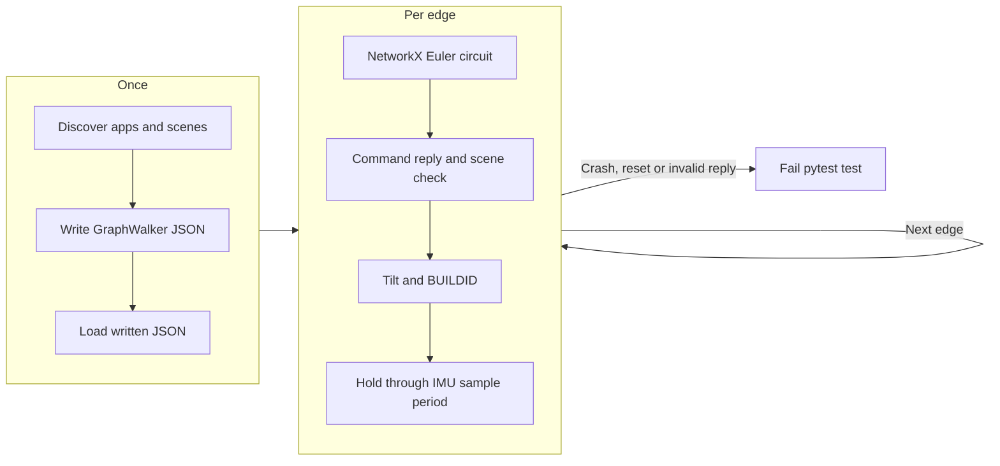

# Device Tests

Suites and checks that run on the board: one suite at a time, a full
self-test, pytest console recipes, POST and Board CI. Back to the
[Testing Guide](README.md).

Every board operation goes through `autana`, which queues on the device lock
instead of fighting for the port; `autana status` shows who holds it. See
[Device-Lock.md](../cli/Device-Lock.md).

## First board run

1. Install `autana` and put it on your `PATH` ([how](../cli/README.md)), and ESP-IDF ([which one](../tools/Build-Environment.md)).
2. Build and flash the diag image once: `autana build diag`, then `autana flash diag`.
3. Run a suite: `autana suite run_button_fsm_suite`. It ends with a `RUNSUITE_COMPLETE name=... found=1` line.

Use Git Bash on Windows. A diag build is the normal firmware plus every
suite; the *device lock* is `autana`'s queue for the one USB port, so two
commands never fight for the board.

## Which run, when

1. **While developing:** `autana suite <name>` for the area you touched, on a normal diag build (SELFTEST on, AUTORUN off, full scope).
2. **Perf captures only:** a [scoped build](../tools/Build-Variants.md#a-diagnostics-build-can-be-scoped), plus the capturing app's own docs.
3. **Before a merge:** the full self-test, `autana selftest` or `report_test_results.sh`, autorun, unattended. About 18 minutes on this board: the gate, not the everyday loop.

`autana selftest` builds, flashes and runs every suite under the device lock,
from any shell including Git Bash.

## runsuite: the everyday device loop

A diag build (`CONFIG_LAUNCHER_SELFTEST` on, `AUTORUN` off) answers
`runsuite <suite>` on the console (`selftest/console_runsuite.c`);
`autana suite <name>` sends it. It runs exactly that one registered suite
with **no rebuild and no reflash**:

```sh
autana suite run_gfx_suite
autana suite run_ui_suite
```

Flash the diag build once, then repeat as often as needed.

`runsuite` only posts a request (`console/console_frame_request.h`); the
shell's frame loop runs it at a frame boundary, because a second task drawing
to the unlocked framebuffer would corrupt the panel. A request sent before the
last finished is refused. On completion the shell prints one line:

```
RUNSUITE_COMPLETE name=<suite> found=<0|1> selected=<n> unmatched=<n>
```

so a harness never has to guess from a quiet console.

**Narrowing a suite.** `runsuite <suite> <pattern>[,<pattern>...]` runs only
tests whose name contains a pattern; `autana suite <name> --test <pattern>`
sends it ([syntax](../cli/Tests.md)).

- The `RUN_TEST` override in `launcher/test/timing.c` does the filtering, so no suite changes. Each test it reaches prints `SUITE_TEST name=<test> selected=<0|1>`.
- Patterns live for that one request; the next `runsuite` runs everything.
- In the completion line, `selected=` is how many tests ran and `unmatched=` how many patterns matched nothing. A refused pattern prints `SUITE_FILTER_REFUSED` and runs nothing.
- Only `runsuite` reads a line long enough for the most patterns `launcher/test/suites.h` allows; other verbs keep `CONSOLE_LINE_MAX`.
- `launcher/test/tests/test_suite_filter_output.py` reads the real output, so a reworded line turns the tooling tests red.

### Two device-only traps

The host runner cannot catch either; both are about what the device build does
differently.

- **64-bit asserts fail silently.** The device Unity build has 64-bit support off, so `TEST_ASSERT_EQUAL_INT64` and friends fail at runtime with `Unity 64-bit Support Disabled`, which looks like a real failure. Use `int32_t` asserts, or `TEST_ASSERT_TRUE` on a boolean built from the 64-bit expression.
- **Log before you assert.** A number logged only after a passing assert prints nothing when the assert fails, exactly when you want it. Put the `ESP_LOGI` before the `TEST_ASSERT_*`.

## Reports

A markdown report instead of a pass/fail line:

```sh
./launcher/tools/quality/report_test_results.sh    # every suite -> tools/results/
```

An app's frame-budget capture script lives in its own `tools/` and writes
under its own `tools/results/`.

Every report script only declares its capture timeout, suite, sentinel,
reporter and output location. It hands the work to
`launcher/tools/device/device_report.sh`, which:

- builds the diagnostics variant;
- flashes and captures under one held lock (`autana selftest`, or `autana suite --runs 1 --flash` for one suite);
- writes the report;
- reflashes release firmware unless given `--no-restore`.

- `autana suite`, `batch` and `selftest` end with `report: <path>` and the report's Errors section: crashes, resets, and error or assert lines, or `None.`. Read that before the raw capture.
- A report script takes its board from `--board SERIAL`, else the only board plugged in.
- Its one positional argument is the report path, ending in `.md`.
- Like every `autana` command it never runs a checkout's own `scripts/device/device.py`; see [Device-Lock](../cli/Device-Lock.md#one-copy-of-the-tools).

An app's capture rules (any free-heap precondition, the perf-scope trade-off,
its scenes) live beside the app, in its docs and `tools/`.

## Board CI

[Board CI](../../.github/workflows/board-ci.yml) runs `autana selftest` on a
self-hosted Windows runner: it builds and flashes the `diag` variant with
autorun, captures every boot-time suite and checks the running build ID
against the built image. The job summary names the board and build and counts
passes and failures; the artifact holds this checkout's `.records/device`
captures, failed runs included.

- It runs by manual dispatch: `gh workflow run board-ci.yml --ref <branch>`.
- It is not a required check. If no board frees up within the wait, the job succeeds with a neutral skipped notice.
- The [nightly scoped performance](../../launcher/tools/perf/README.md#nightly-scoped-chain) workflow's designated board also runs Board CI's steps (`scripts/ci/board-steps.sh`: self-test, then console tests) in the same overnight hold.

The `board-ci-down` issue means the boards could not run: a lane that did not start, hung or stopped early, a self-test capture that never completed, a board missing from USB, a board job stuck in the queue, or a crashed or cancelled job.
A night whose lanes all ran to the end clears it even when tests failed; those, such as a scene over its frame-time ceiling, leave the nightly run red.
Disabling the nightly workflow pauses health checks.

## Console recipes and lifecycle coverage

`launcher/test/device/` uses [pytest-embedded](https://docs.espressif.com/projects/pytest-embedded/en/latest/)
for console transport, logs and Unity results. It runs under QEMU or on a
board.

### Under QEMU

From the repository root, in a virtual environment:

```sh
python -m pip install -r launcher/test/device/requirements.txt
sh launcher/test/run_qemu_tests.sh --suite suite_console --build-only
python launcher/test/qemu/patched_qemu.py build
pytest launcher/test/device
```

The QEMU plugin merges the flash image from `flasher_args.json`. Fixtures
reuse `qemu_run.py` for device-profile PSRAM size, eFuse MAC and watchdog
settings, and each test gets its own log. The console suite sends
`RUNSUITE suite_console` and parses the Unity output with
`expect_unity_test_output()`. QEMU tests wait for boot.

### On a board

Build the shell image with Unity suites **before** taking the lock, then flash
and test inside the hold. `resolve-port` reads the board that hold selected;
pytest opens the port without flashing.

```sh
autana build diag
autana lock run -- bash -c 'autana flash diag && pytest launcher/test/device --embedded-services idf,serial --build-dir build.diag --port "$(python scripts/device/device.py resolve-port | tr -d "\r")" --skip-autoflash y'
```

Board tests share one open port per session, DTR and RTS held low. Each test
has its own DUT and log. The first exchange probes `BUILDID`; any boot banner,
reset line or crash fails the test.

### Recipes

Engine recipes live in `launcher/test/device/`; app recipes in
`launcher/main/apps/<app>/tests/test_*.yaml` (collection includes the YAML
without collecting the app's other test files). Each recipe is one test with
fixture setup and teardown.

| Step key | Meaning |
|---|---|
| `command` | one console line |
| `expect` | a regular expression for the reply |
| `timeout` | optional seconds, for slow replies such as a full screenshot |

`IMU quarter <q>` steps have only `command`. A tilt checks a `BUILDID` barrier
and holds for the sample period the startup `IMU quarter 0` probe reported.
Screenshot replies stay in the test's serial log.

### The scene tour

The tour discovers `APPS` and each console's `scenes` reply; an app that
declines `scenes` has one state. Empty app lists, malformed replies and a
discovery with no scene pairs fail the test. It writes `tour-model.json`
(GraphWalker format) beside the serial log.

- With scenes, the scene current right after OPEN is the landing state.
- App transitions connect landing states and home; scene transitions connect every ordered pair within an app. Every edge changes state.
- NetworkX loads the written model and its `eulerian_circuit` visits every edge, no JVM needed.



Every scene switch must report `current=1` on its requested key through a
fresh `scenes` query, and every edge needs a `BUILDID` heartbeat. Crash and
reset patterns come from `scripts/lib/device_capture.py` and apply to every
expectation, the Unity summary included.

CI runs the suite, recipes and tour against the instruction ratchet's shell
build and uploads the pytest logs and model. Board CI runs pytest after
selftest in the same hold, flashing the shell image with Unity suites first,
and uploads both captures.

## POST is a third thing

The **power-on self test** (`launcher/main/selftest/post.c`) is neither
runner. It answers a different question.

| | POST | Test suites |
|---|---|---|
| Ships in release | **yes** | diagnostics builds only |
| Asks | is this **board** working? | is this **code** correct? |
| Side effects | none: probe and report | draws, mutates state |
| Cost | about 95 ms | `runsuite` seconds; full run about 18 minutes |
| A failure means | this unit is faulty | this code is wrong |

It probes each I2C peripheral, flash size, heap headroom, MAC validity and the
die temperature: fifteen checks, printed as a table and summarised on one line
a production rig can grep (`POST_COMPLETE checks=N failures=N`).

Keep it non-destructive. Anything that changes device state or takes real time
belongs in a suite, because POST runs on every boot of every unit.

It runs in two phases. The SD card is tested *before* `gfx_init()`, since it
sits on its own SDMMC bus and never contends with the display; that makes it a
real mount with nothing to tear down, and an absent card is optional, not a
failure. The audio codec answers only with its power-amp rail up, so POST
raises it, probes, and lowers it again, leaving the state the shell inherits
unchanged.
