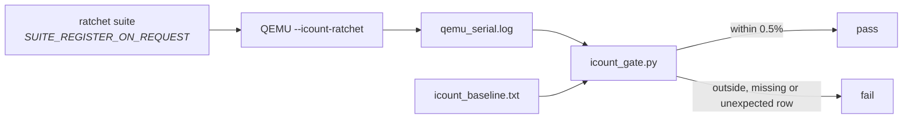

# Performance and Budgets

How tests guard cost: instruction counts, the frame watch, and the rules a
perf test follows. Back to the [Testing Guide](../Testing-Guide.md).

## Rules for a perf test

**Assert sanity, not just a log line.** A test that logs a number and asserts
nothing is decoration: a band-render test once passed while band mode rendered
nothing, because nothing checked any bytes were sent.

Assert something cheap and real beside the number (bytes sent greater than
zero, a frame time not impossibly fast).
`test_present_overlap_against_serial` is the pattern: it logs the overlap and
asserts only sanity, with no budget, because the ratio is not tuned.

**Log before asserting.** See [Device tests](Device-Tests.md#two-device-only-traps).

**Measure landscape first.** Landscape is the shipping orientation. A rotated
screen draws through a transform, and code walking its own data along one axis
meets the other orientation's memory order, so a portrait-only benchmark hides
both costs. Build the landscape case of a new perf test or scene first.

**Scoped builds are instruments, never gates.** The perf scope compiles only
the sources declared in `scope_perf.cmake`; compare its numbers only with
other scoped captures.
See [`Build-Variants.md`](../Build-Variants.md#a-diagnostics-build-can-be-scoped).

**Host wall-clock says nothing about the chip.** For timing, use the board;
for removed work, the instruction ratchet below. QEMU time is not board time
([QEMU](QEMU.md#what-a-run-is-evidence-of)).

## Hot kernel instruction ratchet

Selected serial simulation steps, raster span kernels, float math rows and UI
face/backend rows are guarded in `launcher/tools/quality/icount_baseline.txt`.
Frame totals and whole suites are excluded, so unrelated growth carries no
instruction budget. How the count works, and when it is invalid, is in
[QEMU: `--icount`](QEMU.md#counting-instructions---icount).



Run it from the repository root (CI: `.github/workflows/icount-ratchet.yml`):

```sh
./launcher/test/run_qemu_tests.sh --icount-ratchet
python launcher/tools/quality/icount_gate.py launcher/build.qemu.shell/qemu_serial.log
```

| Rule | Detail |
|---|---|
| Registration | a ratchet suite registers as `SUITE_REGISTER_ON_REQUEST(run_<name>_icount_suite)`; a new row needs that and a baseline entry |
| Tolerance | rows above or below baseline by more than 0.5%, or missing or unexpected rows, fail |
| Short rows | the C reporting helper rejects rows too short to bound clock rounding |
| Improvement | lower the baseline in the same PR |
| Increase | state the reason and update the baseline in the same PR |
| `ICOUNT_INFO` rows | carry a third `info` baseline field; never fail on changed, missing or new counts |
| Math | every row is measured |
| Compiler or IDF bump | re-baseline the kernels in one deliberate commit |

Baseline entries round to whole instructions. After two captures agree within
tolerance, regenerate:

```sh
python launcher/tools/quality/icount_gate.py --update-baseline launcher/build.qemu.shell/qemu_serial.log
```

UI face/backend pairs include identical frame setup, so their difference is
the face's instruction share. Theme and scope rows measure face state without
a backend partner; scope rows measure begin and end together. The tolerance
and capture-length rule live in `launcher/test/perf_stats.h`, which the gate
reads.

## The frame watch as a gate

The frame watch ([Firmware-Architecture.md](../Firmware-Architecture.md#the-frame-watch-no-allocating-or-logging-in-steady-state))
warns on the board. Two places turn it into a failure, both by the rule in
`profile/frame_watch.h` (`FRAME_WATCH_REPEATS` of the last
`FRAME_WATCH_WINDOW` frames, after `FRAME_WATCH_WARMUP`). Either also fails
when the watch ran out of room for an event, since a finding could hide there.

| Where | A frame is | Watched | Fails |
|---|---|---|---|
| Every host render scene (`render_all_scenes.sh`, CI) | one `draw()`; a scene with fewer frames than a warm-up and a window keeps drawing, unwritten, until it has them | `malloc`/`calloc`/`realloc`/`free` wrapped at link time, keyed by caller; anything written to stdout (where `ESP_LOG*` goes on a host) | the render. A heap site's `FRAME_WATCH` line carries an `addr2line` command; a stdout one shows what the frame printed |
| Every on-device test (the `RUN_TEST` wrapper in `test/timing.c`) | the span between two presents | the board's own watch | that test, with the `FRAME_WATCH` lines above its result. `FRAME_WATCH judged N of M tests` ends the run; a test is judged only once it presents more than `FRAME_WATCH_WARMUP` times |

`tools/render/tests/check_frame_watch.sh` proves the host check: a fixture
doing each kind of work every frame must fail naming that kind; once must
pass; three call sites taking turns must not merge; stdout must come back in
order.
