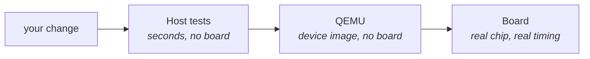
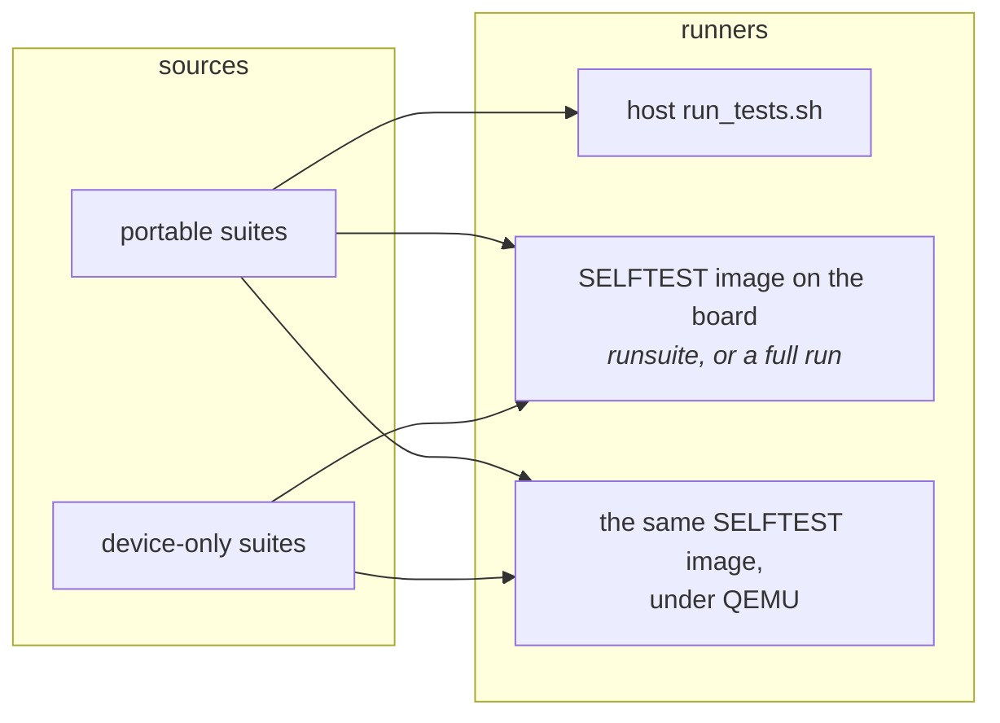

# Testing Guide

How this project tests firmware, and why. Read the topic you need; none of
them depends on reading the others first.

**First result, no hardware:** in Git Bash on Windows or a Linux terminal,
run `launcher/test/run_tests.sh`.

- It needs a host C compiler, not ESP-IDF or a board.
- A good run ends with `0 Failures` and `OK`; most of the wait is compiling.
 On Windows you need four installs first: [Git for Windows](https://git-scm.com/download/win)
(provides Git Bash), a compiler (WinLibs, which includes `make`), CMake and
Python 3; [Host tests](Host-Tests.md#install-what-you-need) has the
commands.

| Word | Means |
|---|---|
| suite | one C file of related tests, e.g. `suite_gesture.c` |
| diag build | the self-test firmware: the normal firmware plus every suite (`CONFIG_LAUNCHER_SELFTEST`) |
| scope | which sources a diag build compiles: all suites ("full"), or only the performance ones ("perf scope") |
| autorun | the diag image runs every suite at boot instead of waiting for a command |
| `BUILDID` | a console command that returns the running image's build ID; used as a "still alive" check |



Each step proves more and costs more. Stop at the first one that answers
your question.

| your question | read |
|---|---|
| How do I run the tests? | [Host tests](Host-Tests.md) |
| Why does the host stop what the board would stop? | [Host tests: device limits](Host-Tests.md#the-host-enforces-the-devices-memory-limits) |
| No board free, or no board at all | [QEMU](QEMU.md) |
| One suite on the board, no rebuild | [Device tests: runsuite](Device-Tests.md#runsuite-the-everyday-device-loop) |
| Console recipes, scene tour, pytest-embedded | [Device tests: pytest-embedded](Device-Tests.md#console-recipes-and-lifecycle-coverage) |
| Is the board itself working? | [Device tests: POST](Device-Tests.md#post-is-a-third-thing) |
| Instruction ratchet, frame watch, perf-test rules | [Performance and budgets](Performance-and-Budgets.md) |
| Which state does each device test start from? | [Test state reset](Test-State-Reset.md) |
| How do I make this code testable? | [Writing a test](Writing-a-Test.md#making-things-testable) |
| I am adding a suite | [Writing a test: adding a suite](Writing-a-Test.md#adding-a-suite) |
| Which suite covers what I changed? | [Writing a test: finding suites](Writing-a-Test.md#finding-the-suite-for-an-area) |
| What do RELEASE, DEVELOPMENT and SELFTEST gate? | [`Build-Variants.md`](../tools/Build-Variants.md) |
| I want to see a screen without flashing | [`tools/Render-Harness.md`](../tools/Render-Harness.md) |
| CI says my function is too complex | [`tools/Complexity-Gate.md`](../tools/Complexity-Gate.md) |

## Two runners, one set of suites

Portable suites (`launcher/test/suites/`, each package's `tests/`, each app's
`tests/`) compile into every runner that can take them. A device-only suite
guards its body with `#ifdef DEVICE_BUILD`; a host-only one uses the opposite
guard, defines an empty runner for the device, and registers once outside it.



| Runner | Runs | Proves | Cost |
|---|---|---|---|
| Host | portable suites | the logic is right on x86 | seconds once built |
| QEMU | every suite | the Xtensa build behaves; no timing | minutes, no board |
| Board | every suite | the same source works on this chip | `runsuite` seconds; full run about 18 minutes |

POST is a third thing, a boot-time hardware check rather than a Unity suite:
[Device tests: POST](Device-Tests.md#post-is-a-third-thing).

The host runner is the red-green-refactor loop. The board run is the
guarantee. It runs the portable suites too, because passing on a laptop does
not prove the Xtensa build behaves the same.

Release images contain no test code: the suites are never compiled in. See
[`Build-Variants.md`](../tools/Build-Variants.md#release-builds-contain-no-test-code).

## CI job inputs

Tree checks on pull requests run when a recorded input changes. A skipped
job reports success, including “Every suite under QEMU”. Branch Name,
PR ticket and Board perf judge the pull request itself and run without this gate.

On pushes and manual runs, [job-inputs](../../.github/actions/job-inputs/action.yml)
resets tracked files' and directories' access times after checkout. Its last
step records reads, the workflow and its local actions in a 90-day artifact.

The pull request gate compares changed paths with the newest unexpired
manifest on its base branch. The log and step summary show decisions and matches.

An addition or rename destination matches a tracked read with the same
extension under its nearest ancestor present on the base. Read directories
from that ancestor upward form a recursive listing and widen the search to
the top one. A removal or rename source matches this way only if its
directory was read. Extensionless files match other extensionless files.

The index and changed paths identify base directories, with the root as fallback.
The untracked `.git/job-inputs-canary` checks access times and stays outside
the manifest. Recorder reads do not establish extension coverage.

A missing manifest runs the job with a notice. A failed gate or a pull request
at the files API's limit runs all jobs. Recording fails if a canary read is
missing or no tree input besides the recorder and workflow files was read.

To add a gated job:

1. Add its output to the workflow's `inputs` job and its id to the
   `job_inputs.py affected --job JOB` arguments.
2. Add these steps immediately after checkout and last, respectively:

   ```yaml
   - uses: ./.github/actions/job-inputs
     with: {step: arm}
   # The job's existing steps go here.
   - uses: ./.github/actions/job-inputs
     if: ${{ !cancelled() }}
     with: {step: record}
   ```

3. Keep its check name and add the dependency and condition, substituting
   its id for `JOB`:

   ```yaml
   needs: inputs
   if: ${{ !cancelled() && (github.event_name != 'pull_request' || needs.inputs.result != 'success' || needs.inputs.outputs.JOB == 'true') }}
   ```

4. Use `ubuntu-24.04`. A gated job's cache keys must come from reads after
   arm, including cache hits. Linux access times must work; Windows runners
   are rejected when arming.

## Related

- [`Build-Variants.md`](../tools/Build-Variants.md): what RELEASE, DEVELOPMENT and SELFTEST gate, and the scope choice.
- [`Building-an-App.md`](../firmware/Building-an-App.md): how an app plugs into the shell, and the folder layout app suites assume.
- [`tools/Render-Harness.md`](../tools/Render-Harness.md): rendering a real screen on a host and diffing it against a capture.
- [`notes/README.md`](../notes/README.md): the hardware constraints behind the device-only performance tests.
