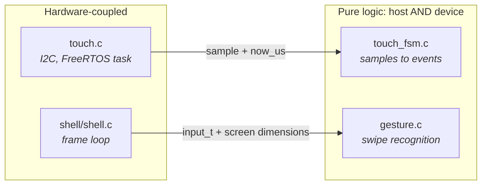

# Writing a Test

How to make code testable, what to test, the conventions every suite follows,
and the steps to add one. Back to the [Testing Guide](README.md).

The framework is Unity (ThrowTheSwitch's C library). The host runner uses a vendored copy, the device the one ESP-IDF
bundles. Same API, so suites do not care which they build against.

## The loop

1. Write the test and watch it fail.
2. Make it pass the simplest way.
3. Clean up with the tests green; back to red for the next one.

### Prove a test can fail

A green suite that was never red proves nothing. **Break the implementation
deliberately, watch the test go red, then restore.** For the touch debounce:
set `TOUCH_RELEASE_QUIET_US` to `0` and confirm exactly
`test_brief_dropout_is_not_a_release` and
`test_contact_resuming_after_a_dropout_does_not_re_press` fail, with messages
that explain why.

## What to test first

Bias toward what has already hurt. Every current test exists because of a
real bug:

- `test_brief_dropout_is_not_a_release`: the FT5x06's INT line means "data ready", not "finger down", and drops mid-touch. Reading that as a lift made a held finger flicker.
- `test_contact_resuming_after_a_dropout_does_not_re_press`: the same fault from the other side.
- The gesture boundary tests: thresholds forgiving enough for a fingertip, strict enough never to fire in normal use.

A bug found on hardware becomes a test **before** it is fixed: a host test if
the logic can be extracted, a device test if it truly needs the chip. That is
the cheapest moment to capture it.

## Making things testable

Hardware access and interpretation live in separate files. The split is the
whole technique.



The hardware side calls *into* the pure side and hands it everything it needs.
Pure modules never call back, include a hardware header or read a global.
When something feels untestable, it is usually one file doing both jobs: split
it.

### Pass time in, never read a clock

<!-- generated: declaration-touch-fsm-update check: python launcher/tools/gen/examples_doc.py --check -->
```c
void touch_fsm_update(touch_fsm_t* fsm, bool have_point, vec2i_t point, int64_t now_us);
```
<!-- /generated: declaration-touch-fsm-update -->

Taking `now_us` instead of calling `timing_now_us()` lets a test assert a 60 ms
debounce instantly, and build sequences (a dropout mid-touch) that are awkward
on real hardware. Any timeout, debounce, animation or rate limit takes time as
a parameter.

### Pass the environment in

<!-- generated: declaration-gesture-is-home-swipe check: python launcher/tools/gen/examples_doc.py --check -->
```c
bool gesture_is_home_swipe(const input_t* input, gesture_edge_t edge, int screen_w, int screen_h);
```
<!-- /generated: declaration-gesture-is-home-swipe -->

It takes the edge and both screen sizes instead of including `gfx.h`, so it
links against nothing and tests at any resolution, even one no real panel has.

## Conventions

| Rule | Why |
|---|---|
| **Suites do not own the runner.** No `setUp`/`tearDown`, no `UNITY_BEGIN`/`UNITY_END`. | Several suites share one binary; the runners own the memory audit. |
| **Each suite has a `fixture()` helper**, called at the top of every test. | A test never inherits state from the one before. |
| **A suite exercises one unit.** | Needing a second usually means the unit does too much. |
| **Warnings are errors.** | A host compiler catches mistakes the target build misses, at no cost. |
| **Name tests as sentences about behaviour:** `test_brief_dropout_is_not_a_release`, not `test_debounce_2`. | The name says what broke when it goes red. |
| **One behaviour per test.** Several assertions are fine for one behaviour. | Unrelated behaviours in one test: the second never runs after the first fails. |
| **Every test in a run has a unique name.** A loop over a table names each pass: `RUN_TEST_CASE(test_profile, scene->key, take, quarter->name)` runs it as `test_profile/<key>/<take>/<quarter>`, leaving out a NULL segment. | `--test` can then pick one case ([patterns](../cli/Tests.md)). The host run and every board capture fail on a name reported twice. |
| **Python tool tests live in a `tests/` subfolder** beside the code, even for one file. | One convention to find them. |

The device runner also resets the panel clock to the shell's state
around every test (`display_restore_system_state()` in its `setUp`/`tearDown`);
a test that times a present pins its clock with `panel_clock_pin()`. The host
runner has no panel and does neither.

Put the *why* in the assertion message, as the edge-consumption assertion
in the suite below does: the message is what a reader sees at failure.

## A minimal suite

This real suite, [`launcher/test/testing_examples/minimal_suite.c`](../../launcher/test/testing_examples/minimal_suite.c), runs
through [`launcher/test/suites/suite_testing_examples.c`](../../launcher/test/suites/suite_testing_examples.c):

<!-- generated: testing-minimal-suite-example check: python launcher/tools/gen/examples_doc.py --check -->
```c
/* A real button suite feeds samples with an explicit clock. */
#include "suites.h"
#include "unity.h"

#include "input/buttons/button_fsm.h"

static button_fsm_t b;
static int64_t now;

static void
fixture(void) {
    button_fsm_reset(&b);
    now = BUTTON_DEBOUNCE_US;
}

static void
test_a_held_button_press_is_reported_once(void) {
    fixture();
    button_fsm_update(&b, false, now);
    button_fsm_update(&b, true, ++now);
    now += BUTTON_DEBOUNCE_US;
    button_fsm_update(&b, true, now);
    TEST_ASSERT_TRUE_MESSAGE(button_fsm_take_pressed(&b), "a level held past the debounce window must produce a press");
    button_fsm_update(&b, true, ++now);
    TEST_ASSERT_FALSE_MESSAGE(button_fsm_take_pressed(&b), "an edge must be consumed by the frame that reads it");
}

void
run_minimal_example_suite(void) {
    RUN_TEST(test_a_held_button_press_is_reported_once);
}

SUITE_REGISTER(run_minimal_example_suite);
```
<!-- /generated: testing-minimal-suite-example -->

The module under test (`input/buttons/button_fsm.c`) is ordinary firmware source next
to its neighbours; only the suite is auto-discovered. Run it with
`launcher/test/run_tests.sh` (host) or `autana suite run_minimal_example_suite`
(board). See [Building-an-App.md](../firmware/Building-an-App.md) for app layout.

Package suites include `testkit/suite.h` for registration and `testkit/cleanup.h`
for deferred fixture cleanup. Engine-only runner features live in `suites.h`.
Use `ESP_PLATFORM` for hardware guards inside packages.

## Adding a suite

1. **Create the file.**

   | Suite for | Goes in |
   |---|---|
   | shell code | `launcher/test/suites/` |
   | a package | the package's `tests/` |
   | an app | the app's own `tests/` folder, so it is deleted with the app |

   Suites are found by their `suite_` name, not by folder, so a misplaced one
   still runs.
2. **Write the tests,** then `void run_<name>_suite(void)` calling `RUN_TEST(...)` for each, or `RUN_TEST_CASE(...)` for each row of a table.
3. **Register it from inside itself:** `SUITE_REGISTER(run_<name>_suite);`.
   - Nothing else lists it: no `suites.h` entry, no call in `host_main.c` or `selftest.c`.
   - Both runners discover `suite_*.c`, so it joins the full scope and runs alone with `autana suite run_<name>_suite`.
   - If a perf capture needs it, declare it in `launcher/test/scope_perf.cmake` (engine suite) or the app's `scope_perf.cmake`, with every other source the run links. See [scoped builds](../tools/Build-Variants.md#a-diagnostics-build-can-be-scoped).
4. **Name any pack it reads.** A suite that reads a pack from the tree (`asset_store_load()`, directly or via `scene_load()`) adds `SUITE_READS(run_<name>_suite, SPONZA_SCENE);` beside its registration. The host run fails when a suite reads a pack it did not name.
5. **Guard hardware with `#ifdef ESP_PLATFORM` in packages or `#ifdef DEVICE_BUILD` in engine suites,** the `RUN_TEST` line included. A portable suite can have a device-only section: `suite_job.c` runs every test on both and fences the one assertion that holds only on a host, where a job runs inline instead of on a second core.
6. **Keep big fixtures off `.bss`** (below).
7. **Stick to ISO C.** The host runner compiles with `-std=c11`, which on glibc hides POSIX-only functions (`strnlen`, `strdup`) that a Windows toolchain declares unconditionally. Suites must build on both.
8. **On the device, avoid the [two traps](Device-Tests.md#two-device-only-traps)** (64-bit asserts, logging after the assert).
9. **Break the implementation, confirm red, restore.**

### A pack waiting on its lock

When a pack's bakes lack their `bakes.lock` rows (a re-keyed bake not yet
locked), `run_tests.sh` leaves that pack out, skips the suites that name it
and prints `waiting on lock: <packs> (skipped suites: ...)` without failing.
CI stays red: the Bakes workflow's lock check and the host-tests job's bake
fetch both fail until the lock has them.

### Keeping fixtures off `.bss`

A suite's file-scope objects are firmware static data in a diagnostics build,
charged against the same internal-heap budget as everything else.

- Constant tables are `static const`.
- Mutable buffers are allocated in a test or its fixture and freed before the suite returns.
- `tools/build/build_diag_check.sh` enforces `SUITE_STATIC_DATA_LIMIT` per suite object, besides the complexity ratchet.

A local `build.diag` keeps whatever scope it was last configured with. A
leftover `CONFIG_LAUNCHER_SELFTEST_SCOPE_PERF=y` compiles the perf suite alone,
which shows a much smaller `.bss` than full scope; CI always generates a fresh
config. To measure the real figure:

```sh
rm -f launcher/build.diag/sdkconfig
./launcher/tools/build/build_diag_check.sh
idf.py -B launcher/build.diag size            # read the real .bss total
```

## Finding the suite for an area

Shell suites (gfx, ui, input, boot, render, core, services) are in
`launcher/test/suites/`; a package's in `launcher/packages/<name>/tests/`; an
app's in `launcher/main/apps/<name>/tests/` or
`launcher/main/shell/apps/<name>/tests/`. `autana suite list [text]` filters by
a substring of the name: a lookup, not an area map.

### What the graphics device suite covers

`suite_gfx.c` covers what a host structurally cannot:

| Check | Why it needs the chip |
|---|---|
| Framebuffer read-back | after `draw_rect`, exactly `w*h` pixels changed, neighbours untouched |
| Clipping at every edge, including straddling rectangles | wrong clipping would corrupt memory, not fail politely |
| Colour packing | the target's real endianness and integer promotion |
| DMA completion | `gfx_present()` returning at all guards the counting-semaphore deadlock; a regression hangs boot, loudly |
| Present/update overlap | `test_present_overlap_against_serial` logs a present overlapped with CPU work (present on core 1, `update()` on core 0) against the same work serial; sanity assert only |

Portable suites reach the rest by including the headers directly:

- `suite_gfx_present_guard.c`: the present-in-flight guard and the dirty tracker's sequencing (`gfx_present_guard.h`, `gfx_dirty.h`).
- `suite_gfx_mode.c`, `suite_gfx_band.c`: mode-grant arithmetic and the band-ring state machine.
- `suite_gfx_band_run.c`: `gfx_band_run()` over host-malloc'd band buffers. Only the DMA send and strip-bounce aliasing need the device.
- `suite_ui_launcher.c`: `ui_launcher.c`'s microui integration.

## Related

- [`Building-an-App.md`](../firmware/Building-an-App.md): the app folder layout app suites live in.
- [`notes/README.md`](../notes/README.md): the hardware constraints behind device-only tests.
