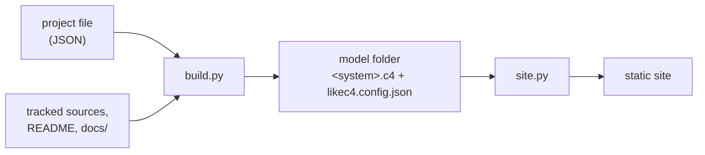

# Architecture diagram

[`scripts/architecture/`](../../scripts/architecture/) draws a C4 model of a C or C++ project from its
tracked sources and writes it as a [LikeC4](https://likec4.dev) site. The project is an argument, so
any checkout that holds this repository (as a submodule, say) can draw itself with it.



```sh
npm ci --prefix scripts/architecture
python3 scripts/architecture/build.py --project <project.json> --root <checkout> -o build/model
python3 scripts/architecture/site.py build/model -o build/site --base /<repository>/ --open index
```

[`build.py`](../../scripts/architecture/build.py) writes the model folder;
[`site.py`](../../scripts/architecture/site.py) validates it and builds the site. The site's root
lists every view; `--open index` makes it open the context diagram instead.

## What it draws

| Level | Boxes | Read from |
|---|---|---|
| Context | the system, people, outside systems | the README's title and first paragraph; the project file |
| Containers | what the system is built into | each container's describing file (its top comment, docstring or first paragraph) |
| Components | one per source folder under a scan root, nested by folder | the folder's `README.md`, else a source named for the folder (inside it, then beside it), else its doc section; else the folder has no words |
| Modules | a source and the same-stem header it includes | the files' top comments; a module with none fails the build |

Arrows count `#include`s between modules. Every arrow stays in the model, and each component view
hides one when another path in that view already joins the same boxes. The component views hide
tests, tools and generated files; the detail container's `<id>_all` view shows them, and the Context
and Containers views show everything.

## The project file

Every key is required, and a key not listed here fails the build:

```json
{
  "people": [{"id": "developer", "name": "Developer", "description": "Builds and runs it."}],
  "systems": [{"id": "engine", "name": "Engine", "description": "The library it runs.",
               "folder": "third_party/engine"}],
  "containers": [{"id": "app", "name": "App", "technology": "C++20", "file": "src/main.cpp"}],
  "relations": [{"from": "developer", "to": "app", "label": "runs"},
                {"from": "app", "to": "engine", "label": "links"}],
  "detail": "app",
  "scan": ["src", "tests"],
  "include_roots": ["src"],
  "headers": [".hpp", ".h"],
  "sources": [".cpp"],
  "vendor_includes": "^(SDL3/|imgui)"
}
```

| Key | Holds |
|---|---|
| `people` | who uses the system: `id`, `name`, `description` (what they do with it) |
| `systems` | the software around it: `id`, `name`, `description`, `folder` (what it stands for, a submodule say, or `null`); a folder the tree no longer holds fails |
| `containers` | what the system is built into: `id`, `name`, `technology`, `file` (whose opening describes it) |
| `relations` | `from`, `to` and `label` (what flows) between any of the above |
| `detail` | the container whose components the component views draw |
| `scan` | source roots; each folder under them is a component |
| `include_roots` | where an `#include` is looked up after the including file's own folder |
| `headers`, `sources` | the suffixes that make a module, in the order a folder's words are looked for |
| `vendor_includes` | a regular expression matched at the start of an include name; matching outside headers are listed in a module's metadata |

A test is a file in a `test/` or `tests/` folder, or one named `test_*`, `suite_*`, `*_test` or
`*Test`; a tool is a file in a `tools/` folder.

## Building on it

A project that knows more than its tree, such as which build image compiles each file, calls
`build.build_data()` from its own script and adds to the data before
[`likec4.py`](../../scripts/architecture/likec4.py) writes it:

| Adds | How |
|---|---|
| tags on modules | a `tags` list on any file record; a module carries every tag its files carry |
| colours for tags | `tag_colours`: tag to colour |
| more component views | `views`: each `{suffix, title, hide}` draws the detail container again without the tags in `hide` |
| build requirements | `links` and `link_notation`: dashed arrows between containers, components and `libraries` |
| deployment | a second `.c4` file in the model folder; `likec4.place()` names each container to point at |

## Links

When `origin` is a GitHub remote, each box links to its file at the merge base of `HEAD` and the
remote's default branch (`origin/HEAD`, else `origin/main`), so a site built from a local merge
still links to pages that exist. Without either ref it links at `HEAD`; without a GitHub `origin`
the boxes carry no links.
