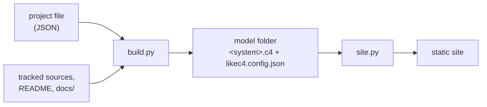

# Architecture diagram

`scripts/architecture/` draws a C4 model of a C or C++ project from its tracked sources and writes it
as a [LikeC4](https://likec4.dev) site. The project is an argument, so any checkout that holds this
repository (as a submodule, say) can draw itself with it.



```sh
npm ci --prefix scripts/architecture
python3 scripts/architecture/build.py --project <project.json> --root <checkout> -o build/model
python3 scripts/architecture/site.py build/model -o build/site --base /<repository>/
```

## What it draws

| Level | Boxes | Read from |
|---|---|---|
| Context | the system, people, outside systems | the README's title and first paragraph; the project file |
| Containers | what the system is built into | each container's describing file (its top comment, docstring or first paragraph) |
| Components | one per source folder under a scan root, nested by folder | the folder's `README.md`, else a source named for the folder, else its doc section |
| Modules | a source and the same-stem header it includes | the files' top comments; a module with none fails the build |

Arrows count `#include`s between modules. Each view hides an arrow when another path in it already
joins the same boxes; every arrow stays in the model. Tests, tools and generated files are hidden
from the default views and shown in the `_all` view.

## The project file

| Key | Holds |
|---|---|
| `people` | `[id, name, what they do with it]` for each person |
| `systems` | `[id, name, what it is, folder it stands for or null]`; a folder the tree no longer holds fails |
| `containers` | `[id, name, technology, file whose opening describes it]` |
| `relations` | `[from, to, what flows]` between any of the above |
| `drill` | the container whose components the component view draws |
| `scan` | source roots; each folder under them is a component |
| `include_roots` | where a quoted include is looked up after the including file's own folder |
| `headers`, `sources` | the suffixes that make a module, in the order a folder's words are looked for |
| `vendor_includes` | a regular expression; matching outside headers are listed in a module's metadata |

The model links every box to its file at the newest commit the remote's `main` also has, so a
site built from a local merge still links to pages that exist.
