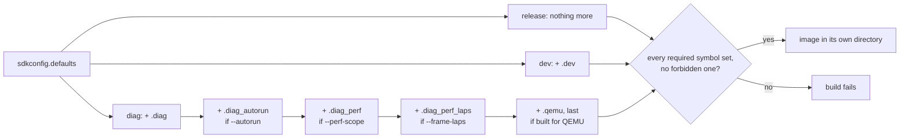

# Build variants

What a build is for is one Kconfig `choice` in
[`main/Kconfig.projbuild`][kconfig]: release (the default) or development,
exactly one ever true. Test suites (off unless set), scope and QEMU are options
layered on a development build.

[kconfig]: ../../launcher/main/Kconfig.projbuild
[math-kconfig]: ../../launcher/packages/math/Kconfig
[idf-variant]: ../../launcher/tools/build/idf_variant.sh

## The variants

| Kconfig symbol | release | dev | diag | QEMU |
|---|---|---|---|---|
| [`LAUNCHER_DEVELOPMENT`][kconfig]: instrumentation, development-only apps | no | yes | yes | yes |
| [`LAUNCHER_SELFTEST`][kconfig]: test code | no | no | yes | yes |
| [`LAUNCHER_SELFTEST_AUTORUN`][kconfig]: suites run at boot | no | no | `--autorun` | yes¹ |
| [`LAUNCHER_SELFTEST_SCOPE_PERF`][kconfig]: perf scope | no | no | `--perf-scope` | `--perf-scope` |
| [`LAUNCHER_SELFTEST_SCOPE_PERF_LAPS`][kconfig]: laps inside the frame stages | no | no | `--frame-laps`² | no |
| [`LAUNCHER_QEMU`][kconfig]: null panel | no | no | no | yes |
| [`MATH_FPU_*`][math-kconfig]: FPU seeds, fused multiply-add | yes | yes | yes | no |

¹ Except `build.qemu.shell/`, which boots into the shell.
² With `--perf-scope`. A lap's own cost moves frame times, so a lapped image is
read for its lap lines, never against the perf scope's budgets.

| Variant | Built by | Directory |
|---|---|---|
| release | `autana build rel`, `autana flash rel` | `build/` |
| dev | `autana build dev`, `autana flash dev` | `build.dev/` |
| diag | `autana build diag`, `autana flash diag`, `autana selftest` (with `--autorun`) | `build.diag/` |
| QEMU | `launcher/test/run_qemu_tests.sh` | `build.qemu/`, `build.qemu.shell/`; `.perf` suffix for the perf scope |

Each image has its own directory, so one never reconfigures another.
[Where builds live](Build-Environment.md#where-builds-live) gives the paths
and their ESP-IDF identity stamps.

## How a build picks its flags



[`idf_variant.sh`][idf-variant] holds each variant's fragments and its
required and forbidden symbols. An `sdkconfig` older than a fragment, or
out of line with those symbols, is regenerated first; the symbols are checked
again after the build.

- `autana build` needs no board and takes no board lock. It runs
  `launcher/tools/build/build.sh` with `--dev` or `--diag`, as CI does for
  every variant.
- `--configure` stops after CMake's configure step: the variant's `sdkconfig`
  and `compile_commands.json`, nothing compiled.
- `--hot-tunables` (dev, diag) makes `TUNE_HOT` values live for sweeps;
  default images keep them constant. Like `--layout-seed`, it selects the image
  built, so a suite run with it needs `--flash`.

## Release builds contain no test code

- **Suites and runner:** under `LAUNCHER_SELFTEST` the CMake conditional
  leaves them out. Not `#ifdef`-ed out: never compiled.
- **Development-only apps:** an app holding a `development_only.cmake` in its
  folder is gated on `LAUNCHER_DEVELOPMENT`, a broader flag. It ships in dev
  and diag, never in release. `main/CMakeLists.txt` globs the markers and
  names no app ([an app is a folder](../firmware/Building-an-App.md#an-app-is-a-folder)).
- **Self-test runner inside an app** (a button, its result line, the
  `selftest_run()` call): gated on `LAUNCHER_SELFTEST` in the app's own file.
  `selftest/selftest.c` joins `app_srcs` only in a SELFTEST build, so the
  symbol does not link anywhere else.

CI then checks the release image:

```sh
autana build rel
launcher/tools/build/check_release_symbols.sh launcher/build/launcher.elf
```

It fails if the image defines a suite, console or self-test symbol it names
(`unity`, `suite_`, `selftest`, a `run_<name>_suite` entry point) or the
`app_<name>` of an app with a `development_only.cmake`. Release is neither
DEVELOPMENT nor SELFTEST, so all of them are absent whichever flag gates each.

Why it matters beyond size:

- The suites draw to the framebuffer and drive the panel: fine in diag,
  unacceptable in a product. Test hooks in a shipped image are a liability.
- A development-only app is a bench tool. One that re-runs POST on entry
  cycles the audio power rail and re-mounts the SD card live, while the
  display runs undisturbed (neither shares its bus). Boot POST still runs in
  release; only this way in is compiled out.

## A diagnostics build can be scoped

A diag build compiles every suite; a full run takes the time
[which run, when](../testing/Device-Tests.md#which-run-when) gives. A scope
narrows which suites are compiled, and removes each dropped suite's `.text`
and `.bss`.

| Scope | Fragment | Carries | For |
|---|---|---|---|
| Full, the default | none | every suite, shell-owned and app-owned | every gate: `autana selftest`, `report_test_results.sh` |
| Perf | `sdkconfig.defaults.diag_perf` | the sources declared in `scope_perf.cmake` | a performance capture |

| To get a perf-scoped image | Command |
|---|---|
| left on the board, no capture | `autana flash diag --perf-scope` |
| built only, no board | `autana build diag --perf-scope` |
| under QEMU | `launcher/test/run_qemu_tests.sh --perf-scope` |

An app's frame-budget capture script, in its own `tools/`, passes the flag
through. The perf manifests are globbed from:

- `launcher/test/scope_perf.cmake`
- `launcher/main/apps/*/scope_perf.cmake`
- `launcher/main/shell/apps/*/scope_perf.cmake`

Each appends its suite sources and link dependencies to `perf_scope_srcs`,
with `CMAKE_CURRENT_LIST_DIR` paths.

- **Scoped around what a run reads, not around folders.** An app owns its perf
  sources, so deleting its folder removes its declaration.
- **Full stays the default and stays globbed.** A scope narrows only when
  named, so coverage cannot shrink by accident.
- **Every source a perf run links is declared.** A builder or fixture missing
  from a manifest fails at link.
- **Release is untouched.** Both scope symbols sit under `LAUNCHER_SELFTEST`,
  itself under `LAUNCHER_DEVELOPMENT`.

> [!WARNING]
> A perf-scoped build is not a gate: it drops behaviour coverage on purpose.
> Never take a merge decision from one, and never compare its numbers with an
> unscoped capture's: different scope, different instruction-cache layout.

**Suite static data** is gated in the full self-test:

- **Limit:** a suite object's writable static data may not exceed
  `SUITE_STATIC_DATA_LIMIT` in `launcher/tools/quality/suite_static_data_gate.py`.
- **Rule:** suite tables are `static const`; mutable test buffers are
  allocated per test and released before the suite returns, so the image
  reserves none of them at boot.
- **Scope:** CI gates its fresh full-scope `build.diag`; a local run measures
  whatever scope `build.diag` was last configured with.

## Float maths is single precision, and the build holds it there

The S3's FPU has no double: every `double` operation is a libgcc call, about
ten times a float's cost.

| Build | Flags | Effect |
|---|---|---|
| Firmware: `main` and each package | `-Werror=double-promotion -Werror=float-conversion` | a float widened to double, or a double constant in float maths, does not compile |
| `diag` objects | `launcher/tools/build/check_no_soft_double.py` | fails a function that calls a soft-double routine unless it also logs or formats |
| Host tests, render, camera-path sampler | `-ffp-contract=off` | a pinned pixel or sampled pose never depends on a fused multiply-add |
| QEMU | `MATH_FPU_RECIP=n`, `MATH_FPU_FUSED_MADD=n` | QEMU lacks the reciprocal seeds and rounds the fused product |

- Code that needs a double on purpose casts it explicitly, in the function
  that logs it. A `%f` argument is a double by the language, hence the logging
  exception in `check_no_soft_double.py`, which runs in `build_diag_check.sh`
  and CI's diag build job.
- The warnings live only in the firmware build, which compiles every portable
  source. The host builds also compile vendored code and tests that use
  `double` on purpose.
- The firmware keeps fused operations, which are faster. So a host pixel and
  a device pixel can differ by one at a truncation boundary.

## Development-only instrumentation is its own flag, not SELFTEST

| Flag | Answers | Guards |
|---|---|---|
| `LAUNCHER_DEVELOPMENT` | is this a development build, not release? | anything whose only reader is a developer: a log line, a rolling average, a per-frame timer, a debug overlay, the screenshot listener, development-only apps |
| `LAUNCHER_SELFTEST` | does this build carry the test suites? | the suites, and anything that only makes sense beside them |

This project does no telemetry: only a developer at the device or its serial
console reads a frame counter. In release such code is pure cost, flash for
the strings and cycles for the bookkeeping.

- **SELFTEST depends on DEVELOPMENT**, it does not turn it on. A config asking
  for SELFTEST alone silently gets neither, so `sdkconfig.defaults.diag` sets
  both, and the variant check above fails a diag `sdkconfig` without them.
- **The reverse is not forced.** A dev build has the profiling and logging
  without Unity and the suites' footprint: real frame timings, nothing else.
- **Neither is off by omission.** RELEASE and DEVELOPMENT are one `choice`, so
  `CONFIG_LAUNCHER_DEVELOPMENT` means "not a release build", never "something
  nobody named yet".
- **Neither gates the other's code.** They travel together in `build.diag/`,
  but a debug log is not gated on SELFTEST, and a suite is not gated on
  DEVELOPMENT alone.

A log line has a second mechanism: ESP-IDF's `CONFIG_LOG_MAXIMUM_LEVEL`
compiles `ESP_LOGI`, `ESP_LOGW` and the rest out above a severity,
project-wide. This project does not yet split that ceiling per variant
([Log-Level-Plan.md](../plans/Log-Level-Plan.md)).

A FRAME_COST bracket ([`profile/frame_cost.h`](Frame-Cost.md)) names a stage
the shell or a screen runs once per frame, and stays in the source, compiled
out of release. It only reads a clock: the code that ships is the code that
was measured, minus two clock reads per stage. A bracket put inside a stage to
answer one question is scaffolding, and leaves with its measurement.

## The Kconfig trap in REQUIRES

`unity` in `main`'s `REQUIRES` is listed unconditionally, never gated on
`CONFIG_LAUNCHER_SELFTEST`.

| ESP-IDF pass | `CONFIG_*` defined? | A Kconfig-gated entry |
|---|---|---|
| Early: component requirements (`REQUIRES`) | no | silently evaluates false |
| Later: `SRCS`, `target_compile_definitions` | yes | works |

- **Symptom:** the test sources compile with `DEVICE_BUILD` defined, and each
  fails with `fatal error: unity.h: No such file or directory`.
- **Only on a clean build directory.** An incremental build already has an
  `sdkconfig` and seems to work, so the bug sits latent until CI, or until
  someone deletes `build.diag/`.
- **Costs release nothing.** IDF puts unity in the component graph either way;
  `REQUIRES` only decides whether `main` sees its headers. With no test source
  compiled nothing references it, and `--gc-sections` drops it. The release
  binary is byte-for-byte the same size with and without the entry.

This is the norm, not a compromise:

- Unit tests verify units. `touch_fsm.c` compiles from identical sources with
  identical flags in both variants; a test framework linked beside it cannot
  change its behaviour.
- Verifying an image (POST, functional tests, checksums) is a separate
  activity that unit tests do in neither build.
- Diag carries more code and less free RAM, so a suite passing there leaves
  release more headroom, not less.
- A failing self test is logged, not fatal: the harness reads the result from
  the console, and a board that still boots is easier to investigate.

## Related

- [Testing](../testing/README.md): the suites these flags carry or
  drop, and how to run them.
- [Debugging.md](../notes/Debugging.md): which tool to reach for when the
  board misbehaves, and which build each one needs.
- [Log-Level-Plan.md](../plans/Log-Level-Plan.md): a planned compile-time
  log-severity ceiling per variant.
- [Settings-App-Plan.md](../plans/Settings-App-Plan.md): the remaining
  DEVELOPMENT/SELFTEST seam inside a development-only app.
- [QEMU.md](../testing/QEMU.md): the QEMU image and its runner.
