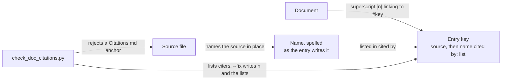

# Citing sources

[Citations](../Citations.md) lists the papers, books and specifications whose techniques
this tree uses. A document cites an entry by its key; code names the source in place.
[`check_doc_citations.py`](../../scripts/gates/check_doc_citations.py) checks every rule below.

## Adding a source

1. Append a row to the table in [Citations](../Citations.md), with a new key and any number.
2. Cite it: a superscript link to its key from a document, or its name in a code comment.
3. Run `python scripts/gates/check_doc_citations.py --fix`. It writes the row's number into
   the table and every citing document, and fills the "cited by" list.

## Rules

| Rule | Detail |
|---|---|
| An entry has a key | Lowercase words joined by hyphens, starting with a letter: `durstenfeld-1964`, `rfc4648`. Author and year for a paper, the organisation and title for a spec or a page; two papers by one author in a year add a word |
| A document cites by key | A superscript `[[n]]` linking to `Citations.md#` plus the key (`kingma-2015`), the path relative to the citing file. A numeric anchor fails |
| The number is shown, never chosen | [n] is the entry's row. `--fix` writes it in the table and in every document, so a PR adding a source never picks one |
| Code cites by name | Never a `Citations.md` anchor: the comment names the source ("Durstenfeld", "RFC 4648") |
| An entry code uses carries that name | Its line opens `` `Durstenfeld` cited by: ``, written once; a mention in another spelling is not found |
| "Cited by" lists every citer | The documents citing the key, then every source file containing the name |
| A key is permanent | An entry nothing uses is deleted and its key never reused; a new source is appended and takes the next row |
| The gate fails | A cited key with no entry, a numeric or repeated anchor, a shown number that is not its row, a source file writing a `Citations.md` anchor, a name in no source file, an entry cited nowhere, a list that differs |
