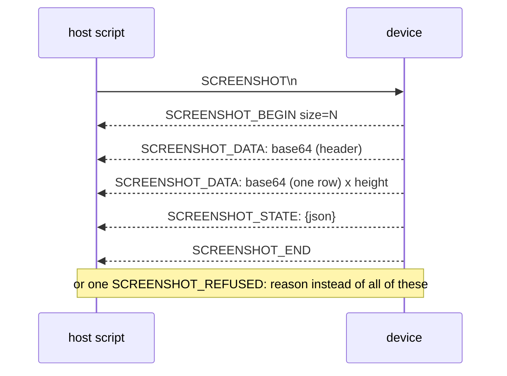
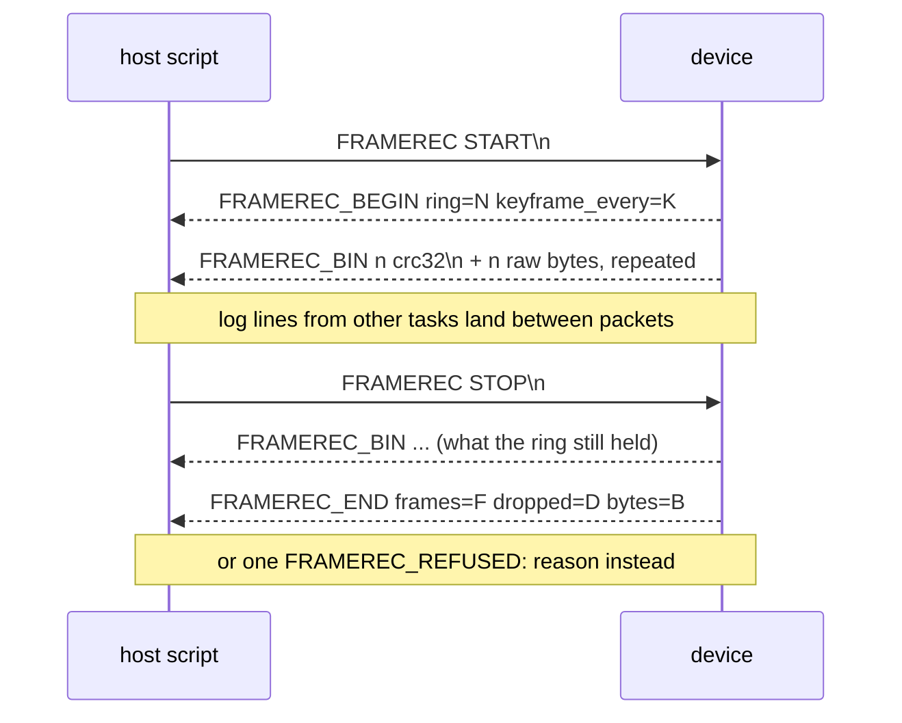

# Console dump framing

How the device sends a block of data over the same serial console that carries its logs, and
how a host script finds it. The screenshot is the model; other verbs follow the same shape.

## The frame

| Line | Carries |
|---|---|
| `SCREENSHOT_BEGIN size=N` | the byte count of the BMP that follows |
| `SCREENSHOT_DATA:` | one base64 chunk: the 54-byte header first, then rows bottom to top |
| `SCREENSHOT_STATE:` | JSON device state from the same frame as the image |
| `SCREENSHOT_END` | the stream is complete |
| `SCREENSHOT_REFUSED:` | the reason; ends the capture at once, not at the timeout |

## Rules the device follows

| Rule | Why | Where |
|---|---|---|
| Marker and data lines go through `console_emit_line()`, never `ESP_LOGx` | a fixed prefix match never has to strip a log prefix | [`console_screenshot.c:142`](../../launcher/main/shell/console/console_screenshot.c#L142) |
| `fflush(stdout)` before the first line | buffered log output must not land inside the stream | same function |
| State is passed in, not read fresh | touch and button fields describe the frame the image shows | [`console_screenshot.h:5`](../../launcher/main/shell/console/console_screenshot.h#L5) |
| Dump after the frame is drawn, before it is presented | the capture matches what is about to appear | same header |

## Rules the host follows

The decoder, [`launcher/tools/device/screenshot.py`](../../launcher/tools/device/screenshot.py), matches
`BEGIN`, `DATA:`, `STATE:`, `REFUSED:` and `END` by exact prefix and ignores every other line,
because the device keeps logging while it streams. It converts the BMP to PNG in memory with
the standard library only; opening the port is the caller's job, under the
[device lock](../cli/Device-Lock.md).

## Binary packets: FRAMEREC

`FRAMEREC START` streams each drawn frame's render input, in the
[frame record format](Frame-Record-Format.md), until `FRAMEREC STOP`. Base64
would add a third to every byte, so the stream goes as raw bytes, each run
behind a line that says how many follow.

| Line | Carries |
|---|---|
| `FRAMEREC_BEGIN ring=N keyframe_every=K` | the send ring's bytes and the keyframe interval |
| `FRAMEREC_BIN n crc32` | `n` raw stream bytes follow the newline; `crc32` is theirs, in hex |
| `FRAMEREC_END frames=F dropped=D bytes=B` | frames sent, frames dropped, stream bytes sent |
| `FRAMEREC_REFUSED:` | the reason: already recording, not recording, or no memory for the stream or the recorder |

| Rule | Why | Where |
|---|---|---|
| A packet's line and bytes go out in one `console_emit_packet()` write of at most `CONSOLE_PACKET_MAX` | no other task's output lands inside a packet | [`console.c`](../../launcher/main/console/console.c) |
| A stream's task starts with FRAMEREC START, sends what the ring holds after STOP, then `FRAMEREC_END`, and ends itself | a STOP drains the ring before the totals; a second START waits for the end | [`console_stream.c`](../../launcher/main/console/console_stream.c), [`console_framerec.c`](../../launcher/main/shell/console/console_framerec.c) |
| A frame goes into the ring whole or not at all; a full ring drops it and counts it | a dropped frame never leaves half a record; the next frame is a keyframe | [`console_framerec.c`](../../launcher/main/shell/console/console_framerec.c) |
| While FREEZE holds the picture, a frame waits up to `FRAMEREC_HELD_WAIT_MS` for room | a STEP's frame is sent, never dropped | same file |
| Development builds only | the verb and the recorder are not in a release image | [`frame_record.h`](../../launcher/main/render/record/frame_record.h) |

On the host, [`console_packets.py`](../../launcher/tools/device/console_packets.py)
splits lines from packets however the reads cut them. It joins a line that a
packet landed inside, and refuses a packet whose crc32 differs.
[`framerec.py`](../../launcher/tools/device/framerec.py) reads the records.
`autana record` holds the port and writes the joined stream to a file or
stdout ([Watch](../cli/Watch.md)).

## Other verbs

Multi-line replies end with their own marker: `PERFMON_END` after the `PERFMON_NAME` and
`PERFMON_EVENT` lines ([`console_perf_parse.h:62`](../../launcher/main/profile/console/console_perf_parse.h#L62)),
`SOUND_END` ([`console_sound.c:48`](../../launcher/main/sound/console/console_sound.c#L48)),
`MELODY_END` ([`console_melody.c:113`](../../launcher/main/sound/console/console_melody.c#L113)).
A new verb with a multi-line reply ends it with a line starting `<VERB>_END` so a script knows when to stop
reading; see [App commands](../cli/App-Commands.md) for adding a verb.
