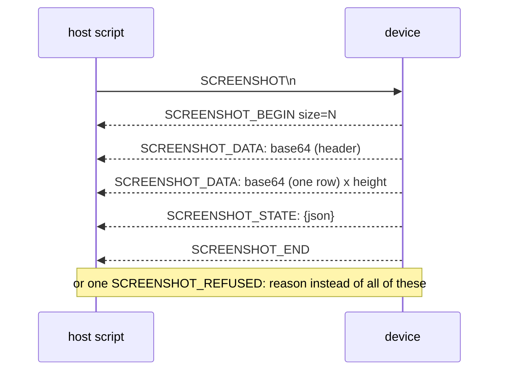

# Console dump framing

How the device sends a block of data over the same serial console that carries its logs, and
how a host script finds it. The screenshot is the model; other verbs follow the same shape.

## The frame

| Line | Carries |
|---|---|
| `SCREENSHOT_BEGIN size=N` | the byte count of the BMP that follows |
| `SCREENSHOT_DATA:` | one base64 chunk: the 54-byte header first, then rows bottom to top |
| `SCREENSHOT_STATE:` | JSON device state from the same frame as the image |
| `SCREENSHOT_END` | the stream is complete |
| `SCREENSHOT_REFUSED:` | the reason; ends the capture at once, not at the timeout |

## Rules the device follows

| Rule | Why | Where |
|---|---|---|
| Marker and data lines go through `console_emit_line()`, never `ESP_LOGx` | a fixed prefix match never has to strip a log prefix | [`console_screenshot.c:140`](../../launcher/main/console/verbs/console_screenshot.c#L140) |
| `fflush(stdout)` before the first line | buffered log output must not land inside the stream | same function |
| State is passed in, not read fresh | touch and button fields describe the frame the image shows | [`console_screenshot.h:5`](../../launcher/main/console/verbs/console_screenshot.h#L5) |
| Dump after the frame is drawn, before it is presented | the capture matches what is about to appear | same header |

## Rules the host follows

The decoder, [`launcher/tools/device/screenshot.py`](../../launcher/tools/device/screenshot.py), matches
`BEGIN`, `DATA:`, `STATE:`, `REFUSED:` and `END` by exact prefix and ignores every other line,
because the device keeps logging while it streams. It converts the BMP to PNG in memory with
the standard library only; opening the port is the caller's job, under the
[device lock](../cli/Device-Lock.md).

## Other verbs

Multi-line replies end with their own marker: `PERFMON_END` after the `PERFMON_NAME` and
`PERFMON_EVENT` lines ([`console_perf_parse.h:62`](../../launcher/main/console/verbs/console_perf_parse.h#L62)),
`SOUND_END` ([`console_sound.c:69`](../../launcher/main/console/verbs/console_sound.c#L69)),
`MELODY_END` ([`console_melody.c:108`](../../launcher/main/console/verbs/console_melody.c#L108)).
A new verb with a multi-line reply ends it with a line starting `<VERB>_END` so a script knows when to stop
reading; see [App commands](../cli/App-Commands.md) for adding a verb.
