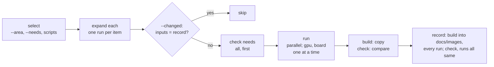

# Doc figures: producers and their runner

The plots, GIFs and renders under `docs/images/` are made by producers:
scripts kept beside the code they explain. A producer states in its own
source which images it makes and how it is run.
[`figures_runner.py`](../../launcher/tools/docs/figures_runner.py) reads
those statements, so it can tell you who makes an image and rebuild just that
image, without a list kept anywhere else.

Producers exist for the `math` area. Every other area runs from
[`render_doc_images.sh`](../../launcher/tools/render/render_doc_images.sh),
which also calls this runner for the declared ones.

## Declaring a producer

One module-level literal, read from the source without running it:

```python
from docs.producer import Producer

PRODUCER = Producer(area="math", needs=("host",), run=("--cc", "{cc}", "--out", "{out}"),
                    outputs=("stats-percentile-ranks.png",))
```

| Field | Meaning |
|---|---|
| `area` | The docs area it serves, the unit of `--area`, and its folder: `docs/images/<area>/`. |
| `needs` | What must exist before it runs, one or more. `host`: the developer's machine, with the Python modules Pillow, numpy and matplotlib; a C compiler too when `run` uses `{cc}`. `bakes`: the baked assets it draws, fetched first. `gpu`, `board`: a GPU or a board; such producers run one at a time. |
| `outputs` | Names in the area's folder. A glob (`fast-path-*.png`) where the code itself decides the names. |
| `run` | The script's arguments. `{cc}` becomes the host C compiler, `{out}` the folder the area's images go into, `{item}` the item of an `each` run. |
| `reads` | Data files the script reads, as globs. Each must match a file before anything runs. |
| `each` | One run per item. `bakes:<glob>`: each bake whose output name matches (`bake.py list`), the item being that name less its suffix. `glob:<pattern>`: each matching file, the item being its stem. Every output then names `{item}`. |

The value must be a literal: no names, calls or computed strings. Two
producers declaring the same output string is an error.

A figure that plots a library's results gets its numbers from a C probe: a
small program that calls the library and prints JSON.
[`figures.py`](../../launcher/tools/docs/figures.py) builds and runs one
(`probe_into_folder` covers the usual `--cc CC --out DIR` producer). It also
holds the one way to write each kind of file:

| Helper | Does |
|---|---|
| `save_png(picture, out)` | writes a PNG without metadata, so one picture always gives one file; `figures.py png` from a shell script |
| `save_gif(frames, out, frame_ms)` | writes a looping GIF on the global palette: each pixel takes the entry nearest it in OKLab, without dithering; `delays=` gives each frame its own delay instead of one `frame_ms` |
| `gif_from_avi(avi, out, fps, ...)` | writes a host render's AVI as such a GIF, resampled, cut and turned; `figures.py gif` from a shell script |
| `render_scene(scene, *flags, log=...)` | runs the scene viewer and returns its output |

Every doc GIF shares one 256-colour palette, so a colour has the same index
everywhere: white, black and the
[`plot_style`](../../launcher/tools/docs/plot_style.py) theme first, then
`GIF_FITTED`, fitted once to the doc GIFs. A new table changes every GIF.

## Running them

From the repository root, with a Python that has Pillow, numpy and matplotlib:
`python launcher/tools/docs/figures_runner.py COMMAND`.

| Command | What it does |
|---|---|
| `list [--area AREA]` | each producer: script, area, needs, image count |
| `which docs/images/math/frustum.png` | the producer that makes it, the data it reads, and the command that rebuilds it |
| `build --area math` | make that area's images and copy them into `docs/images/` |
| `check --area math` | make them and compare with the committed images |
| `index [--check]` | write the [figure index](Figures.md), or say what in it is stale |

`build` and `check` also take script paths in place of `--area`, or nothing for
every producer. `--needs host,bakes` keeps the producers whose needs are all
listed: what one machine without a GPU or a board can run.

With `--changed`, a run is skipped when its inputs match those recorded at its
last good run: its arguments and item, its code (import closure, the C and
requirements it counts, the tracked files that code names), the C its probes
compiled, its `reads` files and its bake's lock row. Records go to
`launcher/tools/results/doc_images/fingerprints.json`, which is not tracked
(`--fingerprints FILE` names another). A command that fails records nothing.



| Step | What happens | On failure |
|---|---|---|
| Check | The C compiler, the Python modules, each `reads` file, an item for each `each`, and every bake drawn (fetched into the bake cache), for all chosen producers | every problem printed, nothing runs, exit 2 |
| Run | The runs in parallel (`--jobs N`, the core count by default), those needing a GPU or a board one at a time, each into its own folder and log under `launcher/tools/results/doc_images/work/figures/` | a run failed, left out a declared image or wrote an undeclared one: its log end, exit 2 |
| Compare | Each image against `docs/images/` by decoded pixels | `changed IMAGE: how`, `changed IMAGE: new image`, or `orphan IMAGE` for a committed image a glob claims but no run made or skipped; exit 1 |

## The figure index

[Figures.md](Figures.md) lists every image under `docs/images/` by area:
its picture (linking to the full image), the first alt text a page gives it,
every page that shows it, and the producer that declares it. All of it is
read from the tracked pages and the producer declarations.

| Image | Picture on the page |
|---|---|
| a still | the image itself, at most the thumbnail width |
| a GIF | a copy at that width under `docs/tools/figure-thumbnails/`, made from the GIF on the global palette by `shrink_gif`, with fewer frames and the same length |

The page's generated-block check runs `index --check`, which fails when:

- the page or a copy no longer matches the images, or a copy's GIF is gone;
- an image under `docs/images/` is shown by no page;
- a tracked page shows a picture that is not a tracked file.

Rerun `index` after changing an image or a page that shows one; the doc-images
refresh ([`refresh_branch.py`](../../scripts/ci/refresh_branch.py)) does this
itself.
