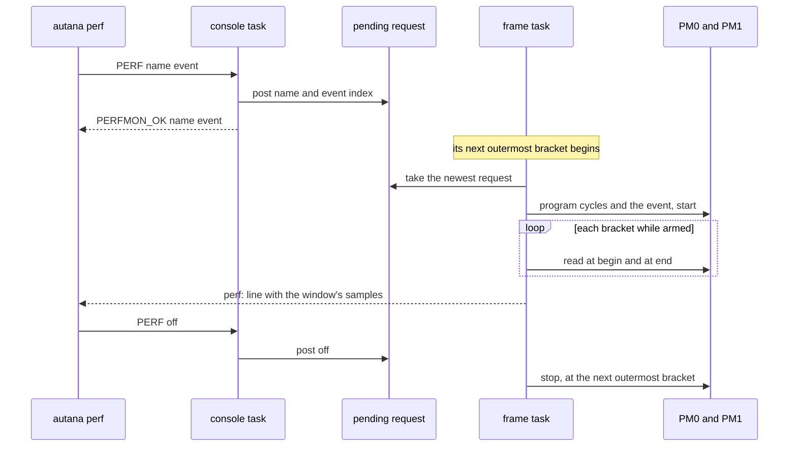

# Frame cost

`profile/frame_cost.h` measures named stages of a frame. For how drawn
pixels reach the panel, see [`gfx/README.md`](../gfx/README.md).

**Where a frame's time goes.** `profile/frame_cost.h` brackets a stage of
a frame and charges its microseconds to a name:

<!-- generated: profile-frame-cost-example check: python launcher/tools/gen/examples_doc.py --check -->
```c
/* Charge one stage's time to a name. */
#include "profile/frame_cost.h"

void draw_the_thing(void);

void
frame_cost_example(void) {
    FRAME_COST_BEGIN(began);
    draw_the_thing();
    FRAME_COST_END(began, "thing.draw");
}
```
<!-- /generated: profile-frame-cost-example -->

Every 1.5 s, under the shell's fps line, the console prints each name's
average milliseconds per frame over the window and the worst single bracket,
then the total those averages add up to (the numbers below show the line's
shape and are not measurements):

```
ms/frame avg/worst: ui.face 0.10/0.2  ui.backend 0.31/0.4  ui.paint 1.20/9.8  present 8.31/16.6  frame.rest 0.90/1.4 | total 10.82
```

`ui.build` brackets launcher construction, and `ui.paint` paints commands or bins them for band replay in development builds.
The per-verb `ui.face` and `ui.backend` brackets are enabled only in a perf-scope build; build and flash one with `autana flash diag --perf-scope`.

Charges are exclusive: a bracket nested inside another is taken out of the
outer one, so nothing is counted twice. `frame.rest` is one whole-iteration bracket
around the frame loop's body; being exclusive of everything else, it is
whatever no other bracket claimed. A stage that did not run in a window is
not listed. A bracket is two clock reads, about a microsecond each: around a
stage, never around a pixel. `FRAME_COST_SLOTS` bounds the names; a
report flags a further one with ` +N dropped`, and a charge from any task but
the frame loop's own with ` +N foreign`. On a host and in release the
brackets compile to nothing.

The raster brackets are `r3d.census`, `r3d.cull`, `r3d.transform`,
`r3d.draw`, `r3d.resolve`, `r3d.show` and `r3d.upscale`. Clip and span fill are inside
`r3d.draw`; `r3d.resolve` runs only when an attachment has a resolve hook.
`r3d.show` paints the selected debug view before upscale.
The shell brackets presentation as `present`; when the frame loop overlaps the send
with the next update, the bracket is `present.wait`, the time the frame waits
for that send to finish.

## Laps inside a bracket

A phase too short or too frequent for a bracket, such as one triangle's
set-up, is timed by a lap instead. `profile/frame_laps.h` reads the core's
cycle counter, one instruction, and keeps cycles per name on each core:

```c fragment
FRAME_LAP("r3d.draw.set_up");  /* close the running lap, run this one */
FRAME_LAP_END();               /* close it, run none */
FRAME_LAP_SINCE("r3d.draw.wait"); /* charge everything since the last boundary */
```

Starting a lap closes the one running on that core, so laps tile the time
between a core's first and last lap. A lap named `<bracket>.<phase>` splits
that bracket. Laps compile only into a lapped perf-scope image
(`autana flash diag --perf-scope --frame-laps`); elsewhere they are nothing. There the
shell prints them under the time line: one lap's own cost, measured on the
board once, then per core each lap's ms and starts per frame (the numbers
below show the line's shape and are not measurements):

```
ms/frame laps: lap 90 ns | cpu0 r3d.draw.set_up 15.000/9000 r3d.draw.fill 24.700/8000 | cpu1 r3d.draw.set_up 15.500/9100
```

A lap around a vertex or a triangle is not free next to the work it times.
Starts times one lap's cost is what the laps cost themselves; the frame-stages
chart takes it out of each lap and shows it apart. A lapped image's
brackets still run longer by that much, which is why the laps have their own
flag: the perf scope's budgets are measured without them.

## Hardware counters

One name at a time can also be read against the S3's two performance
counters, cycles and one event:

```
autana perf                             # the names seen so far, and the events
autana perf <name> [event] [seconds]    # arm, listen (10 s), disarm, summarise
autana perf off
```

`autana perf present insn 10` prints one line: cycles avg/min/max, the
event's average, the number of samples and cycles per event. The event
defaults to `insn` (retired instructions). A name is known once its bracket
has run. The command wraps the console's own `PERF <name|off|?> [event]`,
which replies `PERFMON_OK <name> <event>`, or `PERFMON_ERR` for an unknown
name or event or too many words. The newest request wins.

The counters start with the arm and run free. While one name is armed every
bracket reads them, and only that name's brackets keep a sample. The shell
prints the window's samples on a line of their own, ahead of the time line,
and `autana perf` sums them:

```
perf: stage cyc avg/min/max 112000/108000/179000 insn avg 64000 n=4
```

The counts follow the same rule as the time: own, exclusive of brackets
nested inside. They cover the frame task's core only; a pass that waits for
the other core counts that wait in its cycles. A change of arm drops the
samples of the old one, so a count is never labelled with another event. A
name longer than `FRAME_COST_NAME_MAX` fails to compile in a development
build; a name table that does not fit is counted in the listing rather than
ignored.

The console task posts the request and the frame loop, which runs in
`app_main` on CPU0, applies it between outermost brackets, so no bracket
begins under one configuration and ends under another:



## Related

- [`Build-Variants.md`](Build-Variants.md): development and release instrumentation
- [`firmware/README.md`](../firmware/README.md): the shell frame loop
- [`gfx/README.md`](../gfx/README.md): gfx send counters and overlays
