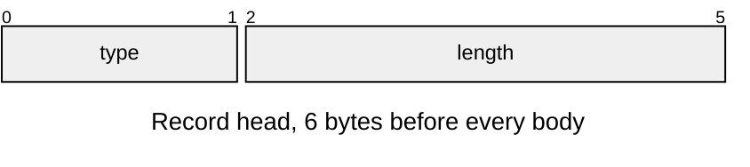
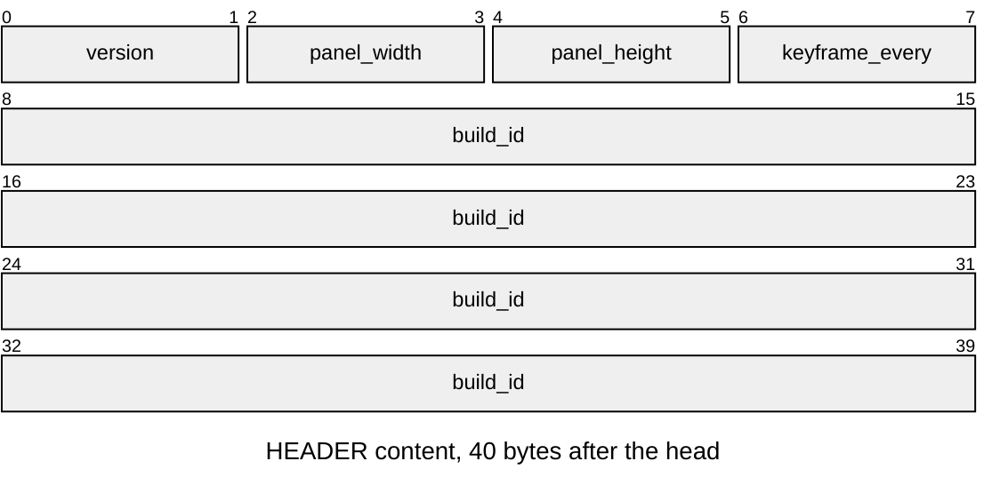
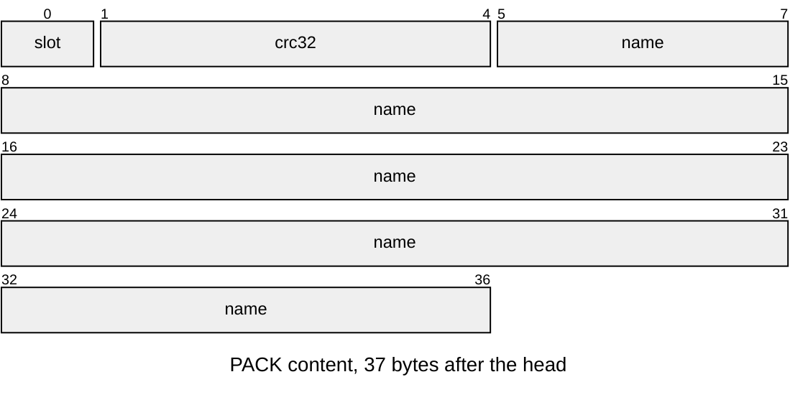
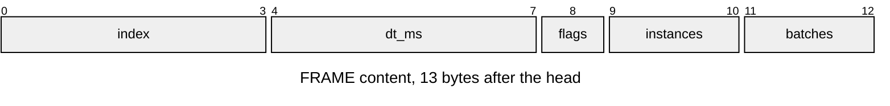
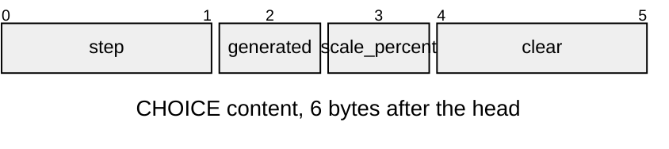
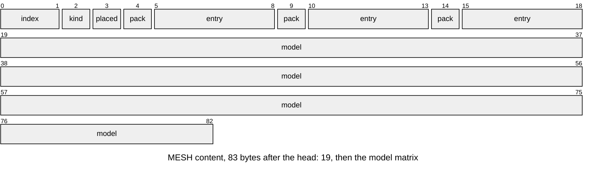
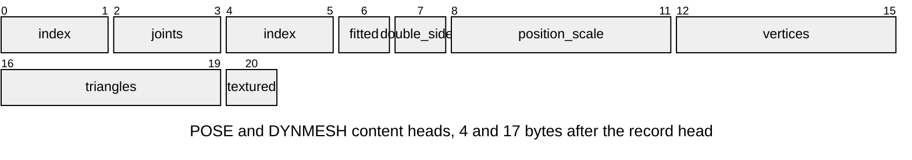
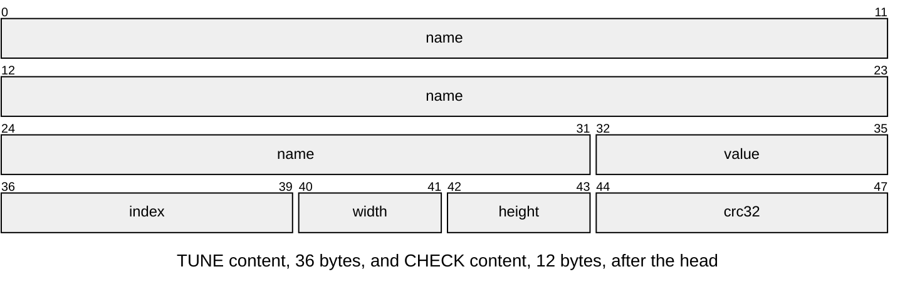

# Frame record format

The bytes of a frame record stream: each drawn frame's render input, so a
host redraws the frame with the same renderer. A board streams it over the
console ([Console framing](Console-Framing.md#binary-packets-framerec)); a host
render writes it with `--record` ([Render harness](Render-Harness.md)).

| Format | Version | Writer (C) | Reader (Python) |
|---|---|---|---|
| frame record stream | `FRAME_RECORD_VERSION` 1 | [`frame_record.c`](../../launcher/main/render/record/frame_record.c) | [`framerec.py`](../../launcher/tools/device/framerec.py) |

The layout is [`frame_record_format.h`](../../launcher/main/render/record/frame_record_format.h).
The stream is cut at the renderer's input, not at scene state and not at
pixels: what reached `render_context_draw()` is all a redraw needs.

## Records

Every record is a head, then `length` bytes of body, little-endian. A reader
skips a type it does not know by its length. The type + length framing and
the keyframe as a state snapshot follow GFXReconstruct's capture files and
trimmed captures[[123]](../Citations.md#lunarg-gfxreconstruct).

| Part | At | Size |
|---|---|---|
| Stream header | 0 | one `HEADER` record |
| Frames | after the header | per frame: `FRAME`, then its records until the next `FRAME` |

| Type | Number | Body |
|---|---|---|
| `HEADER` | 1 | version, panel size, keyframe interval, build id |
| `PACK` | 2 | a pack's slot, crc32 and name, before the first mesh that names it in a keyframe interval |
| `FRAME` | 3 | index, dt, flags, instance and batch counts |
| `VIEW` | 4 | the frame's `render_view_t`, as the engine holds it |
| `CHOICE` | 5 | the resolution step, whether the frame was generated, the scale, the clear colour |
| `MESH` | 6 | a drawn mesh: kind, where its arrays live, model matrix |
| `POSE` | 7 | a skinned mesh's palette: one `float[16]` per joint |
| `DYNMESH` | 8 | a mesh built this frame: then `float[3]` + `u8[3]` per vertex, `u16[3]` per triangle, and a textured mesh's `i16[2]` UV per vertex |
| `TUNE` | 9 | a tunable's value: on a keyframe each off its initial, else each that changed |
| `CHECK` | 10 | the crc32 of a keyframe's composed picture, carried by the next frame the sink takes |

A `MESH` names three places, each a pack slot and entry: its positions, its
colours, and for a batch the copies' places. A mesh the app made has
`FRAME_RECORD_NO_PACK` and `FRAME_RECORD_NO_ENTRY` there; its data rides in
the same frame's `POSE` or `DYNMESH`.

| Kind | Number | The mesh |
|---|---|---|
| `STATIC` | 0 | a pack mesh as it is |
| `BATCH` | 1 | a pack mesh's copies, placed by a pack batch |
| `SKINNED` | 2 | a pack mesh posed by the `POSE` of the same index |
| `BUILT` | 3 | built at run time from the `DYNMESH` of the same index |

## Rules

| Rule | Detail |
|---|---|
| Keyframes | every `FRAME_RECORD_KEYFRAME_EVERY` frames, and the frame after a drop: a `MESH` for every drawn mesh and every pack named again; between them only a `MESH` whose mesh, its arrays or matrix changed. A generated frame due one passes it to the next drawn frame |
| A frame is whole or absent | the sink takes a frame's bytes in one write or drops the frame; the next `FRAME` sets `FRAME_RECORD_AFTER_DROP` |
| Pack identity | a `PACK`'s crc32 is the one its pack header states: a reader loads the same pack bytes and checks them against it |
| Resident copies | a scene that copies pack meshes into its own memory tells the asset store (`asset_store_copies_add()`), so the copies are named by the entries they copy |
| Generated frames | a `FRAME` flagged `FRAME_RECORD_GENERATED` was warped from the last drawn frame and has no `MESH` |
| Picture check | `CHECK` hashes the half picture or the framebuffer, whichever the compose wrote, rows top to bottom; a host redraw is compared against it, as apitrace compares replayed images with references[[124]](../Citations.md#apitrace-usage) |
| Live drops | a board drops whole frames when its send ring is full and counts them, as target tracers count what their buffer lost[[125]](../Citations.md#segger-systemview); while FREEZE holds the picture it waits instead |
| Builds | development and host builds only: in a release build every `frame_record_*` call is an empty inline |
| Owners | type numbers, flags and sizes: [`frame_record_format.h`](../../launcher/main/render/record/frame_record_format.h); the interval and stage name: [`frame_record.h`](../../launcher/main/render/record/frame_record.h) |

`framerec.py summary FILE` prints a stream's header and its frame and record
counts.
