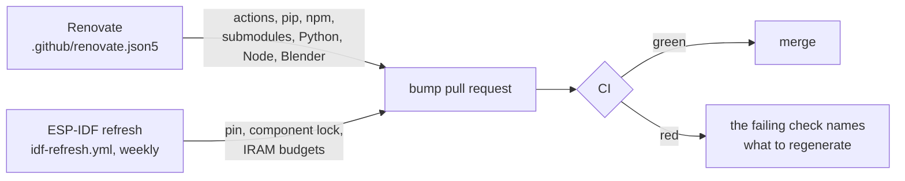

# Framework versions

Every framework the firmware and its tools build with is pinned to one exact
version, each in the one file the table below names. CI installs exactly that
version and never resolves "latest" at build time. Bump pull requests then move
each pin to the newest release, so the pins do not fall behind.

## Where each version lives

| Framework | Its one owner | A bump pull request comes from | What the bump regenerates, or which check names it |
|---|---|---|---|
| ESP-IDF (CI image, commit, esp-clang release) | [`launcher/idf-pin.json`](../../launcher/idf-pin.json); CI pulls the image from its GHCR mirror, same digest | ESP-IDF refresh, weekly | the refresh writes the pin, the component lock and the IRAM budgets, and mirrors the image; any other check that fails names its own command |
| ESP-IDF components | [`launcher/dependencies.lock`](../../launcher/dependencies.lock), within the ranges in each `idf_component.yml` | ESP-IDF refresh, weekly | the refresh re-solves it; a build that rewrites it fails CI with the diff |
| clang-format, clang-tidy | the `esp_clang` release in `launcher/idf-pin.json`; CI runs that esp-clang in the pinned image | moves with ESP-IDF | a new major reformats the tree in a commit of its own: that bump is a migration |
| QEMU and its patches | ESP-IDF's `tools/tools.json` ([`patched_qemu.py`](../../launcher/test/qemu/patched_qemu.py)) | moves with ESP-IDF | a patch that no longer applies stops the QEMU build, naming the file |
| Python | [`.python-version`](../../.python-version) | Renovate | CI proves it; a new minor waits for the bake stack's wheels |
| Python packages | `requirements*.txt` beside the tools that use them | Renovate, one PR for all | a bake package moves bake keys: the Bakes workflow bakes, then `bake.py lock --from-run N` |
| PyTorch and nvdiffrast for the GPU fit | [`requirements-gpu.txt`](../../launcher/tools/r3d/requirements-gpu.txt) | Renovate, from the dashboard | the GPU runner's environment is rebuilt by hand ([r3d README](../../launcher/tools/r3d/README.md)) |
| Node | [`.node-version`](../../.node-version) | Renovate | CI proves it |
| Node packages | `package.json` + `package-lock.json` in [`scripts/gates/`](../../scripts/gates/package.json) and [`scripts/gates/mermaid/`](../../scripts/gates/mermaid/package.json) | Renovate, one PR for all | CI proves it |
| microui, Waveshare BSP | the submodule commit (they tag no releases, so the newest commit is the latest), and the commit each vendored copy was taken from in [`third_party/vendored.json`](../../third_party/vendored.json) | Renovate, monthly | `scripts/deps/vendored.py check` fails until `vendored.py update` merges the upstream change into the copy; after a conflict, finish the merge and run `vendored.py resolved` |
| meshoptimizer, ufbx | the submodule commit, at the release tag `.gitmodules` names | Renovate, monthly | the commit is in every mesh bake key: the Bakes workflow bakes, then `bake.py lock --from-run N` |
| Blender for the skinned-mesh export | `BLENDER_VERSION` in [`blend_skin_to_glb.py`](../../launcher/tools/gltf/blend_skin_to_glb.py) | Renovate, from the dashboard | every skinned mesh re-exports: the Bakes workflow bakes, then `bake.py lock --from-run N` |
| GitHub Actions | the commit SHA in each `uses:` line | Renovate | CI proves it |
| CI runner image | `runs-on: ubuntu-24.04` | Renovate | CI proves it |

Not pinned here: what the runner image carries (the host tests' gcc, the LLVM
the bake jobs install with apt), which GitHub updates in place, and the GPU
runner's own Python, set up by hand with its environment.

A major release is a migration, not a routine bump: Renovate lists it on the
repository's Dependency Dashboard issue and opens it only when someone ticks
it there, and an ESP-IDF release line newer than the pin's tag is a warning
in the refresh run. Each bump pull request names the standing
ticket for routine bumps; a migration gets its own.

## A bump is measured on the board

A bump that can change what the board runs is not mergeable on a green CI
alone: an update should not make the firmware slower. The ESP-IDF refresh and the
microui, Waveshare BSP, meshoptimizer, ufbx and Blender bumps carry the
`needs-board-perf` label, and the Board perf check fails while it is there.
Compare the bump with main on the board, seeded,
`launcher/tools/perf/perf_compare.sh origin/main <bump branch> --suite ...`
(`--help` lists the options), post its summary on the pull request (the
improved, unchanged and regressed rows, with their magnitudes), then remove the
label. The maintainer weighs the summary: small regressions can be banked and
checked later, while one that is large, or worse everywhere, holds the bump.
A new GCC major also re-measures each optimisation flag in
`launcher/main/CMakeLists.txt`'s pinned-GCC block on and off. Bumps that cannot
change the firmware (Python and Node, their packages, Actions, the runner) are
exempt.

## Matching your machine

After an ESP-IDF bump, install the commit in `launcher/idf-pin.json` and
its tools. The resolver selects that checkout for builds and tool readers;
no profile or registry change is required. `autana help config` describes
`idf_installs` for installations outside the known roots. A missing checkout
or matching tools installation prints the commands needed to install them.

`python scripts/deps/versions.py` lists every pin beside what your machine
has; `--drift` lists only the differences. `autana build` and `autana flash` with an explicit override to
another ESP-IDF commit, clang-format and clang-tidy on another patch release of
the pinned major, and the mermaid check on another mermaid-cli each print a
note naming both versions and carry on; clang-format and clang-tidy refuse
another major. CI runs the pinned ones. To match:

| Framework | Command |
|---|---|
| ESP-IDF | in your ESP-IDF checkout, `git fetch`, `git checkout <commit from idf-pin.json>`, `git submodule update --init --recursive`, then `install.sh esp32s3` (`install.ps1` on Windows) |
| clang-format, clang-tidy | come with that ESP-IDF's esp-clang (`python tools/idf_tools.py install esp-clang`); `python scripts/lib/pinned_tool.py clang-format --pinned` prints the release |
| Python | install the version in `.python-version`, then `python -m pip install -r <requirements file>` for the tools you run |
| Node | install the version in `.node-version`, then `npm ci --prefix scripts/gates` and `npm ci --prefix scripts/gates/mermaid` |
| submodules | `git submodule update --init` |
| components | nothing: a build uses `launcher/dependencies.lock` as committed |

## How a bump arrives

Renovate reads [`.github/renovate.json5`](../../.github/renovate.json5), which
the Renovate config workflow validates, and opens its pull requests on Monday
mornings, submodules on the first of the month. Its branches and pull requests
pass the branch-name and ticket checks like any other.

The ESP-IDF refresh ([`idf-refresh.yml`](../../.github/workflows/idf-refresh.yml))
does what Renovate cannot, because only a run inside ESP-IDF can regenerate what
derives from it. It pulls the newest image of the pin's tag, has
`scripts/deps/idf_pin.py write` read the commit and esp-clang release from
inside it, copies the image to `ghcr.io/<owner>/esp-idf` with the same
digest, runs `idf.py update-dependencies`, builds each variant and rewrites
its IRAM budgets. A pull request opened by a workflow starts no checks of its
own: close and reopen it to run CI.

CI pulls the image through [`scripts/ci/idf_image.sh`](../../scripts/ci/idf_image.sh):
the mirror when it holds the pinned digest, else Docker Hub with a warning,
since anonymous Docker Hub pulls run out of quota. The mirror package must be
public for those anonymous pulls.
