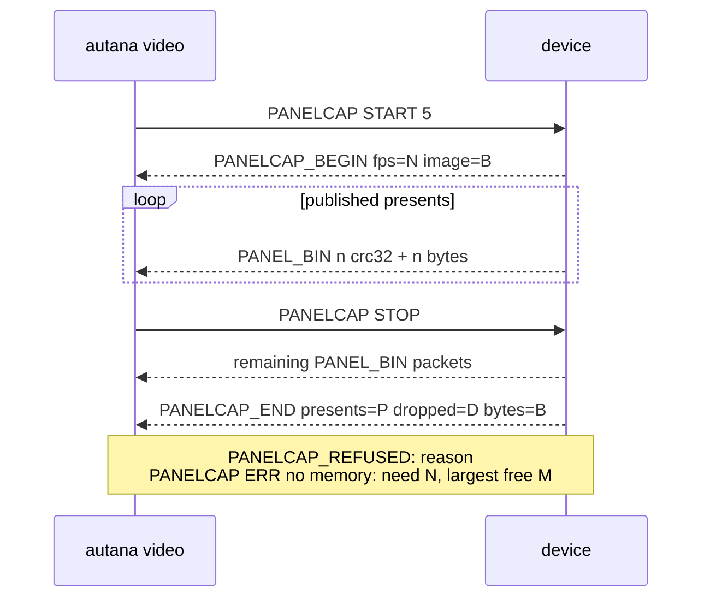
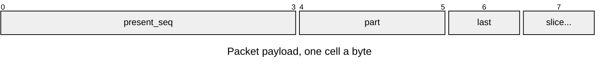
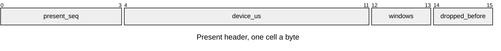
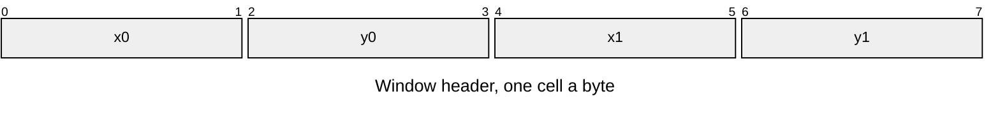

# Panel video

`PANELCAP START [fps]` streams panel windows until `PANELCAP STOP`.
The default publish rate is `PANELCAP_FPS_DEFAULT` in
[`panelcap.h`](../../launcher/main/gfx/present/capture/panelcap.h).

Each `PANEL_BIN n crc32` line ends with a newline followed by `n` raw bytes.
The CRC covers the payload, whose size limit is `CONSOLE_PACKET_BYTES_MAX`.
Header integers are little-endian. RGB565 pixels are high-byte first.

| Meaning |
|---|
| Each present with a successful panel write advances the device sequence. |
| Parts of a published present start at zero and advance by one. |
| A one marks the final part. Other parts carry zero. |
| The slices join to form one present. |

| Meaning |
|---|
| The sequence matches the continuation headers. |
| Device time in microseconds at the start of the present. |
| The count of dirty rectangles and their pixels that follow. |
| Presents since the previous publication that were unpublished due to the FPS gate, an image still being sent, or a redraw owed. Their windows merge into the next published present. Capped at 65535. |

| Meaning |
|---|
| The first pair is the inclusive top-left edge and the second pair is the exclusive bottom-right edge. |
| PackBits commands follow until the rectangle's pixel count is reached. |

| Rule | Detail |
|---|---|
| PackBits | A signed header from 0 to 127 copies n+1 pixels. A header from -127 to -1 repeats one pixel 1–n times. -128 is a no-op. |
| Storage | One `PANELCAP_IMAGE_BYTES` image, allocated at START from the app heap together with the encoder and packet buffers. |
| Copies | Capture copies successful panel writes into PSRAM while the image is free. The copy yields to split compute work while the present task holds the strip. |
| Window merge | The latest write wins. Overlapping and rectangular adjacent regions merge. Overflow collapses the list to its bounding box. |
| Publication | The FPS gate controls when a commit hands accumulated windows to the sender. Empty commits consume no FPS slot. |
| Redraw | START requests a full redraw. Captured windows can cover lost bounds from their edges. The frame owner marks any remainder dirty. Indexed mode resends its lost strips. Bands and expanded pictures redraw in full. |
| Sender | A low-priority console stream task packs the published image and releases it after the last packet or a write failure. |
| App memory | Recording uses `PANELCAP_CAPTURE_BYTES` of app heap. From the launcher, START takes the app heap for the visit. Starting an app from there ends the recording with `PANELCAP STOP app switch`. |
| Short on memory | START refuses with `PANELCAP ERR no memory: need N, largest free M` in bytes. The host exits non-zero. |
| App switch | Stops recording with `PANELCAP STOP app switch`. The usual drain and END follow. |
| STOP | Drains the published image, frees its app memory, and sends END. A stalled USB write ends the drain. |
| Totals | END counts presents fully queued for USB, dropped presents with panel writes, and queued stream bytes excluding continuation headers. |
| Refusal | `PANELCAP_REFUSED: <reason>` for bad syntax or FPS, START while on, STOP while off, or no memory for the sender. A missing image gets `PANELCAP ERR no memory: need N, largest free M`. |
| Release | A release image cannot answer START or STOP. The host releases the lock on its END deadline. |
| Reassembly | A missing, repeated or out-of-order part discards the present. The next sequence starts at part zero. |
| Host drain | The serial reader spools packets and receipt times to a temporary file. Decoding and MP4 encoding start after END. |
| Canvas | The host applies complete presents in window order and uses the screenshot turn when emitting a frame. Missing updates leave previous pixels in place. |
| Output | The MP4 samples the latest present at 30 Hz until the device's STOP timestamp. See [the command contract](../cli/Watch.md#panel-video). |

Recording adds redraw work and a PSRAM copy. Both can change frame timing.

`PANELCAP_STATS` reports the capture cost just before END.

| Fields | Measurement |
|---|---|
| `encode_us`, `write_us` | Elapsed time in PackBits and in packet framing and USB queue writes. |
| `link_failed` | Publications interrupted by a USB queue write timeout. Their windows carry into the next publication. |
| `fps_gate`, `image_busy`, `redraw_wait` | Dropped updates by first blocking reason. A present contributes at most one drop. |
| `window_us`, `copy_bytes` | Elapsed time in the present-path capture hook and bytes copied to the capture image. |
| `redraws`, `redraw_pixels` | Capture-driven redraw requests and their dirty area in pixels. Strip transfers can cover a different area. |
