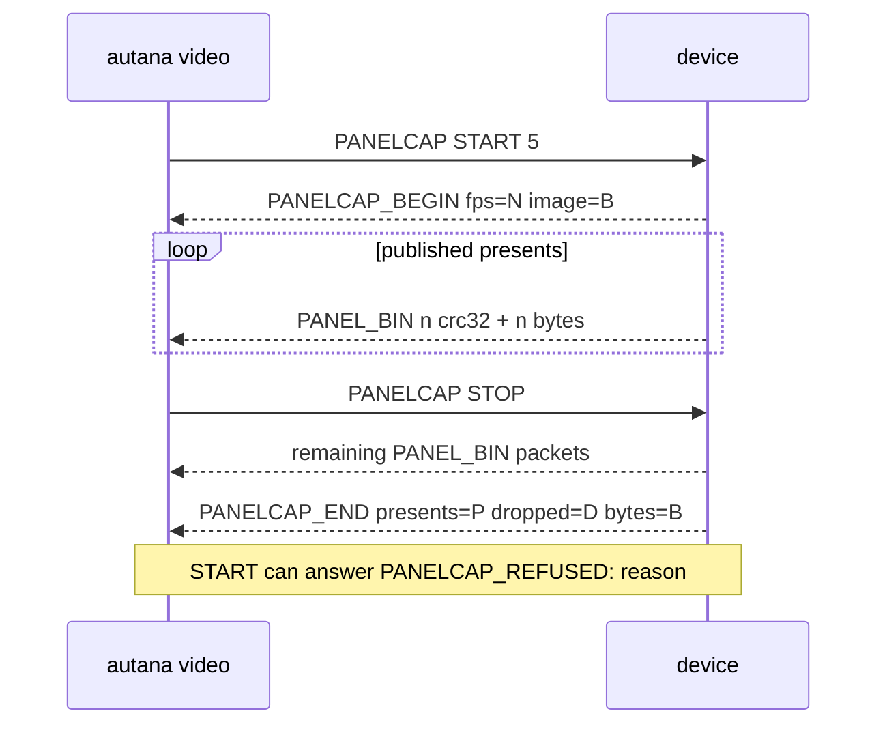
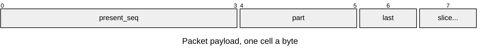
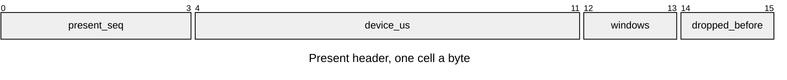
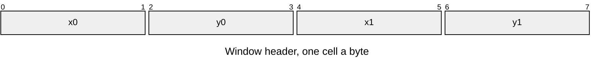

# Panel video

`PANELCAP START [fps]` streams panel windows until `PANELCAP STOP`.
The default publish rate is `PANELCAP_FPS_DEFAULT` in
[`panelcap.h`](../../launcher/main/gfx/present/capture/panelcap.h).

Each `PANEL_BIN n crc32` line ends with a newline followed by `n` raw bytes.
The CRC covers the payload, whose size limit is `CONSOLE_PACKET_BYTES_MAX`.
Header integers are little-endian. RGB565 pixels are high-byte first.

| Meaning |
|---|
| Each present attempt advances the device sequence. |
| Parts of a published present start at zero and advance by one. |
| A one marks the final part. Other parts carry zero. |
| The slices join to form one present. |

| Meaning |
|---|
| The sequence matches the continuation headers. |
| Device time in microseconds at the start of the present. |
| The count of dirty rectangles and their pixels that follow. |
| Presents merged or lost while busy since the last publication, capped at 65535. |

| Meaning |
|---|
| The first pair is the inclusive top-left edge and the second pair is the exclusive bottom-right edge. |
| PackBits commands follow until the rectangle's pixel count is reached. |

| Rule | Detail |
|---|---|
| PackBits | A signed header from 0 to 127 copies n+1 pixels. A header from -127 to -1 repeats one pixel 1-n times. -128 is a no-op. |
| Storage | One `PANELCAP_IMAGE_BYTES` PSRAM image, one resumable encoder, and up to `PANELCAP_WINDOWS_MAX` dirty rectangles. |
| Copies | Development capture copies every successful present's windows into PSRAM while the image is free. Failed panel sends leave it untouched. |
| Window merge | The latest write wins. Overlapping and rectangular adjacent regions merge. Overflow collapses the list to its bounding box. |
| Publication | The FPS gate controls when a commit hands the image to the sender. Windows from intervening presents accumulate. |
| Redraw | START requests a full redraw. If a window is lost while sending, the first writable present queues a redraw request. Publication waits for the frame owner to request it. |
| Sender | The shared console stream task packs the published image once and releases it after the last packet goes out. |
| STOP | Turns off capture, drains the published image, then sends END and frees the stream. |
| Totals | END counts published presents, merged or busy presents, and stream bytes excluding continuation headers. |
| Refusal | Invalid syntax or FPS, START while already on, STOP while off, or unavailable memory. |
| Release | A release image cannot answer START or STOP. The host releases the lock on its END deadline. |
| Reassembly | A missing, repeated or out-of-order part discards the present. The next sequence starts at part zero. |
| Canvas | The host applies complete presents in window order and uses the screenshot turn when emitting a frame. Missing updates leave previous pixels in place. |
| Output | The MP4 samples the latest present at each 30 Hz device timestamp through the final timestamp. See [the command contract](../cli/Watch.md#panel-video). |
