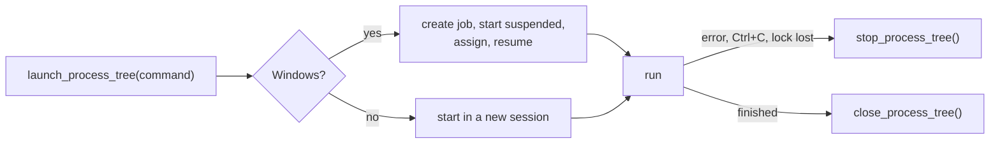

# Process trees

Why a stopped command leaves no child holding the serial port or the device lock, and how
`scripts/lib/process_tree.py` guarantees it on each OS. The device, build and perf scripts
all start their commands through it.

## The problem

A script runs a build or a flash, which runs more processes. Killing only the first leaves the
rest running, still holding a pipe, the serial port or a lock. The module starts every command
as one *tree* that can be stopped whole.

| | Linux and macOS | Windows |
|---|---|---|
| Start | a new session, so the tree has its own process group | a job object, assigned while the process is still suspended, then resumed |
| Stop | `SIGTERM` to the group, wait 2 s, then `SIGKILL` | close the job; if no job was assigned, `taskkill /F /T` |
| Parent dies first | opt in with `parent_lifetime=True`: the child gets `SIGKILL` through `PR_SET_PDEATHSIG` (Linux only) | the job is a kill-on-close job, so closing the job's last handle ends the tree |

## The functions

| Function | Does |
|---|---|
| `launch_process_tree(command, parent_lifetime=False, new_session=True, **options)` | starts the command as a stoppable tree; `options` go to `Popen` |
| `stop_process_tree(process)` | terminates the tree, waits up to 10 s, then releases the job |
| `close_process_tree(process)` | releases the Windows job, killing any descendant still in it; a no-op on POSIX |
| `install_console_interrupt_handler()` | turns Windows Ctrl-Break into `KeyboardInterrupt` so locks and ports unwind |

`run_to_end()` in `scripts/device/device.py` wraps these: it waits on the command, and stops
the tree on any error, on Ctrl+C, or the moment the held lock is lost
([`device.py:1104`](../../scripts/device/device.py#L1103)).

## Using it

| Do | Do not |
|---|---|
| Start child commands with `launch_process_tree`, finish with `close_process_tree` in a `finally` | use bare `subprocess.Popen` for a command that may spawn children |
| On Linux, start a `parent_lifetime=True` child from the thread that waits for it | start it from a worker thread that may exit first; the signal follows that thread |
| Treat the "using tree kill" message as a downgrade | rely on a job object when the message appeared |

The [device lock](../cli/Device-Lock.md) depends on this: a lock is released when its holder ends,
and the holder's children must end with it.
