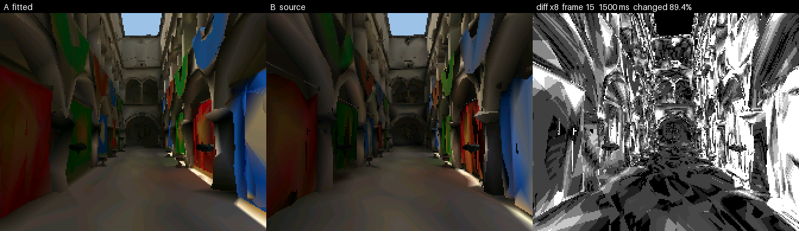
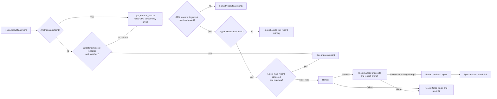
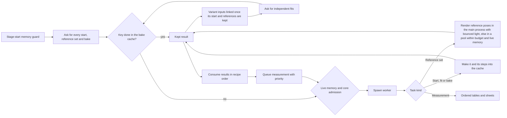
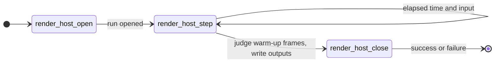
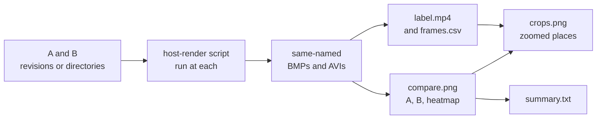

# The host render harness: real drawing code, real pixels, no board

Rendering a firmware screen into an image on a laptop: how a scene is
declared, what its pixels are pinned to, the same scenes under QEMU, and
diffing any of them against a device capture.
[`testing/README.md`](../testing/README.md) is the host/device test split
this sits inside.

On Windows, run the `.sh` commands below in Git Bash. On Linux, use a
terminal. You need a host C compiler; [the README](../../README.md#try-it-without-a-board)
lists setup commands. A **scene** is a named screen and fixture input for the
host renderer.

```sh
./launcher/tools/render/scenes/launcher_home_render_host.sh
```

Open `launcher/tools/results/render/launcher_home/landscape.bmp`
for the home screen. The reference below explains how scenes are declared,
checked, and compared with device captures.

## Viewing a scene file

```sh
sh launcher/tools/render/scene_viewer.sh PATH.scene.toml --object NAME --frames 2 -o out.bmp
```

The viewer needs no app. It builds the scene file's pack with
`build_pack.py`, including its baked meshes and camera clip, into the harness's
results folder and selects it through `AUTANA_ASSET_DIR`. The scene file can
live outside the repository; its mesh and clip references resolve beside it.
Meshes must already be baked.

Repeat `--object NAME` to enable only those mesh renderers; omit it to draw
all authored renderers. An unknown renderer reports the available names.
`--camera NAME` selects a camera; omission activates the scene's default.
Stderr names the camera's path duration in ms, and `--poses FILE` writes one
CSV row per frame of where it stands: `frame,ms`, its world position and
rotation quaternion.
The camera follows its own path at `--frames N` times `--dt MS` (defaults:
30 frames, 16 ms). `--view NAME` selects the render context's view, with
shaded as the default; an unknown name lists them. The names are the
`render_debug_view_t` table's in `render/context/render_context.c`. A debug view needs an enabled mesh.
With `--view cull`, `--counts FILE` writes one CSV row per frame of what the
cull kept and drew ([Culling.md](../render/frame/Culling.md#the-cull-seen));
without it, `--counts` is refused.

`--view boxes` draws what the renderer drew: each instance's root box under its
model matrix, one hue per mesh. `--set boxview.copies=2` keeps only meshes drawn
more than once; edges behind the drawn depth are left out, and
`--set boxview.behind=1` dims them instead (2 draws them in full).

`--set owner.name=value` sets any registered tunable before drawing; repeat it
for several values. Invalid names, values and ranges fail the render.
The viewer compiles hot tunables live. `--tunables` prints every registered
tunable with its default and range on stderr. It exits without rendering.

`--size WxH` fixes the internal render resolution through a one-step ladder;
the output still has the panel's dimensions. Each render axis must fit the
panel framebuffer, 368 by 448.

`--quarter 0|1` selects portrait or landscape (default: landscape), and
`--panel` writes the panel's native orientation. `-o FILE` saves the final
frame as BMP; without it the BMP goes to stdout. `--video FILE.avi` also saves
every frame through the shared harness's video writer. `--deps` compiles
nothing and prints what the viewer is compiled from: a `flags` line, then the
compiler's `-MM` list.

### A whole camera path, A against B, and one frame of it

```sh
sh launcher/tools/render/scene_viewer.sh PATH.scene.toml --object NAME --compare main
sh launcher/tools/render/scene_viewer.sh PATH.scene.toml --object FITTED --compare . --b-args "--object SOURCE"
sh launcher/tools/render/scene_viewer.sh PATH.scene.toml --object NAME --compare main --frame 812
```

`--compare REV|DIR` renders the whole camera path once per side, printing
progress, and writes one video: A, B and their difference side by side, with
each frame's index and time in its label. Any video player shows it; making it
needs ffmpeg. The
renderer arguments are A's and, without `--b-args`, B's too. `-o` names the
video. The default is `launcher/tools/results/render/scene_viewer/compare/<scene>.mp4`.

| Side B | Given as | What differs |
|---|---|---|
| the pack at a git revision | `--compare REV` | the bake: built in a temporary worktree, drawn by this checkout's viewer |
| the pack of an existing checkout | `--compare DIR` | as `REV`, without the worktree |
| other renderer arguments | `--compare . --b-args "ARGS"` | the renderer selection or settings |

`--frame N` renders frame N of the same path to a PNG, with or without
`--compare`. `-o` names A's file, and B's adds `-b` before the extension. The
default is `scene_viewer/frames/<scene>-f<N>.png`. A frame number read off a
video is all that is needed to render that frame again.

Both time the path alike. Without `--dt`, frames are the viewer's frame time
apart, or the shortest whole millisecond that fits the path in one video when
it does not at that; stderr says which. Without `--frames`, they run from the
path's start to its end. Pass the video's `--dt` and `--frames`, if it was
given any, with `--frame`.



## Images in these docs

The CPU and GPU stages own the files under `docs/images/`, run from the
repository root. `launcher/tools/render/doc_images_demo.sh` makes the demo's
bake comparisons, view GIFs, a compare-video frame, fidelity and import sheets and CPU tables through
`scene_viewer.sh`, selecting one renderer with `--object NAME`.
`doc_images_demo.sh OUT WORK SCENE OBJECT --meshlets-only` generates only the
meshlet still; its normal run also writes that image beside the view GIFs.
Run alone, it needs `PYTHON` set to an interpreter with Pillow and NumPy.
`render_doc_images.sh` passes it the demo scene file and `OBJECT`, the object
name of the scene's full renderer; the scene must also place `OBJECT_lite`,
`OBJECT_flat`, `OBJECT_fitted`, `OBJECT_fitted_full` and `OBJECT_flat_fitted`.
The CPU stage makes the launcher's and the UI toolkit's images and runs each app's
`tools/doc_images.sh` for the app's own:

```sh
./launcher/tools/render/render_doc_images.sh           # rewrite images and tables
./launcher/tools/render/render_doc_images.sh --check   # report which would change
```

It needs host C and C++ compilers, Python with Pillow and numpy, and ffmpeg
5.1 or newer. Scratch bakes need the pinned meshoptimizer submodule:

```sh
git submodule update --init --depth 1 third_party/upstream/meshoptimizer
```

The demo image script needs the packages in
`launcher/tools/r3d/requirements.txt`. Demo source models live in
`launcher/demo/*/source/` under Git LFS; fetch them with
`git lfs pull --exclude=""` before a reference render. The CPU workflow caches
the LFS objects.
A render failure prints the failed command and the tails of its work logs,
including logs inside bake directories.
CPU `--check` renders into `launcher/tools/results/doc_images/out/cpu/`
and compares decoded pixels with `compare_images.py`, never bytes: another
ffmpeg or Pillow writes different GIF bytes for the same frames. It prints
`same` or `changed` per image, and `orphan` for a file nothing makes.
`--orphans` renders nothing and reports an image whose name no script
mentions; the Comment Rules workflow runs it on every pull request. The
`doc-images` workflow runs it on pushes to main that touch `launcher/` or
`docs/`, and opens one pull request when an image or table changed. It needs the
repository setting Actions > "Allow GitHub Actions to create and approve pull
requests".

| Image | Shows |
|---|---|
| `overview/launcher-home.png` | the launcher listing the release build's apps, read from the app folders |
| `overview/launcher-home.gif` | the same, rocking the board either way |
| `overview/boot-anim.gif` | the boot animation in landscape orientation |
| `ui/*.png` | each face example in its states, and the States tables of `docs/ui/` (`ui_examples_render_host.sh`, `ui_examples_doc.py`); source uses the [usage example rule](Generated-Files.md#usage-examples) |

Measured CPU tables are refreshed with the images. `doc_images_demo.sh` and
the dynamic-resolution report write one Markdown table per block name into
the output tree's tables folder. The shared writer replaces the body between
an HTML comment containing `generated: NAME sha256=HASH` or
`generated: NAME check: COMMAND` and one containing `/generated: NAME`,
preserving the document's other text and line endings. Names use lowercase
letters, digits and hyphens and are unique across documents. The SHA-256
covers the body, including its boundary newlines, with CRLF normalized to LF.
A generator that CI reruns hands the writer its check command instead, which
starts with `python`, `python3` or `sh` and fails when the block is stale;
that marker never changes on regeneration, so two branches that each
regenerate the block do not conflict on it.
`scripts/gates/check_doc_generated.py` discovers tracked Markdown blocks and
fails on a body hash mismatch, a check command that exits non-zero from the
repository root, or malformed boundaries, without rendering.
Change a measurement's source or generator and regenerate its block; a hash
verifies recorded content, while the render check detects stale measurements.
The image script rewrites blocks by default; --check reports
changed doc-path#block-name and exits 1. The refresh PR includes changed tables
and images together. `render_doc_images.sh --stage gpu` rebuilds fitted comparisons and sweeps in
the WSL CUDA environment; the board stage consumes a perf capture. Both use
this writer.

`--stage board` takes one `--capture PATH` per board run, all from the same
diagnostics image, and uses their median; `--check` reports without writing.
It rejects missing variants, missing or repeated per-pose timings, failed
suites and mismatched build identities, and rewrites the board tables and
`launcher/tools/r3d/board_cost_weights.txt`. Refresh the GPU stage after the
weights change. `--build-commit SHA` accepts a capture from that commit while
the firmware sources still match.

GPU images live under `docs/images/render/gpu/`; CPU checks leave that stage
to its own `--check`. GPU `--check` verifies the saved full run and its input
fingerprint without fitting again. `--smoke` writes only scratch data.
`--stage gpu --inputs` prints that fingerprint and runs nothing; it needs
Python meeting `scripts/lib/python-min-version` (standard library only), a C
compiler and the tree, with no GPU, LFS objects or bakes.
It is a SHA-256 over what the stage's output is made from, each found from the
code rather than listed:

| Input | Found by |
|---|---|
| Python the stage runs | tokens and import bindings in `bake.py`'s closure of `doc_stages.py` and each script its code names by path |
| Native code and requirement pins | `bake.py`'s rules for that closure |
| Other files that code names | string paths resolving to tracked files, such as `board_cost_weights.txt` |
| The host renderer | `scene_viewer.sh SCENE --deps`: its compile flags and the compiler's `-MM` list (sources and project headers, excluding system headers and compiler identity/version) |
| The scene | the scene file, non-bake pack entries, and the key and locked bytes of each bake in `launcher/bakes.lock` |

A comment or blank-line edit in the Python leaves the fingerprint unchanged.
The stage's work folder is named by it, and its saved `source.json` holds it
and lists every input.

The fingerprint decides whether the stage runs, not what it remakes. Each
start, reference set, fit and bake is kept in the bake cache under a key of its
own inputs, so a run remakes only what changed. A key the run asks for twice is
made once: the three fitted variants read one reference set.

| Result | Key | Folder in the bake cache |
|---|---|---|
| Reference set | `bake.py`'s reference key | `reference/<key>/`, shared with `bake.py bake` |
| Start | `bake.py`'s start key, and the code in `doc_stages.py` that makes it | `doc/<digest>/` |
| Fit, sweep point or look | `bake.py`'s fit key for the point's recipe and the start's bytes, the cost model when the point weights it, and the code | `doc/<digest>/` |
| GI bake | `bake.py`'s mesh key, the path cull's sampling and poses, and the code | `doc/<digest>/` |

A `doc/` folder also holds the steps recorded by the run that made it, which
the bake-steps chart shows. Measures, sheets and the occlusion map run every
time.

The `doc-images-gpu` workflow fingerprints inputs on every main push.
Changed images remain pending for the next NIGHT_START; pushes do not render.

The daily cron triggers at 20:17Z. A hosted marker job computes the start in
the NIGHT_ZONE repository variable (IANA name; UTC when unset).
Hosted wait legs sleep until it, and work gets a fresh token.

The [night order](../../launcher/tools/perf/README.md#nightly-scoped-chain)
owns the marker, bake priority and board-plan handoff. The hosted job
only fingerprints. Every Bakes GPU completion triggers a fresh check.

GPU stages wait for active board locks, then take heavy and run to completion.
A board claimed between these steps waits for heavy before building.
Human reservations do not block the GPU stage.

`GPU_STAGE_HANG_SECONDS` in `scripts/lib/local_schedule.py` bounds each
stage's process tree. `override` starts at once while retaining the board-lock
wait; `force` controls freshness independently.

The images are current only when the newest unexpired record from main is a rendered record for this fingerprint. A
failed attempt is a record too, so a newer failed one makes them stale
and the next run renders again.

A dispatch with `force` bypasses both record checks but still skips an
obsolete run. The hosted lookup defers to the GPU gate while another run of
this workflow on main is unfinished.

The gate holds the concurrency group, skips runs whose trigger SHA is no
longer main's head, then checks only the latest record. Refresh jobs queue
instead of replacing each other (`queue: max`).

An obsolete job skips in seconds, so the head's job still runs. The nightly
run covers missed or failed triggers. A forced dispatch that becomes
obsolete must be dispatched again on main.

The first refresh step, `scripts/ci/gpu_refresh_gate.sh`, is the flowchart's
GPU half, persisting `GPU_ENV` through `GITHUB_ENV` for later steps.



The record comes before the pull request calls, so a failed API call after the push
leaves the run red but the inputs current. GitHub writes retry a request that never
reached the server, such as a TLS handshake timeout.

A rendered record means rendered, not merged: closing a refresh PR leaves
these inputs current until they change or a dispatch uses `force`.

A failed record leaves inputs not current, so the next eligible nightly or dispatched run
renders again. Retention is set in `doc-images-gpu.yml`.
Runs open or update "docs: refresh GPU-rendered images" on
`feature/refresh-doc-images-gpu`, and log GPU memory use.

Inputs outside the fingerprint include compiler identity/version and system
headers, the GPU environment (its Python, CUDA, drivers and ffmpeg), the
workflow file and `run_doc_gpu.sh`. `scene_viewer_render_host.sh` and
`render_scene.sh` count only through their `--deps` output. Changes outside
the fingerprint need a dispatch with `force`.

The stage-start guard checks WSL and Windows host available memory.
[`process_budget.py`](../../launcher/tools/r3d/process_budget.py) owns the
floors and worker estimates. Later admission projects each active worker's
not-yet-resident allocation onto live WSL, GPU and cgroup memory, bounded
by CPU affinity. A task can run alone when the floors hold; additional
workers need room for their reservations. Smaller eligible tasks can pass
larger waiting tasks. Admission and worker peaks are logged.

[`task_executor.py`](../../launcher/tools/r3d/task_executor.py) samples NVML on a daemon thread.
Failed or stale queries pause admission with rate-limited warnings.
Workers keep running and are reaped; fresh samples resume admission.

A missing NVML library or a gone GPU fails the stage immediately. A query
stall fails after `GPU_QUERY_FAILURE_SECONDS` only when tasks are queued
and no workers remain active.



Sweep result records are the resume markers. A worker failure prints its
traceback, kills the other workers and fails the stage. SIGTERM kills the
workers too; workers die with their parent.

Reference poses share the loaded source through copy-on-write, and every
pose's rays are fixed, so a pose renders the same in any worker. A source with
bounced light renders its poses in the main process, where Mitsuba's threads use
every core. Standalone reference renders size their pool from available memory.
An admitted prepare sizes its pool from its own admission estimate
(`PREPARE_BYTES`, or `SMOKE_PREPARE_BYTES` for a smoke prepare). At pool
creation, live WSL and cgroup memory also cap the worker count, using the
memory floors while retaining at least one worker. The pool logs the chosen
worker count, both capacities and the parent's resident size.
`worker reference_poses` reports `pose_peak_pss_bytes` and `pose_workers`.
The PSS value sums each worker's maximum end-of-pose sample from Linux
`smaps_rollup`; it is not a simultaneous pool high-water mark. PSS shares
copy-on-write pages proportionally. Unavailable PSS samples report zero.
Bake and visibility sampling are serial. Platforms without fork render
poses serially.

The rest belong to apps, and each app's `tools/README.md` says what its
images show.

---

The firmware's drawing code compiles on a host, so a screen can be rendered
into an image without a flash cycle. A **scene** is one thing to render: it
names the translation units it needs, the quarter turn, how many frames to
draw, and what synthetic touch to feed them.

```sh
./launcher/tools/render/render_all_scenes.sh          # every scene, and the standing check
./launcher/tools/render/scenes/post_ui_render_host.sh        # one scene, into its own results/render/
./launcher/tools/render/scenes/launcher_home_render_host.sh -o /tmp/home
```

Each writes a 24bpp BMP per declared render, plus a PNG beside it when
Pillow happens to be installed. Output lands in `results/render/<scene>/`
under whichever `tools/` folder owns the scene, which is gitignored.

**This is for correctness and code shape, never for cost.** Host wall-clock
is not a perf oracle: an x86 laptop's timings say nothing about what the
work costs on the chip, and even instruction counts only answer whether
work was removed (see
[`../notes/Debugging.md`](../notes/Debugging.md#performance-seems-off)).
Time a change on the device, or under QEMU's `--icount` for counts.

## Declaring a scene

Two files, the same declare-then-source shape a report script uses:

- **`<name>_render_host.c`** defines one named `frame_provider_t`; see
  `launcher/tools/render/render_host.h` for the fields: a setup hook that runs
  once after `gfx_init()`, a draw hook that runs once per frame, and an
  options hook taking whatever arguments the harness did not recognise.
- **`<name>_render_host.sh`** declares `scene_name`, `scene_sources` and
  `scene_renders`, then sources `launcher/tools/render/render_scene.sh` and calls
  `render_scene_run "$@"`. Everything else (finding a compiler, building,
  checking each image, converting to PNG) is that one procedure. A scene that
  reads asset packs also declares `scene_assets`, the folders whose roots
  `build_pack.py` writes as packs beside the renderer; a folder with no asset
  roots fails the build.

CMake's `autana::render_host_core` supplies the host frame loop, drawing and assets.

`scene_renderer=1` selects `autana::render_host`, adding the renderer folders in
`launcher/main/renderer_folders.txt`. Its consumer defines `display_quarter_now()`
from `display/display.h`.

A host consumer adds `launcher/tools/render` with `add_subdirectory()` and links
the chosen target. Its interface sources compile with the consumer's defines;
package libraries supply their own targets.

Scene builds use CMake under their output folder. `--deps` reads a temporary
build's compile database without compiling or leaving output files.
The standalone compile check is
`cmake -S launcher/tools/render -B build/render-host && cmake --build build/render-host`.

The script selects `<scene_name>_provider` with `RENDER_HOST_PROVIDER`;
`scene_provider` overrides the symbol, and an empty value builds
`render_host.c` without `main()` as a library.



If `render_host_open()` returns false, no run opened and `exit_code` carries the command's result.

Each draw receives a `provider_frame_t`. Optional `path_ms` and `seek` hooks
expose a provider's path duration and camera cuts. The scene-file provider
seeks its animators and clears render history at a cut.

An engine scene lives in `launcher/tools/render/scenes/`; an app's scene lives
in that app's own `tools/`, so nothing in the engine's tooling names an app.
`render_all_scenes.sh` finds both by name, so a new scene is one pair of
files and deleting an app deletes its scenes.

An app's scene script may find its app's sources instead of listing them:
collect every `.c` in the app folder outside `tools/` and `tests/`,
excluding `suite_*.c`, and list only the shared engine and host-shim
sources by hand, so a new source file needs no edit to the script.

`render_host.c` calls `scene_shell_compose()` before each `draw()`, as the
shell does before an app's `frame()`. A scene whose sources include
`main/scene/scene_shell.c` gets the real one, which does nothing without an
active camera; any other scene gets a no-op.

Each line of `scene_renders` is `<label>|<arguments>|<width>x<height>`,
optionally followed by flags: `|nopin`; `|nopacks`, which runs that
render with an empty pack folder to show what the scene draws when its packs
are missing; and `|crop`, which keeps only what the frame drew plus the
scene's `crop_margin` (`render_host.h`), telling the background by the colour most of
the frame's border shares. The declared size is checked against
what the binary reports it wrote, and a cropped render must fit inside it. That
is what makes the sweep a check rather than a picture nobody looks at
twice. What a render wrote to stderr is also kept beside its image as `<label>.log`,
for a scene that reports a measurement, as the UI examples' tap does.

## Frames, input and orientation

`.frames` is at least two for anything built through microui: a window is
clipped to the rect it had on the previous frame, and `ui_pointer.c`
holds a press back a frame for hover, so a settled screen is
never the first one. Touch is declared as `render_input_step_t` entries in
**panel** coordinates: where a finger lands, not where the rotated canvas
puts it, each holding until the next, so the harness derives the
pressed/released edges rather than the scene restating them.

An image comes out the way the board is READ at that quarter (448x368 for
a landscape one) unless `--panel` asks for the framebuffer the way the
panel holds it, 368x448. render_diff compares in that second shape, and
turns a device capture back to it first.

A scene that leaves gfx in band mode is refused rather than rendered: the
band ring retains no frame to read back, the same reason a device capture
refuses one.

Every `draw()` is also a frame to the frame watch (`render_watch.h`), which
judges it by the board's rule; see
[Performance and budgets](../testing/Performance-and-Budgets.md#the-frame-watch-as-a-gate). A scene
declaring fewer frames than a warm-up and a window goes on drawing past its
image until it has them, so every scene is judged at rest; its pixels and
pins do not change. A finding fails the render: a heap site's `FRAME_WATCH`
line carries an `addr2line` command naming it, a stdout one shows what that
frame printed. Each render reports `watched <scene>/<render>: N frames
judged`.

## What each scene's pixels are pinned to

An image of the right size can still be the wrong picture, so every render's
content hash is pinned in a `<scene>_render_baseline.txt` beside the scene
that owns it, and `render_all_scenes.sh` fails on a change to the pixels.
Every render is bit-identical from run to run, which is what makes this
worth pinning at all.

Hashes rather than committed images: this repository commits a binary only
as a generator's input, and a rendered frame is neither that nor something
anyone reads a diff of. A render with no pin yet says `(not pinned)` and
passes, so a new scene is not blocked on one.

**A pin only holds where the pixels are integer-exact**, since CI renders on
a different compiler and C library than anyone's desk. The self-test report
and the home screen are pinned: `draw.c` does no float maths.
The boot animation is pinned as well: its slerp uses host-exact arithmetic
with floating-point contraction disabled. A render that is not integer-exact
ends its line with `|nopin` and is checked for its declared size alone (`scene_pin=0` does
the same for a whole scene). Anything that formats a `double` for display
or rasterises in float belongs there. A scene whose pin can fail for a
reason nobody changed teaches the reader to ignore the pin.

Every scene is linked against the maths library regardless, last on the
line: the Windows toolchains fold those functions into libc, so a scene that
needs one links clean on a laptop and fails only on Linux.

```sh
./launcher/tools/render/render_all_scenes.sh --update-baseline   # re-pin, deliberately
```

Re-pin only after looking at the images and agreeing the pixels should have
changed. The failure names the file to look at and the command to run.

## Video

A BMP is one frame. `--video PATH` (`render_video.h`/`.c`) appends every
drawn frame instead, into an uncompressed RIFF AVI, so motion, a
transition, or a scene's settle time can be judged without a flash cycle,
the same reason the rest of this harness exists. The frame rate is
`1000 / --dt`, exact as a rational, not rounded. `-o` keeps working
unchanged alongside `--video`, or on its own.

```sh
./launcher/tools/render/scenes/boot_anim_render_host.sh --video   # every scene's script takes this,
                                                     # writing <label>.avi beside <label>.bmp
python launcher/tools/render/check_avi.py out.avi ...      # re-reads the header and index and
                                                     # checks frame count, size and rate agree
```

Players stop reading a RIFF AVI 1.0 file well short of its 32-bit size
field's 4 GB, so a run whose video would pass 1 GB is refused before
anything is drawn, with the frame count
that does fit stated in the refusal. `--video` never changes what a scene's
BMP pins: the same bytes are written whether or not it is given, so it adds
no baseline of its own.

A scene animates a `--video` run the way it animates any multi-frame
render: `boot_anim_render_host.c`'s `<now_ms>` is where the first frame
starts, and each later frame adds that frame's own `elapsed_ms` to it, the
harness's usual per-frame schedule. Like every other render this harness
writes, a video's frames are drawn from a scene's own fixture data, never a
reading from any board.

## The second backend: the real image under QEMU

The same scenes, the real Xtensa binary. `test/run_qemu_tests.sh` builds an
image that boots into the shell rather than running its suites, and its
console answers `screenshot` with the frame, the board tool's own protocol,
over a socket instead of USB.

```sh
./launcher/tools/render/render_qemu.sh -o /tmp/q \
    --row "<first row>" --row "<second row>"     # capture, then diff
./launcher/test/run_qemu_tests.sh --touch down,128,224 --touch up,128,224 \
    --screenshot /tmp/after_tap.png              # tap a row, capture the app
```

A capture takes about a minute and a half after the build, needs no board
and no lock, and any number of runs go at once. `render_qemu.sh` reads the
quarter from the capture's own sidecar, renders the home screen on the host
at that quarter, and diffs the two with the shell's chrome masked. The rows
have to be stated: only the image knows what registered itself, and its
console reports how many, never which.

**A touch goes in as a level, not an event.** `TOUCH <down|up> <x> <y>` on
the console reaches `touch_inject()`, which leaves a sample the polling task
reads ahead of the controller. With no controller answering there is nothing
else to read. That is enough to open an app and photograph it, which is the
only way to see a screen whose app cannot be linked on a host at all.

**Two limits worth knowing before comparing anything.**

*`dt` is real elapsed time.* The image runs its own frame loop against a
clock, so a QEMU run cannot reproduce a scene's declared frame schedule.
Only a screen that has SETTLED (one whose picture does not depend on how
many frames it took to get there) compares pixel-exact with a host render.
The home screen is such a screen. A scene stepped a fixed number of frames
for its animation is not: the same step count does not mean the same
accumulated time.

*Orientation comes from the injected IMU.* Until an `IMU` line
(`qemu_run.py --do "tilt ..."`) says otherwise, the stand-in reads upright
and still; set the pose before comparing at a given quarter.

## Diffing against a capture

```sh
autana screenshot -o shot.png                                # --dev build only
./launcher/tools/render/scenes/post_ui_render_host.sh -o /tmp/post
./launcher/tools/render/render_diff.sh shot.png /tmp/post/landscape-panel.bmp \
    --mask build_mark --mask home_hint --out /tmp/diff.png
```

It reports the first differing pixel, how many differ, and writes an image
with the differences in red and the masked regions in blue. Exit status is
0 only when nothing differs. Either side may be a host render, a QEMU
capture or a board capture.

**Orientation is declared, never guessed.** A capture's sidecar records the
turn its image was given (`image_turn_quarter`), and render_diff undoes it,
so a default `autana screenshot`, a `--framebuffer` one and a QEMU capture
all compare. The sidecar's `orientation_quarter` says which rotation the
shell used and is reported, not applied. A render in the read orientation
must say `--quarter-a` / `--quarter-b` or it is refused rather than turned
on a guess.

**Masks cover what the shell draws and a scene does not**: the development
build's corner mark, the swipe-home strip. They are declared per quarter in
`launcher/tools/render/render_masks.json` and named on the command line. If that
chrome moves, that file has to move with it.

## Comparing two revisions

```sh
./launcher/tools/render/render_compare.sh --script <host-render-script> \
    [-o DIR] [--clear RRGGBB] [--video [--fps N]] [--crops N] \
    [--label-a TEXT] [--label-b TEXT] <A> <B> \
    [--render LABEL "<renderer arguments>" ...]
```



| Part | What it does |
|---|---|
| `A`, `B` | Revisions (each built in a temporary worktree, removed afterwards) or existing directories. |
| `--script` | The scene's own host-render script, so the tool names no scene. By default it runs at both revisions and the images of the same name are compared. |
| `--render` | Replaces that with ad-hoc renders: the script's `--build-only` builds the renderer, which runs with the arguments given. A revision from before `--build-only` runs its full script instead. |
| `--label-a`, `--label-b` | What each side shows, such as `Today (main)` or the technique and setting being tried. They name the panels of the sheet, the crops and the video in place of the short hashes. |
| `--clear` | The colour the scene clears to. A pixel clear on one side and drawn on the other is red and counted as a hole on the side that left it clear. |
| sheet | `compare.png`, a row per render: A, B, then the absolute difference as a greyscale heatmap, amplified 8 times. `summary.txt` gives the resolved short hashes and per render the changed share, mean difference and holes. |
| `--video` | Records every render's frames on both sides through the renderer's own `--video` (with `--render`, put `--frames` and `--dt` in the arguments; a scene runs from time zero). Writes `<label>.mp4`, its panels labelled as the sheet's, with the frame index and time, and `<label>.frames.csv` with per-frame changed share, mean difference, holes and temporal change. ffmpeg packs the frames into H.264 because an uncompressed side-by-side is tens of megabytes; `--fps` sets playback (default `1000/dt`). |
| `--crops N` | `compare.crops.png` and `<label>.crops.png`: the `N` places the two differ most, A above B, enlarged 4 times without smoothing. Changed pixels (a channel off by more than 8, or a hole) within 3 px are one place; holes rank first, then total difference; a place over 64 px is cut to its strongest 64 px window. A video uses its two worst frames. Nothing is written where nothing differs. |

The renderer arguments are split on spaces and never expanded as patterns.

`--reference SCENE.scene.toml --poses FILE` (with one `A` and a `--render`) scores
a whole camera path against the scene's source model instead of a second
revision: `reference_render.py` draws the poses, `FILE` sampled at the renderer's
`--dt` by `tools/anim/track_host.py --every`, once per scene, poses and
`--samples`, and the render's frames are scored against them. It writes
`<label>.mp4` (reference, render, error heatmap) at `--fps`
30, 40, 60 or 80, and one reference line per frame in `summary.txt`. The
header of `render_compare.sh` has the details.
The tool needs Pillow and numpy (`launcher/tools/render/requirements.txt`).

---

### Temporal video columns

`render_compare.sh --video` adds these columns to `<label>.frames.csv` and
reports their transition means in the summary. The first frame records zero
and is excluded from the means.

| Column | Meaning |
|---|---|
| `extra_change_levels` | Mean absolute extra frame-to-frame change (levels of 255), to 3 decimals |
| `blocks_popping_pct` | Percentage of sliding 4x4 windows with extra change above 8/255 |

Each frame's RGB channels are averaged to luma, then box-blurred over 4x4
windows. The extra change is `abs((B_t - B_previous) - (A_t - A_previous))`.
This measures triangle-scale pops; ordered dither reads as noise, so judge it by eye.

`render_temporal.py --video-column LABEL AVI`, repeated left to right, makes a labelled video
of synchronized looks without a heatmap. All inputs need the same frame rate
and frame count. `--panel-width PX` scales each picture before adding its label
(0 keeps the native size).

## Related

- [`testing/README.md`](../testing/README.md): the host and device test
  runners, runsuite, and the QEMU suite run this harness's second backend
  borrows its image from.
- [`ui/Building-a-Screen.md`](../ui/Building-a-Screen.md): building the screen
  a scene renders.
- [`../notes/Debugging.md`](../notes/Debugging.md#performance-seems-off):
  why a host timing is not a cost.
