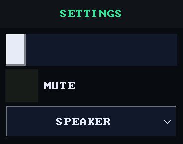
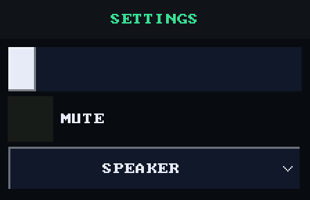
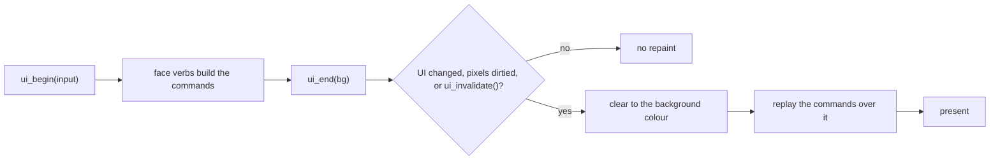
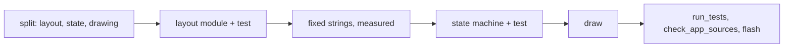

# Building a Screen

Build or change a UI screen here. A screen has three separable parts:
rectangles and text that fit them, the state changed by input, and the drawing
calls. The host renderer shows the real drawing code without a board; see
[the render harness](../tools/Render-Harness.md). For the shell's frame
ownership see [Firmware](../firmware/README.md).

To inspect an existing screen first, run
[`launcher_home_render_host.sh`](../../launcher/tools/render/scenes/launcher_home_render_host.sh)
from Git Bash on Windows or a terminal on Linux. It writes BMPs (and PNGs with
Pillow) to `results/render/launcher_home/`. You need a host C compiler, as in
the [README](../../README.md#try-it-without-a-board).

## The face

A screen includes `ui/ui.h`, plus the toolkit headers that do not reach the
backend (`ui/layout/ui_anchor.h`, `ui/controls/ui_icons.h`). Its verbs take
plain values: a `recti_t` for where, a string for what, a pointer for the
value a control edits, `0xRRGGBB` for a colour. The library behind them is
private to `ui/`, and the include gate refuses it anywhere else, so the
backend can change without touching a screen.

<!-- generated: screen-settings-example check: python launcher/tools/gen/examples_doc.py --check -->
```c
/* A settings frame owns its state and brackets its drawing. */
#include "ui/ui.h"

typedef struct {
    int volume;
    bool muted;
    int output;
    bool reset_requested;
} settings_state_t;

static const char* const OUTPUTS[] = {"SPEAKER", "HEADPHONES", "BLUETOOTH", "OFF"};
#define OUTPUT_COUNT (sizeof OUTPUTS / sizeof OUTPUTS[0])

static void
settings_draw(settings_state_t* s) {
    ui_screen();
    ui_row(UI_ROW_HEIGHT);
    ui_slider(ui_next(), "VOLUME", &s->volume, 0, 10);
    ui_row(UI_ROW_HEIGHT);
    ui_toggle(ui_next(), "MUTE", &s->muted);
    ui_row(UI_ROW_HEIGHT);
    ui_dropdown(ui_next(), "OUTPUT", &s->output, OUTPUTS, OUTPUT_COUNT);
    ui_row(UI_ROW_HEIGHT);
    if (ui_button(ui_next(), "RESET")) {
        s->reset_requested = true;
    }
}

void
settings_frame(const input_t* input, settings_state_t* s) {
    ui_begin(input);
    settings_draw(s);
    ui_end(UI_BACKGROUND);
}
```
<!-- /generated: screen-settings-example -->

The same code, rendered by the host renderer at both orientations a screen
must hold:

| 368x448 portrait | 448x368 landscape |
|---|---|
|  |  |

| A screen needs | Verbs |
|---|---|
| a frame | `ui_begin()`, then `ui_end()` or `ui_end_over()` |
| a window | `ui_screen()`, `ui_window(r)`, `ui_scroll_window(r)`, `ui_scroll_window_aligned(r, align)` |
| rows that flow down the window | `ui_row(h)`, `ui_row_centre(w, h)` or `ui_row_cells(cols, h)`, then `ui_next()` for the rect |
| controls | [`ui_button`](button.md), [`ui_button_icon`](button_icon.md), [`ui_tile`](tile.md), [`ui_tile_icon`](tile_icon.md), [`ui_toggle`](toggle.md), [`ui_slider`](slider.md), [`ui_dropdown`](dropdown.md), [`ui_dropdown_icons`](dropdown_icons.md) |
| text | [`ui_text`, `ui_text_right`, `ui_text_centre`, `ui_caption`, `ui_caption_centre`](text.md), [`ui_header`](header.md) |
| marks | [`ui_panel`](panel.md), `ui_fill`, `ui_outline`, `ui_bevel`, [`ui_icon`, `ui_check`](icon.md), [`ui_swatches`](swatches.md) |
| a look for the screen | `ui_theme(&theme)` once per screen; `NULL` restores the shell look; `ui_corner_radius(r)` for flat, rounded buttons |
| a look for a few widgets | [scopes](scopes.md): `ui_color_begin/end`, `ui_scale_begin/end`, `ui_alpha_begin/end`, `ui_disabled_begin/end` |

Four rules hold for every verb:

- **Rect first.** Every widget takes its rect: from the layout module for
  fixed geometry, from `ui_next()` for a flowed screen.
- **The caller owns every value.** A toggle, slider or dropdown writes
  through its pointer and returns true on the frame it changed. A button or
  tile returns true on the frame a tap is released on it.
- **A label is the identity.** See [identity](input.md#identity).
- **Scopes balance.** See [scopes](scopes.md).

Verbs and arguments are in [`ui/ui.h`](../../launcher/main/ui/ui.h); each
control's page is listed in [`ui/README.md`](README.md#controls).

## One frame

The screen's frame function builds commands and closes the frame; the toolkit
decides whether anything needs painting.



`ui_end_over(paint_backdrop)` repaints only when the UI itself changed, and
only then calls the backdrop; see
[a screen over a backdrop that is drawn](#a-screen-over-a-backdrop-that-is-drawn).
In band mode there is no framebuffer to hash against: `ui_end_for_bands()`
bins the commands and the present replays them per strip with
`ui_replay_band()`. Why the hash exists is in [`ui/README.md`](README.md).

## The loop

Order of work for a new screen. The first four steps need no device.



Decide what owns what before any code. Three files, three jobs:

| File | Holds | Pure? | Tested by |
|---|---|---|---|
| `<screen>_layout.c/.h` | every rect as `recti_t`, canvas size as parameters, the fixed strings | yes: no `gfx.h`, no hardware | host test: invariants at both orientations, strings measured |
| `*_ui.c/.h` | which screen is up, what a tap means, what it remembers | yes: no drawing | host test: taps in, state out |
| `apps/<app>/ui/<screen>.c/.h` | the face calls, taking a small state struct rather than the app's statics | no | host suite in the app's `tests/`, reading back through `launcher/test/ui_probe.h` |

1. **Layout first, tested before any drawing.** Every rect from one function.
   It is the cheapest thing to get right and the most expensive to retrofit.
2. **Fixed strings live beside the rects they must fit**, and the test
   measures them. A caption the layout has never seen cannot be proved to fit.
3. **State next.** The drawing reports which control was hit; the state
   module decides what that means.
4. **Then draw.** Geometry and behaviour are already pinned, so it is mostly
   transcription.
5. **Verify in order:** `run_tests.sh`, then `check_app_sources.sh` (the only
   thing that compiles `app_*.c` without a device), then flash and look.

Never draw before the layout is tested: a layout bug found on glass costs a
flash cycle, the same bug costs a second on a laptop.

## Exact commands

```sh
./launcher/test/run_tests.sh          # host suites: the TDD loop, see testing/README.md
./launcher/test/check_app_sources.sh  # compiles app_*.c against host stubs
autana flash dev                      # --dev, always: autana screenshot needs it
autana screenshot --framebuffer -o shot.png  # lossless PNG, does not reset
```

A screen can also be rendered on a host, with no board and no flash cycle,
through the real drawing code and the real `draw.c`:

```sh
./launcher/tools/render/render_all_scenes.sh        # every declared scene
./launcher/tools/render/scenes/post_ui_render_host.sh -o /tmp/post  # one of them
./launcher/tools/render/render_diff.sh shot.png /tmp/post/landscape-panel.bmp
```

A scene drives its screen over several frames with a declared synthetic
touch. Declaring a scene for your own screen is two files, and diffing one
against a device capture is one command; both are in
[`tools/Render-Harness.md`](../tools/Render-Harness.md). Every scene stands in
the data its screen normally gets, so nothing a render shows came off hardware.

`idf.py -B build.dev build` is also worth running for anything touching
device-only files: it is a real cross-compile and catches what host stubs
cannot.

## House rules

These keep input, layout and rendering consistent.

| Never | Because | Instead |
|---|---|---|
| hand-roll a hit test | hand-tested coordinates do not survive a transform | `ui_button()`, `ui_tile()` and the other controls |
| assume `GFX_WIDTH`/`GFX_HEIGHT` in layout | they swap under a quarter turn | `ui_width()` / `ui_height()` |
| paint pixels outside the face | `ui_end()` hashes what the frame built, so anything drawn behind its back stays as a stale smear | build it with face verbs; the one exception is [the scrim](../firmware/UI.md#the-scrim-the-one-thing-drawn-outside-the-command-list) |
| make a tap target smaller than `UI_TAP_MIN` | a finger misses it | at least `UI_TAP_MIN` in the smaller dimension; aim for `UI_TAP_RECOMMENDED` (`ui/ui.h` says why) |

Two more:

- **Assert every layout invariant at both 368x448 and 448x368**, the two
  renders above.
- **Styles are part of the frame's description.** `ui_begin()` resets the
  button style, so state what you want every frame.

### Anchoring a fixed rectangle

`ui_anchor_rect()` (`ui/layout/ui_anchor.h`) places an element inside its
parent from three choices:

| Argument | Meaning |
|---|---|
| anchor | the point on the parent: `UI_ANCHOR_TOP_LEFT`, `_TOP`, `_TOP_RIGHT`, `_LEFT`, `_CENTER`, `_RIGHT`, `_BOTTOM_LEFT`, `_BOTTOM`, `_BOTTOM_RIGHT` |
| pivot | the same kind of point on the element; it lands on the anchor |
| offset | pixels from that landing point |

`ui_rect_inset()` makes a safe area by insetting each parent edge.
`DISPLAY_PANEL_SAFE_INSET` and `DISPLAY_PANEL_CORNER_RADIUS` are the two glass
facts every layout clears.

Resolve the rectangle in the upright logical canvas, then map it with
`ui_transform_rect()`.

## How to do the things a screen usually needs

### A control the face does not have

Add it to `ui/` as a face verb in `ui/ui.h`, not as a private copy in one
screen. It takes a rect and plain values, draws in the theme's colours, and
gets a host test, an example and a page;
[`ui/README.md`](README.md#adding-to-the-toolkit) lists what it must have.
Hand its result to the state module and let that decide what it means.

### More than one text size

`ui_scale_begin(scale)` / `ui_scale_end()` around the text, or a theme's
`text_scale` for the whole screen. The UI font is the 1bpp 8x8 bitmap, so
integer scales stay crisp.

Do not add a render-time global for a UI setting. Two kinds exist:

| Kind of setting | Example | Cost |
|---|---|---|
| rides inside what the frame builds | the font, and so the scale | free: the repaint hash sees it |
| read at render time | the text style, the transform | invisible to the hash: needs `ui_invalidate()` on every change |

A two-size screen would change a render-time setting every frame and defeat the
repaint skip entirely. Ask which kind you are adding before you add it.

### Text that must fit

Measure it: `ui_measure_text()`, or `draw_font_text_width()` in a host test.
Face text is one clipped line per rect; a button's label alone wraps to two
lines at a space. `ui_clipped_text()` counts the strings a frame clipped, for a
layout test to hold at zero. Fonts and scales are in
[`Text-and-Fonts.md`](../gfx/Text-and-Fonts.md).

### A list of rows that may overflow

Open the window with `ui_scroll_window(r)` and flow the rows with `ui_row()`
and `ui_next()`; [scrolling](scrolling.md) has the example and when a moving
finger is a drag.

### Artwork

`ui_icon(r, icon, fallback)` draws a one-bit `image_t` filling `r` in the text
colour. Icons are always baked assets: never assemble a symbol from
`ui_fill()` or other marks. Marks are for geometry such as panels, tracks and
status indicators.

| Thing | Lives in | Loaded by |
|---|---|---|
| shared UI icon | the engine pack's system set, `launcher/main/engine/icons/` | the engine pack |
| app-owned icon | an icon set in the app's own pack ([icons](../tools/Icon-Baker.md)) | `ui_icon_set_load()` (`ui/controls/ui_icons.h`) |
| other app artwork | the app's own folder, so deleting the app deletes it | the app |

An icon can be missing when its pack is, so a control keeps a label or short
text to show instead. Tests assert structure only: non-empty, bbox in range,
run count under the cap, declared symmetries. Never assert artwork against the
code that draws it.

### A panel over a paused app

Three steps: `ui_end(UI_NO_BACKGROUND)` so the frozen app survives in the
gaps, dim it once with `draw_rect_blend`, then draw the panel over it.

Dim **once** per repaint of the backdrop, never per frame: the blend reads the
pixel it writes, so a second pass darkens the first. Repaint the backdrop and
dim again on a full-redraw request or a turn. Why this is a pixel write and
not a face call: [the scrim](../firmware/UI.md#the-scrim-the-one-thing-drawn-outside-the-command-list).

On close, force a full repaint of the app underneath and reset any
accumulators the pause built up.

### A screen over a backdrop that is drawn

`ui_end_over(paint_backdrop)` is `ui_end()` for a backdrop that is a picture,
not a colour. The launcher's ridge (`shell/ui/ui_ridge.c`) is the model. It
needs a framebuffer, so it does not run in band mode.

| Situation | What happens |
|---|---|
| the UI changed | `paint_backdrop` paints the whole screen, then every window is painted over it |
| the UI is unchanged and the backdrop animates | the backdrop draws its own changed part **before** `ui_end_over()`; the unchanged UI is put back on top with no backdrop call |
| nothing changed | the backdrop must draw nothing: an identical redraw dirties the screen and the launcher stops being free while idle |

Feedback on a press should react to the raw `input_t`, not to the controls: a
control holds a press back until it is known to be a tap and not a scroll,
which is a frame or two too late.

### Knowing what a screen costs

Everything a frame builds spends the device's fixed command list,
`MU_COMMANDLIST_SIZE`: 8 KiB on the device (a little more on a 64-bit
host), counted in bytes, not rects. A development
build logs the high-water mark at the frame close, and a screen's budget suite
calls `ui_probe_budget_assert()` to keep headroom for one more screen.

Check it before adding another image icon or swatch grid: each is a command.
[What a screen costs](README.md#what-a-screen-costs) has the details.

## Testing rules specific to UI

- **Layout, state and geometry are all host-testable. Test them there.**
  Only drawing needs a device.
- **Read what the frame built through `ui_probe.h`.** It answers where a
  widget landed (`ui_probe_widget()`), where and in what colour text was
  drawn, and whether a dropdown's list is open, in plain values, so a suite
  includes nothing of the backend either.
- **A pure module's unit test does not test its consumer.** If the consumer
  is portable, link it and drive it with real taps through `ui_begin()`.
  A passing test of a pure module says nothing about whether its consumer
  can be pressed.
- **Watch every behavioural test fail first, with a mutation that COMPILES.**
  A stub that trips `-Werror` prints no test lines and proves nothing; grep
  the run for `error:` to be sure you saw an assertion.
- **Vary the fixture's arbitrary starting condition** and confirm the
  assertion still catches what it claims.
- **Allocate UI fixtures in `fixture()`, not at file scope.** A suite's
  file-scope objects are firmware `.bss`, and a diagnostics build links every
  suite. UI fixtures get large, which costs real internal heap headroom. Run
  [`build_diag_check.sh`](../../launcher/tools/build/build_diag_check.sh) to build that configuration locally
  rather than finding out from CI.

## Checklist before flashing

- [ ] layout asserted at both orientations, nothing overlapping or off-canvas
- [ ] every fixed string measured against its own rect
- [ ] every tap target >= `UI_TAP_MIN`
- [ ] taps routed through a face control, decided by the state module
- [ ] no toolkit header that reaches the backend included
- [ ] nothing painted outside the face
- [ ] `run_tests.sh` green, `check_app_sources.sh` green
- [ ] new behavioural tests seen red first, on a mutation that compiled

## Related

- [`Building-an-App.md`](../firmware/Building-an-App.md): the app a screen lives in
- [`ui/README.md`](README.md): the toolkit behind the face, pictured
- [`Text-and-Fonts.md`](../gfx/Text-and-Fonts.md): fonts, scales, text styles
- [`firmware/README.md`](../firmware/README.md): the mechanisms
- [`testing/README.md`](../testing/README.md): suites and runners
- [`Build-Variants.md`](../tools/Build-Variants.md): what release, dev and
  diagnostics builds carry
- [`tools/Render-Harness.md`](../tools/Render-Harness.md): rendering a screen
  on a host, and diffing it against a capture
