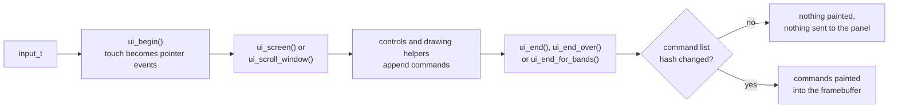
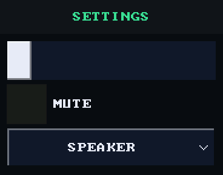
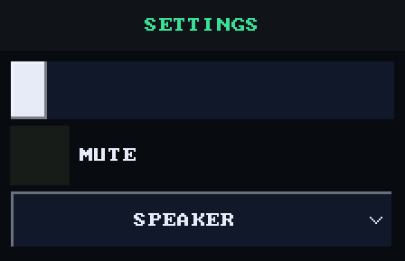
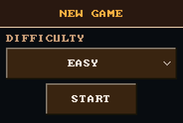
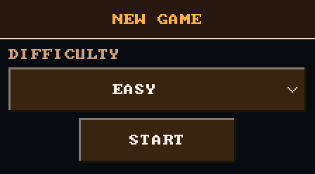

# UI Toolkit

What the shell's `launcher/main/ui/` layer gives any screen, in the shell or
in an app: the controls, the drawing helpers, the layout arithmetic and the
frame calls around them. A screen describes its whole UI again every frame
through the plain-value face in `ui/ui.h`, and the frame becomes a list of
drawing commands. This is the index: each control has its own page below.
How to put a screen together, and the house rules it must follow, are in
[`Building-a-Screen.md`](Building-a-Screen.md). The library behind the face
is private to `ui/`, and the include gate refuses it anywhere else.

Every example on these pages is a file in
`launcher/tools/render/ui_examples/`, shown whole, and every picture is that
file drawn on a host by `ui_examples_render_host.sh` (see
[Regenerating the images](#regenerating-the-images)).

## Controls

| Control | Call | For |
|---|---|---|
| [Button](button.md) | `ui_button()` | an action, by a label |
| [Button with an icon](button_icon.md) | `ui_button_icon()` | an action, by an icon and a label |
| [Tile](tile.md) | `ui_tile()` | one of a row of choices |
| [Tile with an icon](tile_icon.md) | `ui_tile_icon()`, `ui_tile_icon_rect()` | one of a row of choices, icon above label |
| [Toggle](toggle.md) | `ui_toggle()` | on or off |
| [Slider](slider.md) | `ui_slider()` | a whole number in a range |
| [Dropdown](dropdown.md) | `ui_dropdown()` | one of a list, without scrolling the screen |
| [Dropdown with icons](dropdown_icons.md) | `ui_dropdown_icons()` | the same, an icon beside each name |
| [Text](text.md) | `ui_text()`, `ui_text_right()`, `ui_text_centre()`, `ui_caption()`, `ui_caption_centre()` | a line of text in a rect |
| [Header](header.md) | `ui_header()` | a title bar |
| [Panel](panel.md) | `ui_panel()` | a captioned section |
| [Swatches](swatches.md) | `ui_swatches()` | a grid of colours |
| [Icon](icon.md) | `ui_icon()`, `ui_check()` | an icon, or the check mark |

How the controls share a finger, a scroll and a scope:

| Page | Covers |
|---|---|
| [Input](input.md) | a tap from press to release, a tap that misses, a control's identity |
| [Scrolling](scrolling.md) | scroll windows, when a moving finger is a drag, flowed rows and fixed rects |
| [Scopes](scopes.md) | `ui_disabled_begin()`, `ui_color_begin()`, `ui_scale_begin()`, `ui_alpha_begin()`, and the frame settings |

`ui_fill()`, `ui_outline()` and `ui_bevel()` are the marks the controls are
built from, for a screen drawing its own.

## One frame



Nothing draws pixels directly. Every control and helper appends commands to
the frame's command list, and `ui_end()` paints them only when the list hashes
differently from the last frame, so a screen that does not change costs
nothing: hashing a few kilobytes of commands is far cheaper than repainting
and sending a whole screen to the panel.

Anything painted outside the list is invisible to the hash and stays on
screen as a stale smear. In an [expanded frame](../gfx/Targets-and-Modes.md#expanded-frames)
`ui_end()` bins the commands as `ui_end_for_bands()` does, and the present
replays them over each strip it sends.

## A whole screen

<!-- generated: ui-settings-renders sha256=2a1a0cb81f3d94cec7263d86b5dc1f29e375078c6f42845d5391326f4c70de11 -->
| Portrait | Landscape |
|---|---|
|  |  |
<!-- /generated: ui-settings-renders -->

The same code draws both orientations, because it measures against
`ui_width()` rather than a fixed width. The render wraps it in
`ui_begin()`, `ui_screen()` and `ui_end()`:

<!-- generated: ui-settings-example check: python launcher/tools/gen/examples_doc.py --check -->
```c
/* A whole settings screen: a title bar, then rows flowing down a window below it. */
#include "ui/ui.h"

typedef struct {
    int volume;
    bool muted;
    int output;
} settings_example_t;

static const char* const OUTPUTS[] = {"SPEAKER", "HEADPHONES", "BLUETOOTH", "OFF"};

bool
settings_example(settings_example_t* s) {
    ui_header((recti_t){0, 0, ui_width(), UI_TITLE_HEIGHT}, "SETTINGS");
    ui_window((recti_t){0, UI_TITLE_HEIGHT, ui_width(), ui_height() - UI_TITLE_HEIGHT});
    bool changed = false;
    ui_row(UI_ROW_HEIGHT);
    changed |= ui_slider(ui_next(), "volume", &s->volume, 0, 10);
    ui_row(UI_ROW_HEIGHT);
    changed |= ui_toggle(ui_next(), "MUTE", &s->muted);
    ui_row(UI_ROW_HEIGHT);
    changed |= ui_dropdown(ui_next(), "output", &s->output, OUTPUTS, 4);
    return changed;
}
```
<!-- /generated: ui-settings-example -->

- **The caller owns every value.** `volume`, `muted` and `output` live in
  the screen, and each call is handed the current value. A slider, toggle
  or dropdown writes through the pointer and returns true on the frame it
  changed. Between frames the toolkit remembers only the pressed control and
  whether a dropdown's list is open and how far it is scrolled.
- **Labels are ids.** See [identity](input.md#identity).
- **One file here, three in a real screen.** A shipped screen splits this
  into layout, state and drawing, each tested on a host, as
  [`Building-a-Screen.md`](Building-a-Screen.md) describes.

### Which control

| For | Use |
|---|---|
| a whole number in a range | [`ui_slider()`](slider.md) |
| on or off | [`ui_toggle()`](toggle.md), or two tiles when the choice deserves pictures |
| one of two to four choices, all worth seeing at once | a row of [`ui_tile_icon()`](tile_icon.md)s, with `selected` on the current one |
| one of a longer list, or where there is no room for a row | [`ui_dropdown()`](dropdown.md) |
| an action | [`ui_button_icon()`](button_icon.md), or [`ui_button()`](button.md) for a label alone |

## States

Each control's page has a States table: its unchanged example drawn in each
state the face can put it in, and when a tap there fired. A state whose
pixels match rest is not pictured; its row says "looks like rest".

| State | What the render does to the example |
|---|---|
| rest | nothing: it is drawn alone |
| pressed | a finger is held on its middle |
| tapped | a finger pressed its middle and lifted before the picture |
| disabled | it is drawn inside `ui_disabled_begin(true)` |
| no-pack | it runs with no asset pack, so every icon is missing |

Fires is "on release", "while held" or "no", measured by one more tap on
the middle after the picture. Values a caller passes in, like `selected`
or `on`, are not states: the example draws them itself.

## Theme

`ui_theme(&theme)` states a screen's colours once, for the rest of the
frame; `NULL` restores the shell look the pictures here use. `ui_theme_t`:

| Field | Used for |
|---|---|
| `panel_face`, `panel_edge` | `ui_panel()` and `ui_header()`, and a slider's frame; the shell look has no edge |
| `button_face` | a control at rest |
| `accent` | headings |
| `accent_face`, `on_accent` | the selected choice, and the ink on it |
| `text`, `caption` | ink at rest, and captions |
| `muted` | a disabled control's ink |
| `text_scale` | label size, in glyph cells |
| `icon_side` | an icon beside a label (a tile sizes its own) |

Those are all of its fields; colours are `0xRRGGBB`.

<!-- generated: ui-themed-renders sha256=ce90d245fc56abf913679889c16dcc7dc96dbc20863a3114d87492dded49eda8 -->
| Portrait | Landscape |
|---|---|
|  |  |
<!-- /generated: ui-themed-renders -->

<!-- generated: ui-themed-example check: python launcher/tools/gen/examples_doc.py --check -->
```c
/* A screen in its own colours: ui_theme() once, then the same verbs as any other. */
#include "ui/ui.h"

typedef struct {
    int difficulty;
    bool started;
} themed_example_t;

static const ui_theme_t THEME = {
    .panel_face = 0x2A1A10,
    .panel_edge = 0xF2D6B0,
    .button_face = 0x3A2616,
    .accent = 0xFFB347,
    .accent_face = 0xFFB347,
    .on_accent = 0x2A1A06,
    .text = 0xFFF1E0,
    .caption = 0xC9A27A,
    .muted = 0x6B5340,
    .text_scale = 2,
    .icon_side = 24,
};

static const char* const DIFFICULTIES[] = {"EASY", "NORMAL", "HARD"};

bool
themed_example(themed_example_t* s) {
    ui_theme(&THEME);
    ui_header((recti_t){0, 0, ui_width(), UI_TITLE_HEIGHT}, "NEW GAME");
    ui_window((recti_t){0, UI_TITLE_HEIGHT, ui_width(), ui_height() - UI_TITLE_HEIGHT});
    ui_row(ui_text_height() + UI_TEXT_PAD);
    ui_caption(ui_next(), "DIFFICULTY");
    ui_row(UI_ROW_HEIGHT);
    const bool picked = ui_dropdown(ui_next(), "difficulty", &s->difficulty, DIFFICULTIES, 3);
    ui_row_centre(ui_width() / 2, UI_ROW_HEIGHT);
    if (ui_button(ui_next(), "START")) {
        s->started = true;
    }
    return picked;
}
```
<!-- /generated: ui-themed-example -->

### Bezels

Every face control draws a bezel, sunk while pressed. `ui_bezel_spans()` and
`ui_panel_spans()` in `ui/controls/ui_style.h` are pure geometry, so
`test/suites/suite_ui_style.c` checks the shapes without linking `draw.c`.

The system icons come from the engine pack through `ui_icon_image()`
(`ui/controls/ui_icons.h`), loaded by `ui_init()`. Without a pack a control
shows its label alone, and an icon its short text: the no-pack rows.

## Layout

| Constant | Value | For |
|---|---|---|
| `UI_TAP_MIN` | 56 | the smallest a control may be, in its smaller dimension |
| `UI_TAP_RECOMMENDED` | 64 | what a new control should aim for |
| `UI_ROW_HEIGHT` | 64 | a list row |
| `UI_ROW_GAP` | 8 | between rows |
| `UI_MARGIN` | 16 | from the canvas edge |
| `UI_TITLE_HEIGHT`, `UI_BANNER_HEIGHT` | 56 | a title strip; the empty status strip on the home screen |

The panel is about 322 pixels per inch, so a phone's 44 px is only 3.5 mm
here. 56 px is about 4.4 mm.

- **Canvas size.** `ui_width()` and `ui_height()` are the logical canvas:
  368x448 in portrait and 448x368 in landscape. Lay out against them,
  never `GFX_WIDTH`/`GFX_HEIGHT`. A layout that stacks in portrait usually
  wants rows or columns in landscape, and a layout test holds it at both
  sizes.
- **Fixed rects.** `ui_centered_rect()` centres a rect horizontally.
  `ui_anchor_rect()` places one against a parent's edge, corner or centre
  (`UI_ANCHOR_*`) with a pivot and offset, and `ui_rect_inset()` makes a
  safe area.
- **Rows that may overflow.** [Scrolling](scrolling.md).

## Text

| Call | |
|---|---|
| `ui_set_font_scaled(draw_font_ui(), scale)` | the UI font at `scale` glyph cells, for the rest of the frame |
| `ui_measure_text()` | a string's width at the current font and scale |
| `ui_set_text_style()` | `UI_TEXT_PLAIN`, `UI_TEXT_OUTLINED` or `UI_TEXT_SHADOWED` |

A font and its scale ride inside every text command, so changing size costs
nothing extra. A text style does not, and needs `ui_invalidate()` when it
changes. The details are in [`Text-and-Fonts.md`](../gfx/Text-and-Fonts.md).

## Orientation

`ui_set_transform()` maps every command through a fixed-point transform
before drawing, so the whole UI turns without any call site knowing.
`ui_transform_quarter_turn()` builds the one the shell uses. Only
axis-preserving transforms draw correctly, and
`ui_transform_is_axis_preserving()` says which those are.
`ui_layout_generation()` increments when the canvas shape changes: read
it, keep it, and compare later.

## Closing the frame

| Call | When |
|---|---|
| `ui_end(background)` | the usual case. `UI_NO_BACKGROUND` draws over an app's own output instead of clearing |
| `ui_end_over(paint_backdrop)` | the backdrop is a picture rather than a colour |
| `ui_end_for_bands()`, `ui_replay_band()` | band mode, where the screen is drawn a strip at a time with no whole framebuffer kept. The shell passes `ui_replay_band()` to `gfx_band_run()` as the per-band overlay (see [`gfx/README.md`](../gfx/README.md)) |
| `ui_invalidate()` | something replaced the screen behind the UI's back, so the next `ui_end()` must repaint |

How a panel over a paused app and a drawn backdrop use these is in
[`Building-a-Screen.md`](Building-a-Screen.md#a-panel-over-a-paused-app).

## What a screen costs

The frame's command list is 8 KiB on the device (`MU_COMMANDLIST_SIZE`).
Each image icon uses one command; its runs are drawn during painting.
Each swatch grid uses one command containing a copy of its colours.

Open dropdowns add their rows to the screen beneath them. The budget suites
reserve headroom for more controls and check the device limit on device/QEMU.
Development builds log the high-water mark from `ui_end()`.

## Adding to the toolkit

A control belongs in `ui/`, as a face verb in `ui/ui.h` over a helper in
`ui/controls/` (private to `ui/`), not in a private copy in one app's
screen, once a second screen could use it. It must:

- take the screen's `ui_theme_t` rather than colours of its own
- use no app's vocabulary: say what shape of caller needs it
- emit commands, never pixels
- respect `UI_TAP_MIN`
- have a host test in `test/suites/suite_ui_widgets.c` that drives real
  taps through `ui_begin()`
- have an example, `launcher/tools/render/ui_examples/<name>.c`, defining
  `<name>_example_t` and `bool <name>_example(<name>_example_t*)` with face
  verbs alone and no `ui_begin()` or `ui_end()`; the scene fails to build
  without both
- have a page, `docs/ui/<name>.md`, in the shape of the others, and a row in
  the table above

A control that shows everything at once sits inline, like
`ui_swatches()` or a row of tiles. One that must show more than its own
rect has room for opens over the screen the way `ui_dropdown()` does: its own
window, one open at a time, closed when a tap lands outside it. When a
control needs a colour no theme field means, add a field to `ui_theme_t` and
give it a value in every theme that exists, rather than reusing a field for
something else.

## Regenerating the images

```sh
sh launcher/tools/render/scenes/ui_examples_render_host.sh
python launcher/tools/render/ui_examples_doc.py --renders launcher/tools/results/render/ui_examples --out launcher/tools/results/render/ui_examples
python launcher/tools/gen/examples_doc.py
```

The scene renders every file in `ui_examples/`, each cut to what it drew
plus `UI_MARGIN`, into `launcher/tools/results/render/ui_examples/`, and
checks it against `ui_examples_render_baseline.txt`, so a change that moves
a pixel fails until the new picture is looked at and re-pinned with
`--update-baseline`. A file in `ui_examples/screens/` is a whole screen,
drawn at rest only.

`ui_examples_doc.py` writes only render and States tables and requires
`--renders` and `--out`. `examples_doc.py` embeds the example files;
`--check` fails when one is stale. See
[Usage examples](../tools/Generated-Files.md#usage-examples).

`launcher/tools/render/render_doc_images.sh` turns the renders into
`docs/images/ui/` and the States tables; see "Images in these docs" in
[`tools/Render-Harness.md`](../tools/Render-Harness.md).

### Band replay measurements

The band bin is allocated once at UI initialization with `memory_alloc` and
`MEMORY_PSRAM`. Its capacity owner, `UI_BAND_BIN_MAX` in `ui/ui_internal.h`, derives
from `UI_BAND_BIN_MEASURED_PEAK` with the growth margin owned by
`UI_BAND_BIN_MARGIN_DIVISOR`; its byte size is that capacity times
`sizeof(ui_band_entry_t)`. Command and fill entries share storage for their
mutually exclusive payloads. Allocation failure retains no entries and uses
full-band repaint for bands touched by drawing.
Bands touched by drawing that does not fit replay the complete UI in painter's
order and remain dirty. Other bands replay the retained entries.
`ui_band_fallback_count()` reports full band replays in the current frame.

On a development build, `autana tune ui.band_stats_frames N` requests the next
N UI frame reports. Capture them with `autana monitor 30`. Repeat on launcher
home, an options screen, and a busy menu with its dropdown open:

```text
ui: band stats: fallbacks=<bands> ui_us=<microseconds> commands=<bytes> roots=<canvases>
```

`ui_us` measures UI finalization and painting, including binning and band replay;
it excludes command construction, application drawing, panel transfer and the
report itself. Band-frame reports appear at the next UI finalization, even
when unchanged bands skip painting. Full-frame painting reports zero fallbacks.
Compare frames with zero and positive fallback counts on the same screen to measure the fallback
cost. The request expires after N reports; zero disables it. Check the running
build id before and after each capture.

In a self-test build, the on-request suite `run_ui_band_perf_suite` measures
the options screen with its dither dropdown closed and open, and the shared
sparse and dense dropdown-menu fixture through the real band ring. Warm-up frames are presented before each measured range.
The menu fixture repeats each revision on consecutive frames, covering changing
and steady sparse content. Deferred cleanup restores the full framebuffer even
when an assertion fails. The host widget suite runs the same cases with the
engine and screen icon packs. Run the device suite with
`autana suite run_ui_band_perf_suite --flash`. Each case collects the frame
range owned by `MENU_FRAMES` in `suite_ui_widgets.c` in memory, then reports:

```text
ui_band_perf: case=NAME frames=N fallbacks=TOTAL frame_us=MEAN max_us=MAX
```

`fallbacks` is the total number of full band replays across the measured frames.
`frame_us` and `max_us` are the mean and maximum elapsed microseconds, including
command construction, finalization, drawing and band submission; they exclude
presentation waiting before the frame and the summary log. The suite asserts
zero fallbacks in every measured case. The host widget suite also exceeds the
bin capacity to verify that fallback matches a full repaint and preserves
dropdown painter order.
