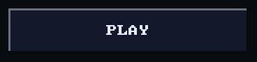
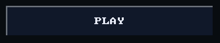
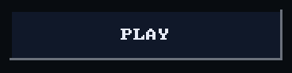
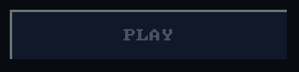

# Button

`bool ui_button(recti_t r, const char* label)` draws a labelled button
filling `r`. It returns true on the frame a tap is released on it, and the
caller decides what that means.

## Example

<!-- generated: ui-button-example check: python launcher/tools/render/ui_examples_doc.py --check -->
```c
/* A button: true on the frame a tap is released on it. */
#include "ui/ui.h"

typedef struct {
    int plays;
} button_example_t;

bool
button_example(button_example_t* s) {
    ui_row(UI_ROW_HEIGHT);
    const bool tapped = ui_button(ui_next(), "PLAY");
    if (tapped) {
        s->plays++;
    }
    return tapped;
}
```
<!-- /generated: ui-button-example -->

## Renders

 

## States

Each row is the example above, unchanged, in one of the
[states](../UI-Toolkit.md#states). Fires says when a tap there made it
return true.

<!-- generated: ui-button-states sha256=c6790bc416e39c910f3847ed1e42511dfb6a2640f488cde85a3e03555763db62 -->
| State | Render | Fires |
|---|---|---|
| rest |  | on release |
| pressed |  | on release |
| tapped | looks like rest | on release |
| disabled |  | no |
| no-pack | looks like rest | on release |
<!-- /generated: ui-button-states -->

## Interactions

- Sinks while a press holds it.
- Fires when the finger lifts over it; sliding off first cancels
  ([input](input.md#a-tap)).
- A tap just outside lands on the nearest control within reach
  ([input](input.md#a-tap-that-misses)).
- In a `ui_scroll_window()` a vertical drag scrolls the rows and presses
  nothing ([scrolling](scrolling.md)).
- Inside `ui_disabled_begin(true)` it draws in the theme's `muted` ink and
  never fires ([scopes](scopes.md)).
- Its label is its identity: two with one label in a window are told apart
  by call order ([input](input.md#identity)).

## See also

- [Button with an icon](button_icon.md)
- [Tile](tile.md): a choice rather than an action
- [UI Toolkit](../UI-Toolkit.md): every control, the theme, the frame
