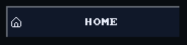
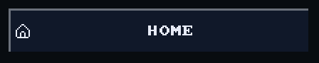
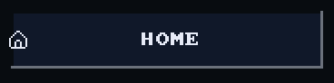
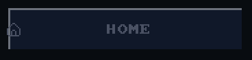
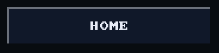

# Button with an icon

`bool ui_button_icon(recti_t r, const char* label, const draw_image_t*
icon)` is a [button](button.md) with `icon` at its left and the label
centred in the rest. A `NULL` icon is `ui_button()`.

## Example

<!-- generated: ui-button-icon-example check: python launcher/tools/gen/examples_doc.py --check -->
```c
/* A button with an icon at its left: true on the frame a tap is released on it. */
#include "ui/controls/ui_icons.h"
#include "ui/ui.h"

typedef struct {
    bool going_home;
} button_icon_example_t;

bool
button_icon_example(button_icon_example_t* s) {
    ui_row(UI_ROW_HEIGHT);
    const bool tapped = ui_button_icon(ui_next(), "HOME", ui_icon_image(UI_ICON_HOME));
    if (tapped) {
        s->going_home = true;
    }
    return tapped;
}
```
<!-- /generated: ui-button-icon-example -->

## Renders

<!-- generated: ui-button-icon-renders sha256=a50579a8acfa40f997ed25819ae95a7a65d1c1735749623762f0fff096af7b5d -->
| Portrait | Landscape |
|---|---|
|  |  |
<!-- /generated: ui-button-icon-renders -->

## States

Each row is the example above, unchanged, in one of the
[states](README.md#states). Fires says when a tap there made it
return true.

<!-- generated: ui-button-icon-states sha256=f26a72eee8ef0d00df4a96162a45c9f48c96953fb4e27d78d809309d75a52ca7 -->
| State | Render | Fires |
|---|---|---|
| rest |  | on release |
| pressed |  | on release |
| tapped | looks like rest | on release |
| disabled |  | no |
| no-pack |  | on release |
<!-- /generated: ui-button-icon-states -->

## Interactions

- Without its pack the icon is missing and the label draws alone.
- Fires when the finger lifts over it or within `snap.reach` of it; sliding
  farther off first cancels ([input](input.md#a-tap)).
- A press just outside draws the nearest control within reach pressed, and a
  lift within reach fires it ([input](input.md#a-tap-that-misses)).
- In a `ui_scroll_window()` a vertical drag scrolls the rows and presses
  nothing ([scrolling](scrolling.md)).
- Inside `ui_disabled_begin(true)` it draws in the theme's `muted` ink and
  never fires ([scopes](scopes.md)).
- Its label is its identity: two with one label in a window are told apart
  by call order ([input](input.md#identity)).

## See also

- [Button](button.md)
- [Icon](icon.md): `ui_icon_image()` and app icon sets
- [UI Toolkit](README.md): every control, the theme, the frame
