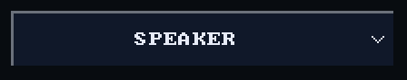
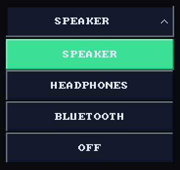
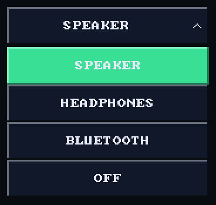
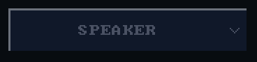
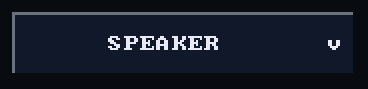

# Dropdown

`bool ui_dropdown(recti_t r, const char* label, int* index, const char*
const* names, int count)` shows `names[*index]` and a chevron. It writes
`*index` and returns true on the frame a pick changed it; opening and
closing the list return false. `count` is at least one.

## Example

<!-- generated: ui-dropdown-example check: python launcher/tools/gen/examples_doc.py --check -->
```c
/* A dropdown: a tap opens the list, a pick writes the index and returns true. */
#include "ui/ui.h"

typedef struct {
    int output;
} dropdown_example_t;

static const char* const OUTPUTS[] = {"SPEAKER", "HEADPHONES", "BLUETOOTH", "OFF"};

bool
dropdown_example(dropdown_example_t* s) {
    ui_row(UI_ROW_HEIGHT);
    return ui_dropdown(ui_next(), "output", &s->output, OUTPUTS, 4);
}
```
<!-- /generated: ui-dropdown-example -->

## Renders

<!-- generated: ui-dropdown-renders sha256=8b62024607ecdbff0e0c0f937edead8be39de2e62a1cdc34cbf66e093c5876bf -->
| Portrait | Landscape |
|---|---|
|  |  |
<!-- /generated: ui-dropdown-renders -->

## States

Each row is the example above, unchanged, in one of the
[states](README.md#states). Fires says when a tap there made it
return true.

<!-- generated: ui-dropdown-states sha256=54ab6979a436af56c319038c3411df2b4a15aa2bd487073e8f5d6721008f6958 -->
| State | Render | Fires |
|---|---|---|
| rest |  | no |
| pressed |  | no |
| tapped |  | no |
| disabled |  | no |
| no-pack |  | no |
<!-- /generated: ui-dropdown-states -->

## Interactions

- A press opens the whole list over the screen: below the dropdown when
  every row fits there, above when they fit there, otherwise over the canvas
  between its margins.
- A list taller than its room scrolls, and opens with the current item
  centred ([scrolling](scrolling.md)).
- A pick writes the index and stays on screen `UI_DROPDOWN_CLOSE_FRAMES`
  frames after the finger lifts. A tap outside the list closes it without a
  pick.
- Only one list is open at a time. Give each dropdown its own label or
  `###key` ([input](input.md#identity)).
- Inside `ui_disabled_begin(true)` it draws in the theme's `muted` ink and
  never fires ([scopes](scopes.md)).

## See also

- [Dropdown with icons](dropdown_icons.md)
- [Tile](tile.md): when two to four choices all fit at once
- [UI Toolkit](README.md): every control, the theme, the frame
