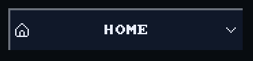
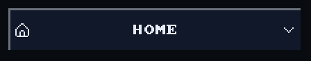
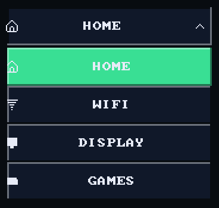
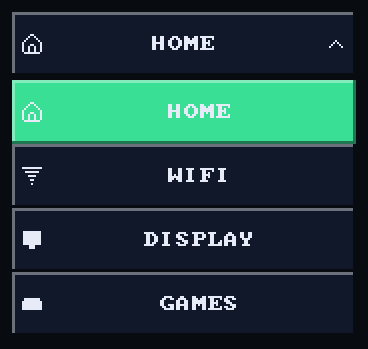
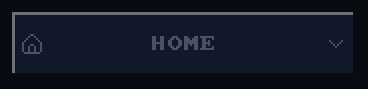
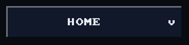

# Dropdown with icons

`bool ui_dropdown_icons(recti_t r, const char* label, int* index, const
char* const* names, const draw_image_t* const* icons, int count)` is a
[dropdown](dropdown.md) with a parallel `icons` array, one beside each name.

## Example

<!-- generated: ui-dropdown-icons-example check: python launcher/tools/render/ui_examples_doc.py --check -->
```c
/* A dropdown whose rows carry an icon beside the name. */
#include "ui/controls/ui_icons.h"
#include "ui/ui.h"

typedef struct {
    int page;
} dropdown_icons_example_t;

static const char* const PAGES[] = {"HOME", "WIFI", "DISPLAY", "GAMES"};

bool
dropdown_icons_example(dropdown_icons_example_t* s) {
    const draw_image_t* const icons[] = {ui_icon_image(UI_ICON_HOME), ui_icon_image(UI_ICON_WIFI),
                                         ui_icon_image(UI_ICON_MONITOR), ui_icon_image(UI_ICON_GAMEPAD)};
    ui_row(UI_ROW_HEIGHT);
    return ui_dropdown_icons(ui_next(), "page", &s->page, PAGES, icons, 4);
}
```
<!-- /generated: ui-dropdown-icons-example -->

## Renders

<!-- generated: ui-dropdown-icons-renders sha256=e532f7dcffd87139df9e361e483a85f15402d2efa96c2528f367e027ea1e1518 -->
| Portrait | Landscape |
|---|---|
|  |  |
<!-- /generated: ui-dropdown-icons-renders -->

## States

Each row is the example above, unchanged, in one of the
[states](README.md#states). Fires says when a tap there made it
return true.

<!-- generated: ui-dropdown-icons-states sha256=909746633152ec3adf7afe24359fffbf2c09de565c3b7fdfcf80f9b09e7ad197 -->
| State | Render | Fires |
|---|---|---|
| rest |  | no |
| pressed |  | no |
| tapped |  | no |
| disabled |  | no |
| no-pack |  | no |
<!-- /generated: ui-dropdown-icons-states -->

## Interactions

- Without its pack the icons are missing and the names draw alone.
- A press opens the whole list over the screen: below the dropdown when
  every row fits there, above when they fit there, otherwise over the canvas
  between its margins.
- A list taller than its room scrolls, and opens with the current item
  centred ([scrolling](scrolling.md)).
- A pick writes the index and stays on screen `UI_DROPDOWN_CLOSE_FRAMES`
  frames after the finger lifts. A tap outside the list closes it without a
  pick.
- Only one list is open at a time. Give each dropdown its own label or
  `###key` ([input](input.md#identity)).
- Inside `ui_disabled_begin(true)` it draws in the theme's `muted` ink and
  never fires ([scopes](scopes.md)).

## See also

- [Dropdown](dropdown.md)
- [Icon](icon.md)
- [UI Toolkit](README.md): every control, the theme, the frame
