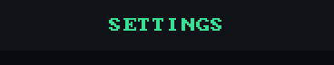
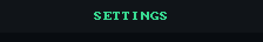

# Header

`void ui_header(recti_t r, const char* title)` draws a bar on the theme's
`panel_face`, a `panel_edge` line along its bottom when the theme has one,
and the title centred in its `accent`.

## Example

<!-- generated: ui-header-example check: python launcher/tools/render/ui_examples_doc.py --check -->
```c
/* A title bar across the top of the canvas, over the screen's rows. */
#include "ui/ui.h"

typedef struct {
    int page;
} header_example_t;

static const char* const TITLES[] = {"SETTINGS", "DISPLAY"};

bool
header_example(header_example_t* s) {
    ui_header((recti_t){0, 0, ui_width(), UI_TITLE_HEIGHT}, TITLES[s->page]);
    return false;
}
```
<!-- /generated: ui-header-example -->

## Renders

 

## States

Each row is the example above, unchanged, in one of the
[states](../UI-Toolkit.md#states). Fires says when a tap there made it
return true.

<!-- generated: ui-header-states sha256=ed1bfa61da1d1459c59c086cca94754bd001c535b0ee7986352ff32d4035e460 -->
| State | Render | Fires |
|---|---|---|
| rest |  | no |
| pressed | looks like rest | no |
| tapped | looks like rest | no |
| disabled | looks like rest | no |
| no-pack | looks like rest | no |
<!-- /generated: ui-header-states -->

## Interactions

- It takes no tap. Rows go below it, in a `ui_window()` that starts where it
  ends ([scrolling](scrolling.md)).
- `UI_TITLE_HEIGHT` is the shared height of a title strip.

## See also

- [Panel](panel.md)
- [Text](text.md)
- [UI Toolkit](../UI-Toolkit.md): every control, the theme, the frame
