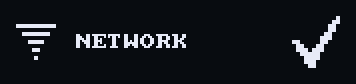
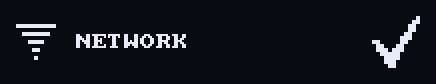
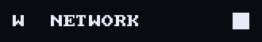

# Icon

`void ui_icon(recti_t r, const draw_image_t* icon, const char* fallback)`
draws a one-bit icon filling `r` in the text ink, or `fallback` centred when
`icon` is `NULL`. `void ui_check(recti_t r)` draws the system check mark.

## Example

<!-- generated: ui-icon-example check: python launcher/tools/render/ui_examples_doc.py --check -->
```c
/* Icons in the text colour: a pack icon with a short fallback, and the system check. */
#include "ui/controls/ui_icons.h"
#include "ui/ui.h"

typedef struct {
    bool connecting;
} icon_example_t;

bool
icon_example(icon_example_t* s) {
    ui_row(UI_ROW_HEIGHT);
    const recti_t r = ui_next();
    const int side = r.h;
    ui_icon((recti_t){r.x, r.y, side, side}, ui_icon_image(UI_ICON_WIFI), "W");
    ui_text((recti_t){r.x + side + UI_ROW_GAP, r.y, r.w - 2 * (side + UI_ROW_GAP), side}, "NETWORK");
    if (!s->connecting) {
        ui_check((recti_t){r.x + r.w - side, r.y, side, side});
    }
    return false;
}
```
<!-- /generated: ui-icon-example -->

## Renders

 

## States

Each row is the example above, unchanged, in one of the
[states](../UI-Toolkit.md#states). Fires says when a tap there made it
return true.

<!-- generated: ui-icon-states sha256=68d87458f70b64f1d1ea3202c11334a071418376b44aa4085d2cb479979f526d -->
| State | Render | Fires |
|---|---|---|
| rest |  | no |
| pressed | looks like rest | no |
| tapped | looks like rest | no |
| disabled | looks like rest | no |
| no-pack |  | no |
<!-- /generated: ui-icon-states -->

## Interactions

- The system icons come from the engine pack through `ui_icon_image()`
  (`ui/controls/ui_icons.h`). An app's icons are a `ui_icon_set_t` in its
  own pack ([icons](../tools/Icon-Baker.md)).
- Without a pack the icon is `NULL` and the fallback shows.
- It takes no tap.

## See also

- [Button with an icon](button_icon.md)
- [Tile with an icon](tile_icon.md)
- [UI Toolkit](../UI-Toolkit.md): every control, the theme, the frame
