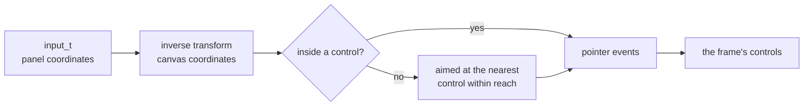

# Input

How a finger on the glass reaches the face's controls. `ui_begin(input)`
takes the frame's `input_t`, maps the touch through the inverse of the UI
transform into canvas coordinates, and turns it into pointer events
(`ui/input/ui_pointer.h`). Every control of the frame then answers from
those events alone.

## A tap

| Moment | What the face does |
|---|---|
| finger down | the press is held back a frame, until the control under it is hovered, then lands on that control |
| finger held | the pressed control draws pressed: a button or tile sinks, a toggle shows its flipped value |
| finger slides off | the control stays pressed but will not fire |
| finger lifts over it | a button or tile returns true; a toggle writes and returns true |
| finger lifts elsewhere | nothing fires, and a toggle keeps its old value |

A slider and a dropdown act on the press instead: the slider takes the value
under the finger and follows it, and the dropdown opens its list. Each
control's page has a States table that measures when it fires.

## A tap that misses

A press that lands outside every control is aimed at the nearest control
edge within reach, the tunable `snap.reach` (40 px by default), so that
control draws pressed. The release is aimed the same way, so a button, tile
or toggle fires when the finger lifts within reach of it, and a tap in the
gap between two tiles picks the nearer one. A tap farther from every control
than the reach presses and fires nothing. A stroke that turned into a scroll
lifts where it is.

## Identity

A control's label is its identity across frames: it is what keeps a press
on the control it landed on. Two controls with one label in a window are
told apart by call order, which breaks when a screen skips one of them
some frames. `"Text##key"` shows `Text` and keys on the whole string;
`"Text###key"` shows `Text` and keys on `key` alone, so a label can change
without the control losing its press.

## See also

- [Scrolling](scrolling.md): when a moving finger is a drag
- [Scopes](scopes.md): disabling controls
- [UI Toolkit](../UI-Toolkit.md)
