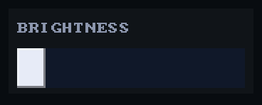
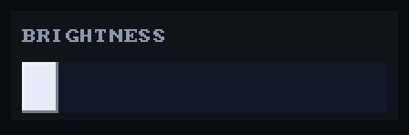
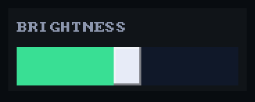

# Panel

`void ui_panel(recti_t r)` draws a face on the theme's `panel_face`, edged
in `panel_edge` when the theme has one, grouping the controls drawn over it
without inviting a press itself.

## Example

<!-- generated: ui-panel-example check: python launcher/tools/render/ui_examples_doc.py --check -->
```c
/* A panel grouping a caption and a control, inviting no press itself. */
#include "ui/ui.h"

typedef struct {
    int brightness;
} panel_example_t;

bool
panel_example(panel_example_t* s) {
    ui_row(UI_TITLE_HEIGHT + UI_ROW_HEIGHT);
    const recti_t r = ui_next();
    const int inner_w = r.w - 2 * UI_PADDING;
    ui_panel(r);
    ui_caption((recti_t){r.x + UI_PADDING, r.y, inner_w, UI_TITLE_HEIGHT}, "BRIGHTNESS");
    return ui_slider((recti_t){r.x + UI_PADDING, r.y + UI_TITLE_HEIGHT, inner_w, UI_TAP_MIN}, "brightness",
                     &s->brightness, 0, 4);
}
```
<!-- /generated: ui-panel-example -->

## Renders

 

## States

Each row is the example above, unchanged, in one of the
[states](../UI-Toolkit.md#states). Fires says when a tap there made it
return true.

<!-- generated: ui-panel-states sha256=fb8152979310e99cc0fd7e98ba063545c830e92617c82d0841bdaade2bb0c9e3 -->
| State | Render | Fires |
|---|---|---|
| rest |  | while held |
| pressed |  | while held |
| tapped |  | while held |
| disabled | looks like rest | no |
| no-pack | looks like rest | while held |
<!-- /generated: ui-panel-states -->

## Interactions

- A panel is drawn first and its contents after, at rects inside it. It
  takes no tap, so the controls on it answer as they would anywhere
  ([input](input.md)).
- The States table measures the whole example, so its Fires column is the
  slider's: the panel takes no tap.

## See also

- [Slider](slider.md)
- [Header](header.md)
- [UI Toolkit](../UI-Toolkit.md): every control, the theme, the frame
