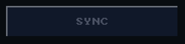
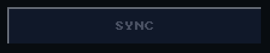

# Scopes

A scope changes how the controls between its `_begin` and its `_end` draw
or answer, without touching their calls. Every `_begin` pairs with its
`_end` before `ui_end()`, at most `UI_FACE_SCOPE_DEPTH` (4) deep of each
kind, and a development build asserts on an unbalanced frame.

| Scope | Inside it |
|---|---|
| `ui_disabled_begin(bool disabled)` | with `true`, controls never fire and their labels draw in the theme's `muted` ink (a slider has none, so looks unchanged); a nested `false` cannot re-enable them |
| `ui_color_begin(UI_COLOR_FACE, rgb)` | buttons, tiles and toggles draw their face in `rgb` |
| `ui_color_begin(UI_COLOR_TEXT, rgb)` | text, captions and labels draw in `rgb` |
| `ui_scale_begin(int scale)` | text and labels draw at glyph scale `scale` |
| `ui_alpha_begin(uint8_t alpha)` | text ink draws at `alpha`/255 coverage, dithered and without its halo |

<!-- generated: ui-disabled-example check: python launcher/tools/gen/examples_doc.py --check -->
```c
/* A disabled scope prevents a disconnected action from firing. */
#include "ui/ui.h"

typedef struct {
    bool connected;
    bool sync_requested;
} disabled_example_t;

bool
disabled_example(disabled_example_t* s) {
    ui_row(UI_ROW_HEIGHT);
    ui_disabled_begin(!s->connected);
    if (ui_button(ui_next(), "SYNC")) {
        s->sync_requested = true;
    }
    ui_disabled_end();
    return s->sync_requested;
}
```
<!-- /generated: ui-disabled-example -->

<!-- generated: ui-disabled-renders sha256=039a7b0014dbb7a91875d6d44e1d6ffcc5383d2db22d13ced458d21fb01c6ba2 -->
| Portrait | Landscape |
|---|---|
|  |  |
<!-- /generated: ui-disabled-renders -->

A scope rides inside the frame's description like everything else, so
entering or leaving one costs nothing beyond the commands it changes. The
disabled row of each control's States table is that control inside
`ui_disabled_begin(true)`.

## Frame settings

These are not scopes: each holds until it is set again.

| Call | Holds |
|---|---|
| `ui_theme(&theme)` | for the rest of the frame; `NULL` restores the shell look |
| `ui_set_text_style(style)` | until set again, across frames; a change needs `ui_invalidate()` |
| `ui_set_font_scaled(font, scale)` | until set again |

## See also

- [Input](input.md)
- [Text](text.md)
- [UI Toolkit](README.md)
