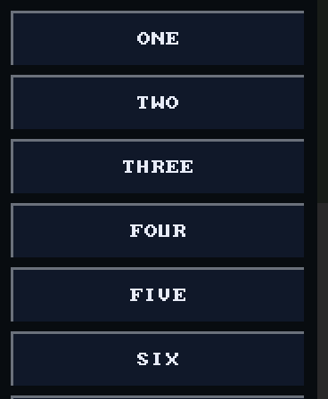
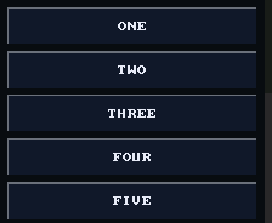

# Scrolling

`ui_scroll_window(r)` opens a window whose flowed rows scroll vertically once
they overflow `r`. Rows flow with `ui_row(h)` or `ui_row_centre(w, h)`, then
`ui_next()` for each row's rect, each below the last.

<!-- generated: ui-scroll-example check: python launcher/tools/gen/examples_doc.py --check -->
```c
/* Flowed rows scroll when their window overflows. */
#include "ui/ui.h"

typedef struct {
    int chosen;
} scroll_example_t;

static const char* const labels[] = {"ONE",   "TWO",   "THREE", "FOUR", "FIVE",   "SIX",
                                     "SEVEN", "EIGHT", "NINE",  "TEN",  "ELEVEN", "TWELVE"};
#define SCROLL_COUNT (sizeof labels / sizeof labels[0])

bool
scroll_example(scroll_example_t* s) {
    bool changed = false;
    ui_scroll_window((recti_t){0, 0, ui_width(), ui_height()});
    for (size_t i = 0; i < SCROLL_COUNT; i++) {
        ui_row(UI_ROW_HEIGHT);
        if (ui_button(ui_next(), labels[i])) {
            s->chosen = (int)i;
            changed = true;
        }
    }
    return changed;
}
```
<!-- /generated: ui-scroll-example -->

<!-- generated: ui-scroll-renders sha256=bad676cb4a47cbc91147cabcebeb75f46ff3f8878667136eebdb1741c7c82cea -->
| Portrait | Landscape |
|---|---|
|  |  |
<!-- /generated: ui-scroll-renders -->

## A drag or a press

On content that can scroll, a finger that comes down is not yet a press: it
may be the start of a drag. The face waits.

| The finger | Becomes |
|---|---|
| lifts before moving `UI_POINTER_DRAG_THRESHOLD` (12 px) | a tap on the control under it, pressed and released at once |
| moves that far, more down than across | a drag: the rows follow it and no control is pressed |
| moves that far across first | a press on the control under it, so a slider follows the finger; the window never scrolls sideways |

So a button in a scrolling list sinks only when the tap resolves, not as the
finger lands. Outside a scroll window nothing waits.

## Flowed rows and fixed rects

A row from `ui_next()` counts toward the window's content and moves with
its scroll. A control given a fixed rect does neither: it stays put while
the rows scroll under it, and once the rows overflow it is never reached by
scrolling.

## Windows

`ui_screen()` is a window the size of the canvas, `ui_window(r)` one at
`r`, and `ui_scroll_window(r)` one that scrolls. A window closes at the next
window call or at `ui_end()`, so a title bar at a fixed rect followed by a
window below it is the usual screen.

The dropdown's open list is its own scrolling window: a list taller than
its room scrolls the same way, and opens with the current item centred.

## See also

- [Input](input.md): a tap, and identity
- [Dropdown](dropdown.md)
- [UI Toolkit](README.md)
