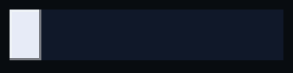
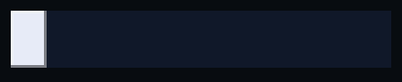
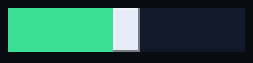

# Slider

`bool ui_slider(recti_t r, const char* label, int* value, int lo, int hi)`
draws a track, fill and knob for a whole number from `lo` to `hi`. It writes
`*value` and returns true on each frame it changed it. The label is its
identity and is not drawn.

## Example

<!-- generated: ui-slider-example check: python launcher/tools/render/ui_examples_doc.py --check -->
```c
/* A slider over a whole-number range: true on a frame it changed the value. */
#include "ui/ui.h"

typedef struct {
    int volume;
} slider_example_t;

bool
slider_example(slider_example_t* s) {
    ui_row(UI_ROW_HEIGHT);
    return ui_slider(ui_next(), "volume", &s->volume, 0, 10);
}
```
<!-- /generated: ui-slider-example -->

## Renders

<!-- generated: ui-slider-renders sha256=ce140c305730342c6d50dfd2f78fb6e999f450ff43bfa18fc788d81e8a75d107 -->
| Portrait | Landscape |
|---|---|
|  |  |
<!-- /generated: ui-slider-renders -->

## States

Each row is the example above, unchanged, in one of the
[states](README.md#states). Fires says when a tap there made it
return true.

<!-- generated: ui-slider-states sha256=fbf442137102ca1cdc47bf7e801035cda6f6411bd71b51204b78f26e811e67f0 -->
| State | Render | Fires |
|---|---|---|
| rest |  | while held |
| pressed |  | while held |
| tapped |  | while held |
| disabled | looks like rest | no |
| no-pack | looks like rest | while held |
<!-- /generated: ui-slider-states -->

## Interactions

- Takes the value under the finger from the press on, and follows a drag, so
  it changes while held.
- Inside a `ui_scroll_window()` a sideways drag moves it and a vertical one
  scrolls ([scrolling](scrolling.md)).
- Inside `ui_disabled_begin(true)` it looks as at rest and takes no input
  ([scopes](scopes.md)).
- Its label is its identity: two with one label in a window are told apart
  by call order ([input](input.md#identity)).

## See also

- [Panel](panel.md): a captioned slider
- [UI Toolkit](README.md): every control, the theme, the frame
