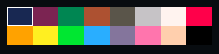
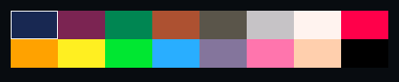

# Swatches

`void ui_swatches(recti_t r, const uint32_t* rgb, int cols, int rows)` fills
`r` with `cols` x `rows` equal cells of the colours in `rgb`, row by row.

## Example

<!-- generated: ui-swatches-example check: python launcher/tools/render/ui_examples_doc.py --check -->
```c
/* A grid of colours, with the caller's pick outlined over it. */
#include "ui/ui.h"

typedef struct {
    int picked;
} swatches_example_t;

#define COLS 8
#define ROWS 2

static const uint32_t PALETTE[COLS * ROWS] = {
    0x1D2B53, 0x7E2553, 0x008751, 0xAB5236, 0x5F574F, 0xC2C3C7, 0xFFF1E8, 0xFF004D,
    0xFFA300, 0xFFEC27, 0x00E436, 0x29ADFF, 0x83769C, 0xFF77A8, 0xFFCCAA, 0x000000,
};

bool
swatches_example(swatches_example_t* s) {
    ui_row(UI_ROW_HEIGHT);
    const recti_t r = ui_next();
    const int w = r.w / COLS;
    const int h = r.h / ROWS;
    ui_swatches(r, PALETTE, COLS, ROWS);
    ui_outline((recti_t){r.x + s->picked % COLS * w, r.y + s->picked / COLS * h, w, h}, 0xFFFFFF);
    return false;
}
```
<!-- /generated: ui-swatches-example -->

## Renders

<!-- generated: ui-swatches-renders sha256=196c46e09e0a5c85affb28a2fc70fb1ca8480ba13c4db28a23a8c2bac4567dae -->
| Portrait | Landscape |
|---|---|
|  |  |
<!-- /generated: ui-swatches-renders -->

## States

Each row is the example above, unchanged, in one of the
[states](README.md#states). Fires says when a tap there made it
return true.

<!-- generated: ui-swatches-states sha256=b5338f8ba771fef2606984a86d77e192f2e8a095717d5cd74bd172f1d8658bbc -->
| State | Render | Fires |
|---|---|---|
| rest |  | no |
| pressed | looks like rest | no |
| tapped | looks like rest | no |
| disabled | looks like rest | no |
| no-pack | looks like rest | no |
<!-- /generated: ui-swatches-states -->

## Interactions

- It takes no tap and draws no selection: the example outlines the caller's
  pick with `ui_outline()`.
- To pick a colour by touch, lay tiles or buttons over the cells.

## See also

- [Tile](tile.md)
- [UI Toolkit](README.md): every control, the theme, the frame
