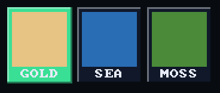
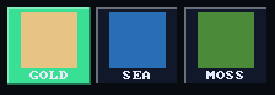
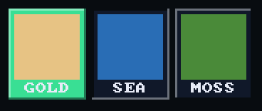
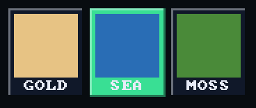
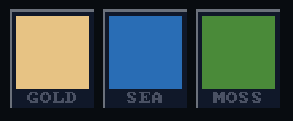

# Tile

`bool ui_tile(recti_t r, const char* label, bool selected)` draws one choice
of a row, its label at the bottom under a square kept for a picture. It
returns true on the frame a tap is released on it. `selected` is the
caller's, drawn on the theme's `accent_face`. Draw the picture in
`ui_tile_icon_rect(r)`, or pass an icon with [`ui_tile_icon()`](tile_icon.md).

## Example

<!-- generated: ui-tile-example check: python launcher/tools/render/ui_examples_doc.py --check -->
```c
/* A row of tiles, one choice of three, each with the caller's own picture of
 * its choice in the square the tile keeps above its label. */
#include "ui/ui.h"

typedef struct {
    int colour;
} tile_example_t;

static const char* const NAMES[] = {"GOLD", "SEA", "MOSS"};
static const uint32_t COLOURS[] = {0xE0C080, 0x2A6FB0, 0x4F8A3C};

bool
tile_example(tile_example_t* s) {
    ui_row(2 * UI_ROW_HEIGHT);
    const recti_t row = ui_next();
    const int w = (row.w - 2 * UI_ROW_GAP) / 3;
    bool picked = false;
    for (int i = 0; i < 3; i++) {
        const recti_t r = {row.x + i * (w + UI_ROW_GAP), row.y, w, row.h};
        if (ui_tile(r, NAMES[i], s->colour == i)) {
            s->colour = i;
            picked = true;
        }
        ui_fill(ui_tile_icon_rect(r), COLOURS[i]);
    }
    return picked;
}
```
<!-- /generated: ui-tile-example -->

## Renders

<!-- generated: ui-tile-renders sha256=749aa1b70653ad5baba24fe9841caac08dcb0dcf8d91e7516680917df980f187 -->
| Portrait | Landscape |
|---|---|
|  |  |
<!-- /generated: ui-tile-renders -->

## States

Each row is the example above, unchanged, in one of the
[states](../UI-Toolkit.md#states). Fires says when a tap there made it
return true.

<!-- generated: ui-tile-states sha256=98219f420cf217a32928cf37b1a8341e4e6e9ce21fb41623e62ace53dbe49e0d -->
| State | Render | Fires |
|---|---|---|
| rest |  | on release |
| pressed |  | on release |
| tapped |  | on release |
| disabled |  | no |
| no-pack | looks like rest | on release |
<!-- /generated: ui-tile-states -->

## Interactions

- A tile never selects itself: the caller stores the pick and passes it back
  next frame.
- Fires when the finger lifts over it or within `snap.reach` of it; sliding
  farther off first cancels ([input](input.md#a-tap)).
- A press just outside draws the nearest control within reach pressed, and a
  lift within reach fires it ([input](input.md#a-tap-that-misses)).
- In a `ui_scroll_window()` a vertical drag scrolls the rows and presses
  nothing ([scrolling](scrolling.md)).
- Inside `ui_disabled_begin(true)` it draws in the theme's `muted` ink and
  never fires ([scopes](scopes.md)).
- Its label is its identity: two with one label in a window are told apart
  by call order ([input](input.md#identity)).

## See also

- [Tile with an icon](tile_icon.md)
- [Toggle](toggle.md): on or off without a row of choices
- [UI Toolkit](../UI-Toolkit.md): every control, the theme, the frame
