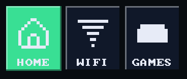
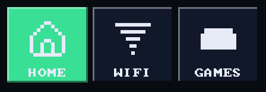
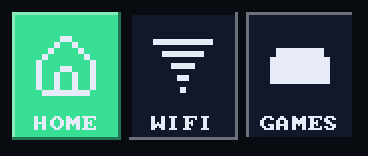
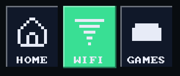
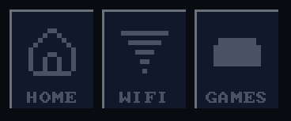
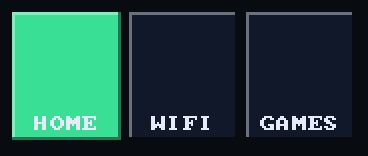

# Tile with an icon

`bool ui_tile_icon(recti_t r, const char* label, const draw_image_t* icon,
bool selected)` is a [tile](tile.md) with `icon` above its label.
`ui_tile_icon_rect(r)` gives the icon's square, for a caller drawing its own
picture of the choice. A `NULL` icon is `ui_tile()`.

## Example

<!-- generated: ui-tile-icon-example check: python launcher/tools/render/ui_examples_doc.py --check -->
```c
/* Tiles with an icon above the label, one choice of three. */
#include "ui/controls/ui_icons.h"
#include "ui/ui.h"

typedef struct {
    int page;
} tile_icon_example_t;

static const char* const PAGES[] = {"HOME", "WIFI", "GAMES"};

bool
tile_icon_example(tile_icon_example_t* s) {
    const draw_image_t* const icons[] = {ui_icon_image(UI_ICON_HOME), ui_icon_image(UI_ICON_WIFI),
                                         ui_icon_image(UI_ICON_GAMEPAD)};
    ui_row(2 * UI_ROW_HEIGHT);
    const recti_t row = ui_next();
    const int w = (row.w - 2 * UI_ROW_GAP) / 3;
    bool picked = false;
    for (int i = 0; i < 3; i++) {
        const recti_t r = {row.x + i * (w + UI_ROW_GAP), row.y, w, row.h};
        if (ui_tile_icon(r, PAGES[i], icons[i], s->page == i)) {
            s->page = i;
            picked = true;
        }
    }
    return picked;
}
```
<!-- /generated: ui-tile-icon-example -->

## Renders

 

## States

Each row is the example above, unchanged, in one of the
[states](../UI-Toolkit.md#states). Fires says when a tap there made it
return true.

<!-- generated: ui-tile-icon-states sha256=f9ab109fc1d3d6787ace48ff642d7f003d1a77442c6803829444e893f850fd8e -->
| State | Render | Fires |
|---|---|---|
| rest |  | on release |
| pressed |  | on release |
| tapped |  | on release |
| disabled |  | no |
| no-pack |  | on release |
<!-- /generated: ui-tile-icon-states -->

## Interactions

- Without its pack the icon is missing and the label draws alone.
- Fires when the finger lifts over it; sliding off first cancels
  ([input](input.md#a-tap)).
- A tap just outside lands on the nearest control within reach
  ([input](input.md#a-tap-that-misses)).
- In a `ui_scroll_window()` a vertical drag scrolls the rows and presses
  nothing ([scrolling](scrolling.md)).
- Inside `ui_disabled_begin(true)` it draws in the theme's `muted` ink and
  never fires ([scopes](scopes.md)).
- Its label is its identity: two with one label in a window are told apart
  by call order ([input](input.md#identity)).

## See also

- [Tile](tile.md)
- [Icon](icon.md)
- [UI Toolkit](../UI-Toolkit.md): every control, the theme, the frame
