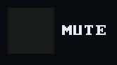
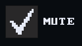
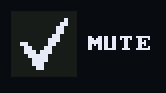
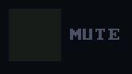

# Toggle

`bool ui_toggle(recti_t r, const char* label, bool* on)` draws a box and its
label. It writes `*on` and returns true on the frame it changed it.

## Example

<!-- generated: ui-toggle-example check: python launcher/tools/render/ui_examples_doc.py --check -->
```c
/* A toggle: writes through its pointer and returns true when it changed it. */
#include "ui/ui.h"

typedef struct {
    bool muted;
} toggle_example_t;

bool
toggle_example(toggle_example_t* s) {
    ui_row(UI_ROW_HEIGHT);
    return ui_toggle(ui_next(), "MUTE", &s->muted);
}
```
<!-- /generated: ui-toggle-example -->

## Renders

 

## States

Each row is the example above, unchanged, in one of the
[states](../UI-Toolkit.md#states). Fires says when a tap there made it
return true.

<!-- generated: ui-toggle-states sha256=b8c057018bb87980f4bcbd94718e8585ca57ec80f4b0997338e708823a1614c4 -->
| State | Render | Fires |
|---|---|---|
| rest |  | on release |
| pressed |  | on release |
| tapped |  | on release |
| disabled |  | no |
| no-pack | looks like rest | on release |
<!-- /generated: ui-toggle-states -->

## Interactions

- Shows the flipped value while pressed, and writes it when the finger lifts
  over it.
- Sliding off before lifting puts the old value back
  ([input](input.md#a-tap)).
- A press just outside draws the nearest control within reach pressed, but
  only a lift inside fires it ([input](input.md#a-tap-that-misses)).
- In a `ui_scroll_window()` a vertical drag scrolls the rows and presses
  nothing ([scrolling](scrolling.md)).
- Inside `ui_disabled_begin(true)` it draws in the theme's `muted` ink and
  never fires ([scopes](scopes.md)).
- Its label is its identity: two with one label in a window are told apart
  by call order ([input](input.md#identity)).

## See also

- [Tile](tile.md): two tiles when the choice deserves pictures
- [UI Toolkit](../UI-Toolkit.md): every control, the theme, the frame
