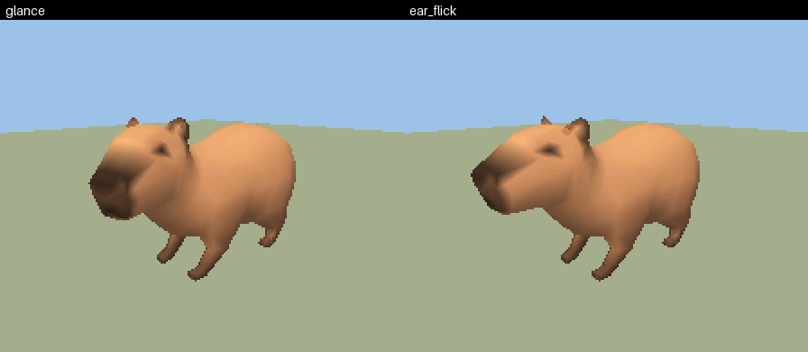

# Capybara idle gestures

[capybara.blend](capybara.blend) holds the source actions.
[capybara.import.toml](capybara.import.toml) selects the engine clips.

## References and limits

Inaka and Kimura classify forward, slightly pulled-back, and strongly
pulled-back sideways-facing ears in photographs. These postures guide the
flick; the study does not measure its speed.[[131]](../../../docs/Citations.md#inaka-2021)

[Nagasaki Biopark's footage](https://www.youtube.com/watch?v=J_lkQfeN4rE&t=50)
shows head reorientation during tactile interaction. Keeper contact and
perspective prevent a reliable neutral head-turn range measurement.

## Clips

| Clip | Authored motion | Evidence and limits |
|---|---|---|
| `glance` | About 25 degrees of combined neck/head turn: 0.75 s turn, 0.7 s hold, 0.95 s return within 3 s. Body and feet stay quiet. | Biopark footage supplies qualitative head reorientation; range and timing are authored. |
| `ear_flick` | Brief backward flick, rebound and stagger, returning to idle within 1 s. | Inaka and Kimura supply ear orientations; angles and dynamic timing are authored. |
