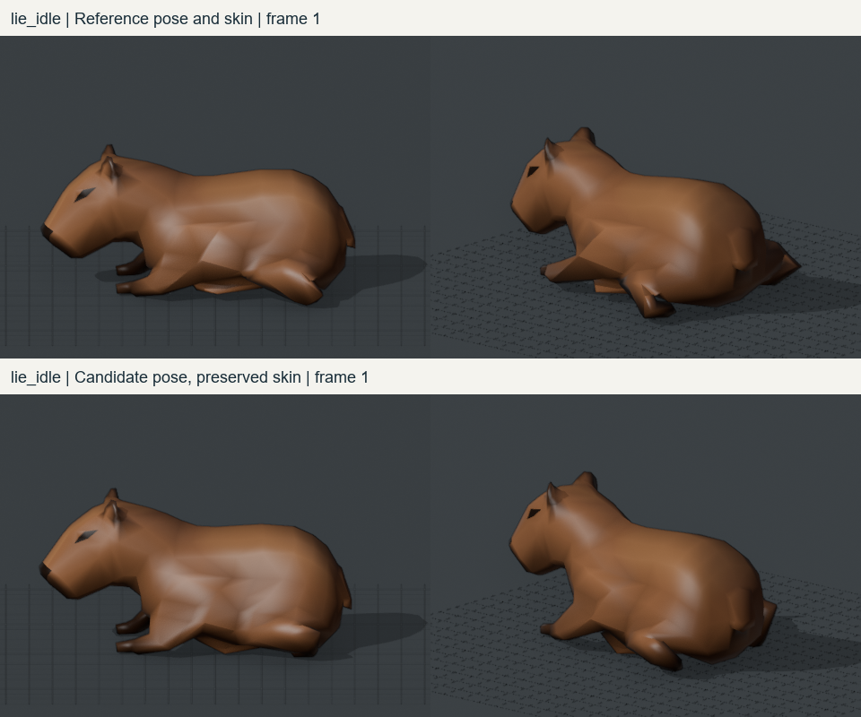
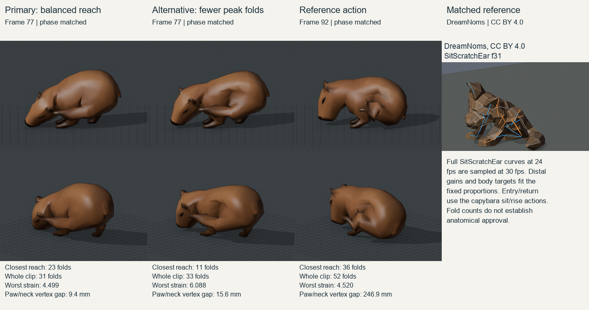
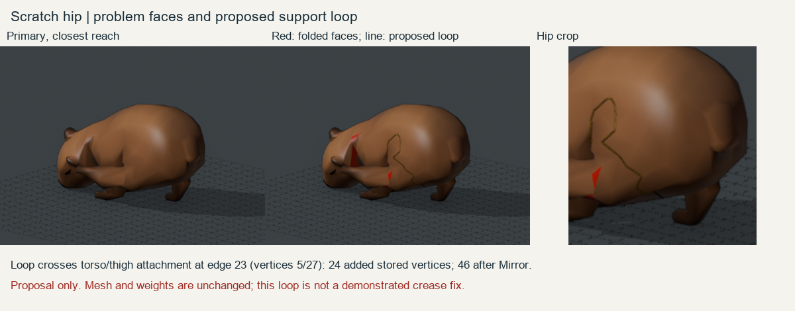
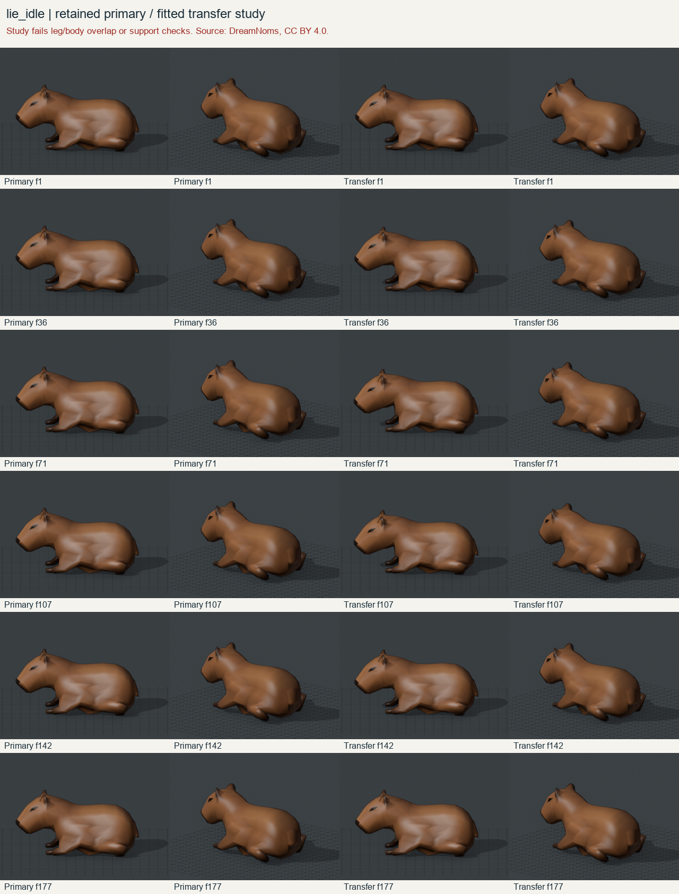

# Capybara rest, sit and idle gestures

These references distinguish observed postures from animation choices. A still image
establishes a silhouette, not a movement order or duration. The clip table marks timings
that have no direct measurement.

## Posture evidence

| Feature | Evidence and scope | Animation implication |
|---|---|---|
| Sternal rest | Pucora, Schiffmann and Clauss describe sternal recumbency as typical for capybaras, citing Lord's observations. Their discussion also compares other hystricomorph rodents.[[126]](../../../docs/Citations.md#pucora-2019) | Keep the sternum and ventral trunk down; retain a rounded back. |
| Tucked limbs | Ruiz-Tagle and colleagues' ethogram defines lying by ventral contact and bent forelegs and hind legs.[[127]](../../../docs/Citations.md#ruiz-tagle-2021) | Fold the hind legs; avoid a straight-legged hover. |
| Forelegs forward | Monto's [Ljubljana photograph](https://commons.wikimedia.org/wiki/File:Ljubljana_zoo_-_capybara.jpg) shows a low trunk, one foreleg reaching forward and rear legs visible to the side. It is a pose example, not evidence that every rest is symmetrical. | Lower the trunk as a whole, fold the hind legs beside it and bring the forelegs forward. Keep the back rounded and the barrel deep. |
| Head low | Kilby's [Resting photograph](https://commons.wikimedia.org/wiki/File:Capybara_Resting_(21995770022).jpg) shows the muzzle close to the substrate and forelimb. The contact surface is obscured; chin-on-ground versus chin-on-foreleg cannot be separated. | Lower the head without asserting a precise chin support. |
| Lateral rest | Pucora and colleagues report lateral recumbency in the context of bird ectoparasite removal, citing Lord. This is distinct from their description of typical sternal rest.[[126]](../../../docs/Citations.md#pucora-2019) | Do not turn the sternal loop into a side roll. |
| Haunches-down sit | Ruiz-Tagle's ethogram specifies grounded haunches, bent hind legs and straightened forelegs; it also allows a hind leg extended along the ground.[[127]](../../../docs/Citations.md#ruiz-tagle-2021) | Raise the chest over supporting forefeet and ground the rear. |
| Sitting silhouette | Kilby's [Sitting Sideways photograph](https://commons.wikimedia.org/wiki/File:Capybara_Sitting_Sideways_(18114724916).jpg) shows an upright chest, grounded rear and a rounded haunch. The thigh is contained within the body outline. | Follow the photographed body slope; avoid an upright human-like torso. |
| Activity context | Mones and Ojasti describe morning rest near water and shade, with grazing concentrated later in the day and overnight.[[129]](../../../docs/Citations.md#mones-1986) | Keep the rest loops quiet; this account does not establish clip duration. |

## Motion and measurement limits

[Nagasaki Biopark's footage](https://www.youtube.com/watch?v=J_lkQfeN4rE&t=50)
shows a petted animal lowering and rolling onto its side at about 50.6–53.1 s.
Inspection at four samples per second brackets that action at about 2.5 s, with 0.25 s resolution.

The keeper obscures individual foot contacts in that sequence. It does not establish a
sternal lowering or rise. The dog rig supplies a separate joint and timing reference.

## Rig references

| Reference | Licence | Role and limits |
|---|---|---|
| [German Shepherd by DreamNoms](https://sketchfab.com/3d-models/stylized-low-poly-german-shepherd-18d8fbe184c5448283762893b6ea9752) | [CC BY 4.0](https://creativecommons.org/licenses/by/4.0/) | `SitDown`/`LayDown`, `IdleLieDown`, `SitUp`/`StandUp`, `SitScratchEar`: rest joint targets, hind-paw orientation and authored stroke spacing. Separate pelvis and breast helpers and additional skin influences distinguish it from this rig. |
| [AI4Animation quadruped mocap](https://github.com/sebastianstarke/AI4Animation/tree/master/AI4Animation/SIGGRAPH_2018), Zhang, Starke, Komura and Saito | [CC BY-NC 4.0](https://creativecommons.org/licenses/by-nc/4.0/); research/education project | `D1_045_KAN01_001.bvh`: sternal rest, lowering and rise. Spine, chest, neck, head, forelegs, hind legs and tail; no ears or separate hind toes. |
| [Rabbit by CDmir, with TinyWorlds](https://opengameart.org/content/rabbit-0) | [CC0](https://creativecommons.org/publicdomain/zero/1.0/) | `Sitting.000`: folded hind-leg target on a rig with comparable limb chains and ears. It contains no verified hind-foot scratch. |
| [Quaternius Ultimate Animated Animal Pack](https://quaternius.com/packs/ultimateanimatedanimals.html), Shiba Inu | [CC0](https://creativecommons.org/publicdomain/zero/1.0/) on the pack page | Thigh and belly skin comparison. Its stored influences exceed this asset's limit; its inspected action set supplies no lie or scratch. |

The dog dataset supplies measured trunk-transfer timing. The Shepherd supplies
authored rest and scratch joint targets.
These guide authored control keys; its motion samples and rigs stay outside the repository.[[131]](../../../docs/Citations.md#zhang-2018)

| Motion | Timing and adaptation |
|---|---|
| Lower to lie | Dog take, source frames 390-492 at 60 Hz; 1.7 s. Trunk height and knee-flexion progress guide the keys. Paw replanting is authored for the fixed capybara proportions. |
| Rise from lie | The same take, frames 123-189; 1.1 s. The measured trunk lift guides a separate rise curve. Stationary idle is the authored endpoint; the capture continues into locomotion. |
| Lower to sit | Grounded haunches and supporting forefeet; 2.5 s. Authored timing. |
| Rise from sit | Forward load before hind extension; 2.3 s. Authored timing. |

Mortola and Lanthier's Table 2 reports 41 breaths/min for one 38 kg male capybara,
videotaped standing for 27 minutes. This is a resting standing observation, not a species
range or a measurement of sleeping or lying respiration.[[128]](../../../docs/Citations.md#mortola-2005)

The rest loops use four breaths in 176 frame intervals at 30 fps: about 40.9/min.
Applying the standing rate to lying and sitting is an animation choice. Visible flank
excursion in metres is not established by the cited table.[[128]](../../../docs/Citations.md#mortola-2005)

The lying trunk keeps its control scales fixed. The loop carries its small breathing
cue through the neck. The sitting breathing keys retain their chest excursion; neither
amplitude is a measured biological excursion.

## Gestures and anatomy

| Feature | Evidence | Authored motion and limits |
|---|---|---|
| Scratch | [BBC Natural History / Getty footage](https://www.gettyimages.com.au/detail/video/capybara-scratches-head-with-hind-leg-stock-video-footage/831811658) shows a seated animal bowing its head while a hind foot reaches the cheek. The supporting foreleg stays on the bank. | Lower into a partial crouch, turn and bow the head toward the left hind paw, and make small knee/hock strokes with a stable thigh. The source clock and fitted gains are animation choices; the preview establishes posture and path. |
| Ear orientation | Inaka and Kimura classify ears as forward, slightly pulled back, or strongly pulled back and facing sideways. Their study scores photographs; it does not measure flick speed.[[130]](../../../docs/Citations.md#inaka-2021) | A short backward flick, small rebound and stagger between the ears, returning within a 1 s clip. Angles, stagger and timing are animation choices, not measured. |
| Glance | The Biopark footage shows head reorientation during tactile interaction. Perspective and keeper contact prevent a reliable neutral head-turn range measurement. | About 25 degrees of combined neck/head turn, 0.75 s to turn, 0.7 s hold and 0.95 s return within 3 s. Animation choice, not measured; keep the body and feet quiet. |
| Tail | Mones and Ojasti identify the capybara's tail as vestigial.[[129]](../../../docs/Citations.md#mones-1986) | The rig's tail control has only a subtle rest adjustment. This is asset stylisation, not evidence for a conspicuous natural tail wag. |

## Review measurements

The review package measures floor penetration, scheduled planted-foot drift, pose seams,
edge strain and local face folds. Its side and three-quarter sheets use the mesh's
`Attribute` corner colours through `capyvertex`.

Original gait actions retain their keys. Weight fitting must keep their worst edge
strain and maximum folded-face counts within their measured source limits; the
before/after sheets remain part of that check.

The lying pose fits the Shepherd elbow, knee and hock targets while retaining belly and haunch
support. The fitter adapts the joint angles to the fixed limb lengths and skin.
`reference_targets.json` and the fit report retain the target residuals.

The Shepherd skin blends the thigh through pelvis helpers. The local skin studies
compare a continuous body-to-thigh band and motion-bounded pairs.
The primary retains the approved weights. Scratch uses a partial crouch and a
bowed, turned head to shorten the reach. The hip crease remains a visual failure.

The scratch sheet puts the primary first, then the lower-fold alternative and
the reference action. Its matched Shepherd panel is credited to DreamNoms,
CC BY 4.0. The local package includes separate complete GIFs for both variants.

Red faces fail the local fold test. The line marks a proposed hip support loop;
it is not applied or proven to remove the crease. The measured variants, loop
vertex counts and protected-action hashes are in [rest-review.json](rest-review.json).

The lying sheet pairs the primary with the fitted Shepherd transfer. The study
has no inter-leg crossings or floor penetration, but leg/body overlaps remain.
The primary keeps the protected lying actions.

Fixed control scales and a rounded silhouette do not establish true enclosed volume.
Subframe contact and arbitrary self-intersection remain unmeasured.

The scratch preview is restricted BBC/Getty footage. Its watermarked frames belong
only in the local review package. The repository links the source page without
embedding an image.

Capybara sternal-rise timing, recumbent respiration, flick timing and a neutral
head-turn range remain unmeasured. The dog timing is a quadruped reference, not
a capybara measurement.

## Clip reference table

Lying transition timing follows the dog take; the other durations are authored.
Loop breathing follows the limited standing observation described above.
No recumbent breathing rate is verified.

| Clip | Posture and timing followed | Sources |
|---|---|---|
| lie_down | Standing idle to sternal rest with measured dog trunk-transfer timing; 1.7 s. | Monto's Ljubljana photograph; Ruiz-Tagle ethogram[[127]](../../../docs/Citations.md#ruiz-tagle-2021); Biopark 50.6–53.1 s for loose pacing only. |
| lie_idle | Rounded sternal trunk with its barrel depth retained, forward forelegs, hind legs folded beside it and lowered head; about 40.9 breaths/min; seamless 176-interval loop. | Monto and Kilby Resting photographs; Pucora[[126]](../../../docs/Citations.md#pucora-2019); Mortola and Lanthier[[128]](../../../docs/Citations.md#mortola-2005). |
| lie_up | Sternal pose to idle with the separate measured dog trunk-lift timing; 1.1 s. | AI4Animation dog take and the lying posture references; capybara rise timing is unmeasured. |
| sit_down | Idle to haunches-down sit, forefeet supporting the chest; 2.5 s. | Kilby Sitting Sideways photograph; Ruiz-Tagle[[127]](../../../docs/Citations.md#ruiz-tagle-2021). |
| sit_idle | Rounded grounded haunches with the thigh inside the body outline, raised chest and supporting forelegs; about 40.9 breaths/min; seamless 176-interval loop. | Kilby Sitting Sideways photograph; Ruiz-Tagle[[127]](../../../docs/Citations.md#ruiz-tagle-2021); Mortola and Lanthier[[128]](../../../docs/Citations.md#mortola-2005). |
| stand_up | Sit to idle; forward loading before hind extension; 2.3 s. | Same sitting references; rise order and timing not measured. |
| scratch | Partial crouch, bowed and turned head, outward knee and short knee/hock strokes with a stable thigh, then return to idle. | BBC Natural History / Getty posture; fitted DreamNoms SitScratchEar curves and capybara sit/rise entry and return. |
| ear_flick | Idle to brief ear flick and rebound, return to idle; 1 s. | Inaka and Kimura's ear orientations[[130]](../../../docs/Citations.md#inaka-2021); dynamic timing is unmeasured. |
| glance | Idle to conservative head turn, hold and return; 3 s. | Biopark for qualitative head reorientation; angle and timing are unmeasured. |
